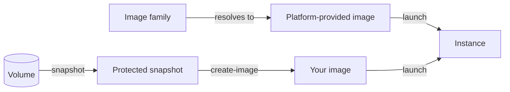

# Images

An image is the template an instance boots from: the operating system and whatever else was built into it. You choose one at launch. The launch copies the image onto the new instance's root disk, and from then on the instance doesn't depend on the image.

The following diagram shows where images come from and how they're used.

## Key concepts

**Platform-provided image**  
An image the platform publishes, such as a Debian or Ubuntu base image. Any project can launch from one. `origin compute list-public-images` lists them per zone, and each one's name has no project: `zones/<zone>/images/<image-id>`.

**Your own image**  
An image you create from a protected snapshot of one of your volumes. It belongs to the project and zone you create it in, and `origin compute list-images` lists it. See [Create an image](create.md).

**Image family**  
A stable name for a line of platform-provided images that resolves to the current one. See [Image families](image-families.md).

**Default user**  
The account an instance launched from the image logs in as. Every image has a `defaultUser`. The platform-provided images use `cloud`. See [Guest environment](../instances/guest-environment.md#login-user).

## Image fields

Three image fields are typed enums in the API. Each has exactly one value. Handle the value you get, and let a value your client doesn't recognize surface rather than defaulting it away.

| Field | Value | Meaning |
|---|---|---|
| `status` | `AVAILABLE` | The image can be launched from. An image becomes visible only once its contents are in place, and there is no other status. An image that couldn't be created never appears. |
| `architecture` | `X86_64` | The CPU architecture the image's contents are built for. An instance launched from it runs on a machine of that architecture. |
| `platform` | `LINUX_UNIX` | The operating-system family. It covers every Linux and UNIX-like distribution. |

Platform-provided images also carry the family they belong to and whether the family currently resolves to that image: `family` and `isFamilyCurrent` in the API, `imageFamily` and `familyCurrent` in `list-public-images`. The CLI prints an image's status as `state`.

## What you can do

- [Create an image](create.md) from one of your volumes
- List your images with `origin compute list-images` and read one with `origin compute get-image`; list the platform-provided ones with `origin compute list-public-images` and read one with `origin compute get-public-image`
- [Launch an instance](../instances/launch.md) from an image

## Related

- [Image families](image-families.md)
- [Snapshots](../../storage/snapshots/index.md)
- [`origin compute` commands](../reference/cli.md)
