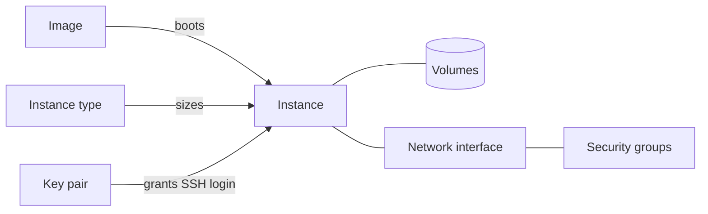

# What is Origin Cloud Compute?

Compute runs virtual machines, called instances, without you owning or operating the hardware underneath. You pick an image to boot from, an instance type for its size, a key pair to log in with and the network interface that places it on your network. The platform creates the instance's root disk, places it on a machine and starts it. You can stop an instance, start it again later, change its size while it's stopped, or terminate it for good.

The following diagram shows what you choose at launch and what an instance is connected to while it runs.

The image provides the operating system. The instance type sets vCPU and memory. The key pair's public key is installed for the login user. Volumes hold the instance's data and live in the [Storage guide](../storage/index.md). The network interface and its security groups belong to the [Network guide](../network/index.md).

## Features

**Instances**  
Virtual machines with a lifecycle you control, health checks that report what the platform observes, and defined behavior when a machine fails. See [Instances](instances/index.md).

**Instance storage**  
Every instance boots from a durable root disk you can size at launch. You can attach and detach more volumes while the instance runs. See [Instance storage](instance-storage/index.md).

**Images**  
Platform-provided images and image families, plus your own images made from a snapshot of a volume. See [Images](images/index.md).

**Key pairs**  
SSH key pairs you import or have the platform generate. The public half goes into every instance you launch with it. See [Key pairs](key-pairs/index.md).

## Ways to access Compute

**CLI**  
The `origin compute` command group. See [Use the CLI](../platform/access/cli.md) to install and log in, and [`origin compute` commands](reference/cli.md) for every command.

**GraphQL API**  
Instances, images, image families, instance types and key pairs live under the `compute` namespace of the API, for both queries and mutations. See [API access](../platform/access/api.md).

## When to use Compute

Use Compute when you need a general-purpose Linux machine you administer yourself: a web server, a build agent, a database you operate, or the nodes of your own Kubernetes cluster. You get full root access through `sudo`, a durable root disk and a private network.

Compute doesn't restart an instance for you after a machine failure. If a workload must keep serving through the loss of one machine, run more than one instance. For more information, see [When the machine under an instance fails](instances/host-failure.md).

## Related services

- [Storage](../storage/index.md) – volumes and snapshots that hold instance data
- [Network](../network/index.md) – VPCs, subnets, security groups and floating IPs that connect instances
- [Platform](../platform/index.md) – organizations, projects, billing and access

## Pricing

An instance's compute usage is billed while it is `RUNNING`. Its volumes are billed while they exist, including while the instance is stopped. For prices, see [Pricing](../pricing/index.md).

## On origincloud.eu

[Compute](https://www.origincloud.eu/compute/) describes the service and its gp1 series, and [Compute instance rates](https://www.origincloud.eu/compute/pricing/) lists the hourly rate of each instance type.

## Next steps

- [Get started with Origin Cloud](../platform/getting-started/index.md)
- [Launch an instance](instances/launch.md)
- [Compute reference](reference/index.md) – every command and status reason
- [Troubleshoot Compute](troubleshooting/index.md)
