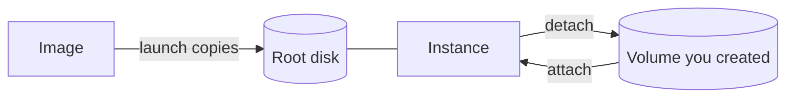

# Instance storage

Every instance boots from a root disk that the launch creates from the image. On top of that, you can attach volumes you created yourself. All of an instance's volumes are durable network storage that isn't tied to any machine, so an instance can stop, start and move between machines without losing data.

The following diagram shows where an instance's disks come from.

## Key concepts

**Root disk**  
The volume the instance boots from. The launch creates it by copying the image onto it. It can't be detached, and it's deleted when the instance terminates.

**Attached volume**  
A volume you created and attached. It outlives the instance: termination releases it rather than deleting it. See [Attach and detach volumes](attach-detach.md).

**A disk's serial is its volume's id**  
Every volume disk in the guest, the root disk included, has the volume's id, such as `vol-AbC123xYz9`, as its serial. A Linux guest links each disk as `/dev/disk/by-id/virtio-<volume-id>`, and `lsblk -o NAME,SERIAL` lists the serials. That tells you which disk is which volume without relying on the order the guest named its disks in. The cloud-init seed disk is not a volume and has no serial.

**Storage backend**  
Instance volumes use the `pvs` backend: durable, network-attached storage. A launch that asks for `host_local` is refused immediately, naming the field, and creates nothing.

**Host-local drives are temporary**  
A host-local drive lives on the disk of the machine the instance runs on, like an instance-store volume. Its data doesn't survive a stop and start, a reboot of that machine, or the instance's termination. A host-local drive is never a boot drive: the root disk is always a durable volume. Keep anything that must survive on a durable volume. See [Volumes](../../storage/volumes/index.md).

## Sizing the root disk

By default the root disk is exactly as large as the image, which for a platform-provided image is enough for the operating system and little else. Ask for more at launch with `--boot-volume` on `origin compute create-instance`, such as `--boot-volume size_gib=40,storage_class=gp1`, or `bootVolume` on the `launchInstance` mutation. Size and storage class are independent, and both are optional.

**The image's size is the minimum**  
A smaller size is refused rather than raised. The error names the field and the smallest size that works.

**You get and pay for exactly the size you ask for**  
Most images grow their root file system to fill the disk on first boot. That behavior belongs to the image, so check inside the guest if it matters.

**The storage class is checked against the live catalog**  
Read it with `origin pvs list-storage-classes` or the `pvs.storageClasses` query, and pick one whose `available` is `true`. A class that doesn't exist is refused as invalid input. One that exists but isn't on sale is refused with [`PRODUCT_UNAVAILABLE`](../../platform/reference/errors.md#product_unavailable). See [Storage classes](../../storage/volumes/storage-classes.md).

**It has its class's performance limits**  
A `gp1` root disk is limited to 3,000 IOPS and 125 MiB/s, like any other `gp1` volume. See [Performance limits](../../storage/volumes/storage-classes.md#performance-limits).

**It counts against your storage quota at launch**  
A launch that would take the organization or project past its volume storage limit is refused up front, naming the quota. See [Limits](../../platform/reference/limits.md#storage).

You can't change the root disk's storage class after launch. To grow it later, resize the volume, which only grows. See [Resize a volume](../../storage/volumes/resize.md). Both are reasons to ask for what you need at launch.

## What you can do

- [Attach and detach volumes](attach-detach.md)
- [Launch an instance](../instances/launch.md) with a larger root disk
- [Find which instance holds a volume](../../storage/volumes/find-instance.md)

## Limits and quotas

See [Limits](../../platform/reference/limits.md#storage).

## Related

- [Volumes](../../storage/volumes/index.md)
- [Snapshots](../../storage/snapshots/index.md)
- [Images](../images/index.md)
