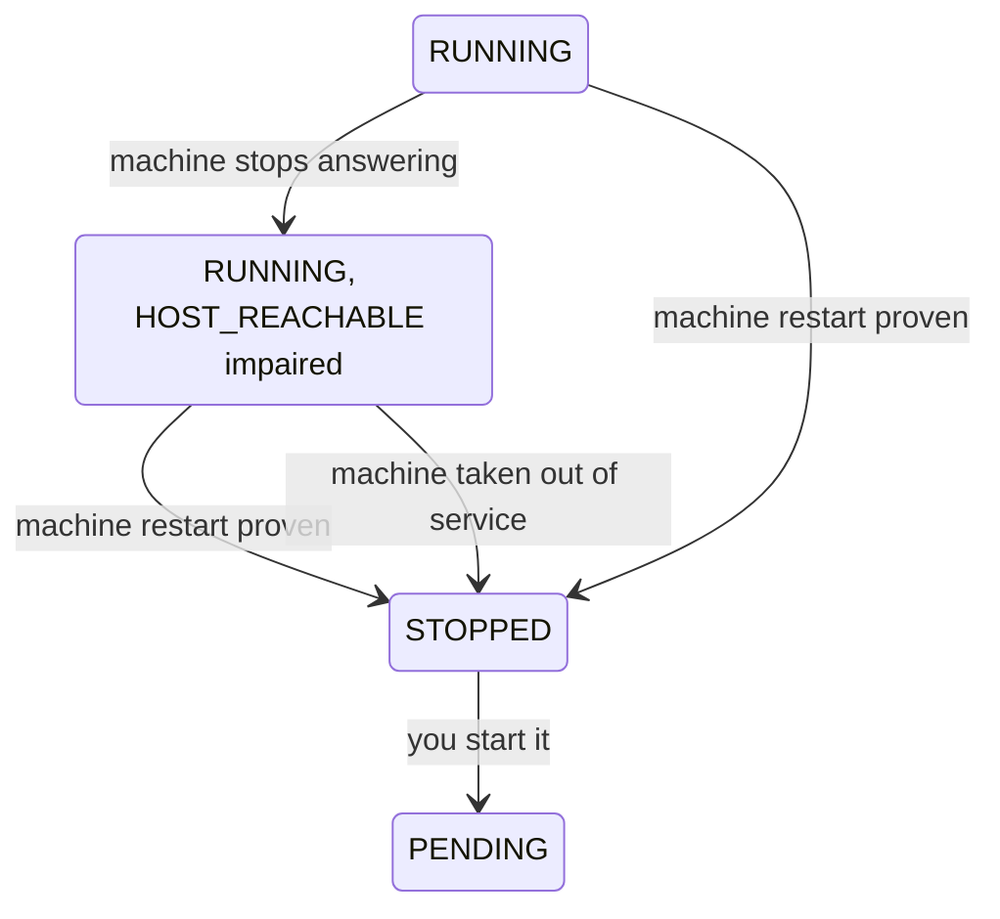

# When the machine under an instance fails

The machines your instances run on can fail, for example through a component fault or a loss of power. When the machine carrying your instance goes down, your instance goes down with it. The platform records that once it can prove it, and leaves restarting the instance to you.

The following diagram shows how an instance's status and health change after its machine fails.

## While the machine is unreachable

A machine the platform can't reach proves nothing about what runs on it. So the instance stays `RUNNING`, `HOST_REACHABLE` reads `IMPAIRED`, and the other checks fall back to `INSUFFICIENT_DATA`. For how to read that, see [Instance health checks](health-checks.md#when-the-machine-stops-reporting).

## When the platform records the failure

The platform moves the instance from `RUNNING` straight to `STOPPED`, without `STOPPING`, in two cases:

- **The machine restarted.** The machine comes back and the platform can prove it restarted. A virtual machine doesn't survive that. `statusReason` reads: "the machine this instance was running on failed, and the instance went down with it; start it again to bring it back".
- **The machine is taken out of service.** The machine doesn't come back, and the platform takes it out of service after confirming it's powered off. `statusReason` reads: "the machine this instance was running on failed and has been taken out of service; the instance went down with it, and starting it again will place it on another machine".

From that moment the instance uses no compute capacity and accrues no compute usage, exactly as if you had stopped it. Its network interface stays reserved and its volumes stay attached.

## Starting it again is up to you

The platform doesn't start the instance again for you. Whether a workload should come back on its own after a failure, or needs checking first, depends on the workload.

Starting it is an ordinary start. Its volumes, network interface, addresses and security groups are as they were, and it can come up on a different machine. If your workload should come back on its own, watch for `STOPPED` with a non-null `statusReason` and start the instance. For the steps, see [Stop and start an instance](stop-start.md).

## What survives

**Survives**  
Everything on the instance's volumes. Volumes aren't tied to a machine, so they come back attached to the same instance with the same contents. Nothing is rebuilt from the image. The instance URN, network interface, private and public addresses, and security groups also stay the same.

**Doesn't survive**  
Anything only in memory, and anything on a temporary file system. Treat a machine failure the way you'd treat a sudden power loss.

## Planned moves

When a machine needs maintenance, the platform can move the instances on it to another machine. Moving an instance means stopping it and starting it again elsewhere. From inside the guest, that looks like a reboot you didn't ask for. In the API, the instance passes through `STOPPING`, `STOPPED` and `PENDING` back to `RUNNING`, with the same volumes, interface and addresses. Its `statusReason` stays `null` throughout. If the move is called off part-way, the instance stays `STOPPED`; start it yourself.

If your workload can't tolerate an unannounced restart, run more than one instance and spread the load across them. A move affects the instances on one machine, so an instance on another machine keeps serving.

## Related

- [Instance health checks](health-checks.md)
- [Instance lifecycle](lifecycle.md)
- [Status reasons](../reference/status-reasons.md)
