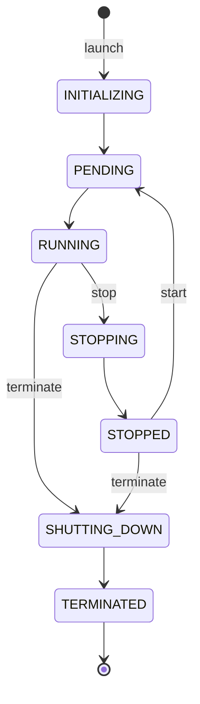

# Instances

An instance is a virtual machine. It boots from an image, runs with the vCPU and memory of its instance type, and keeps its identity, addresses and volumes for its whole life, across stops and starts. You decide when it runs. The platform reports both what was asked for or confirmed (`status`) and what it can observe (`healthChecks`).

The following diagram shows the main path through an instance's life.

The full set of eight statuses, including `FAILED`, is on [Instance lifecycle](lifecycle.md).

## Key concepts

**Lifecycle**  
The eight statuses an instance moves through, which ones resolve on their own, and which ones you're billed for. See [Instance lifecycle](lifecycle.md).

**Instance type**  
The size of an instance: its vCPU count and memory, from a catalog of types. See [Instance types](instance-types.md).

**Health checks**  
What the platform observes about a running instance, separate from its status, and whether a problem is the platform's or yours. See [Instance health checks](health-checks.md).

**Machine failure**  
What happens to an instance when the physical machine under it fails or is taken out of service. See [When the machine under an instance fails](host-failure.md).

**Guest environment**  
What the platform sets up inside the guest: the login user, time synchronization and machine identity. See [Guest environment](guest-environment.md).

## What you can do

- [Launch an instance](launch.md)
- [Stop and start an instance](stop-start.md)
- [Change an instance's type](change-type.md)
- [Run an instance as a service account](service-account.md)
- [Terminate an instance](terminate.md)

## Limits and quotas

Launching an instance counts against your instance-count and vCPU quotas, at both the organization and the project level. See [Limits](../../platform/reference/limits.md#compute).

## Related

- [Instance storage](../instance-storage/index.md) – the root disk and extra volumes
- [Images](../images/index.md) – what an instance boots from
- [Key pairs](../key-pairs/index.md) – how you log in
- [Security groups](../../network/traffic-control/security-groups.md) – what traffic reaches an instance
- [`origin compute` commands](../reference/cli.md)
