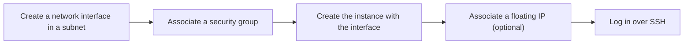

# Launch an instance

Launch an instance to get a running Linux machine you can log in to over SSH. You choose what it boots from, its size, its key pair, and the network interface that places it on the network.

## Before you begin

- An organization that is approved and has a valid payment method, and a project to launch into. See [Organizations](../../platform/organizations/index.md) and [Add a payment method](../../platform/billing/payment-method.md).
- The `origin` CLI, logged in, with a default project and zone. See [Use the CLI](../../platform/access/cli.md#set-a-default-project-zone-and-region).
- A key pair in the project. See [Create a key pair](../key-pairs/create.md).
- A subnet in your default zone to launch into, and a security group in its VPC that admits the traffic you need, such as SSH. Your project's [default VPC](../../network/vpcs/default-vpc.md) has both once the platform has created it. Otherwise, build a VPC first; see [Create a VPC and subnets](../../network/vpcs/create.md).
- Free quota for one more instance and its vCPUs, and for its root disk. See [Limits](../../platform/reference/limits.md#compute).

## How a launch fits together

An instance's network interface is a resource of its own: you create it in a subnet, open it with a security group, and name it at launch. It keeps its addresses for the instance's whole life, and stays when the instance is terminated.



## Choose what to launch

1. Choose an instance type whose `available` is `true`:

   ```sh
   origin compute list-instance-types
   ```

   For what the fields mean, see [Instance types](instance-types.md).

2. Choose an image. List the platform-provided images in your zone, and your project's own:

   ```sh
   origin compute list-public-images --zone eu-central1-az1
   origin compute list-images --zone eu-central1-az1
   ```

   To launch the current image of a family instead, note the family's id from `origin compute list-image-families`, and use `--image-family <family-id>` in place of `--image` in the launch below. See [Image families](../images/image-families.md).

## Create the network interface

1. Find the subnet and the security group. List the VPCs of your default region, then the subnets and security groups of the one to launch into:

   ```sh
   origin network list-vpcs
   origin network list-subnets --vpc <vpc-id> --zone eu-central1-az1
   origin network list-security-groups --vpc <vpc-id>
   ```

   The default VPC reads `projectDefault: true`, and its default security group `vpcDefault: true`. The default security group admits SSH, HTTP, HTTPS and ICMP from anywhere. See [Security groups](../../network/traffic-control/security-groups.md).

2. Create a network interface in the subnet, and note its `name` from the output:

   ```sh
   origin network create-network-interface --subnet <subnet-id>
   ```

   The interface gets the subnet's next free IPv4 and IPv6 addresses. It admits and sends nothing until a security group opens it.

3. Open the interface with the security group:

   ```sh
   origin network create-security-group-association \
     --network-interface <network-interface-id> \
     --security-group <security-group-id>
   ```

   Repeat this step for each further group. An interface admits the traffic any of its groups allows. For more on interfaces, see [Network interfaces](../../network/vpcs/network-interfaces.md).

## Launch the instance

1. Launch the instance with the interface:

   ```sh
   origin compute create-instance \
     --instance-type gp1.core.2 \
     --image-family <family-id> \
     --key-pair <key-pair-id> \
     --network-interface <network-interface-id> \
     --tag origin:name=web-1
   ```

   The instance passes through `INITIALIZING` and `PENDING`. The command waits until it reads `RUNNING`, then prints it. If the launch fails, the command fails with the reason; the instance still exists as `FAILED`, with the reason in `stateReason`. See [Status reasons](../reference/status-reasons.md).

2. Add the options you need. Each is optional:

   | Option | Use it to |
   |---|---|
   | `--image <image-id>` | Launch a specific image instead of a family's current one. A public image is named `zones/<zone>/images/<image-id>`; one of your own takes its id. Give exactly one of `--image` and `--image-family`. |
   | `--boot-volume size_gib=<size>,storage_class=<class>` | Make the root disk bigger than the image, or pick its storage class. Either key can be left out. See [Instance storage](../instance-storage/index.md) and [Storage classes](../../storage/volumes/storage-classes.md). |
   | `--login-user <name>` | Override the image's default user. See [Guest environment](guest-environment.md#login-user). |
   | `--tag <KEY=VALUE>` | Tag the instance; `--tag origin:name=web-1` names it. Repeat it for more tags. See [Tags](../../platform/tags.md). |
   | `--no-wait` | Print the launch's operation at once instead of waiting. Wait for it later with `origin compute wait-operation --operation <operation-name>`. See [Wait for long-running operations](../../platform/access/cli.md#wait-for-long-running-operations). |

3. Find the instance's private addresses. The instance's `interfaceAddresses` lists each network interface with its `ipv4Address` and `ipv6Address`:

   ```sh
   origin compute get-instance --instance <instance-id>
   ```

   `list-instances` shows the same for every instance. See [Network interfaces](../../network/vpcs/network-interfaces.md).

## Give the instance a public address

An instance launched with an interface you created gets no public address of its own, even in a subnet whose auto-assign public IP setting is on. To reach it from the internet, associate a floating IP with its interface. Its subnet's route table also needs a default route to an internet gateway, as the default VPC's has.

1. Allocate a floating IP, and note its `name` and `address`:

   ```sh
   origin network create-floating-ip
   ```

2. Associate it with the instance's network interface:

   ```sh
   origin network create-floating-ip-association \
     --floating-ip <floating-ip-id> \
     --network-interface <network-interface-id>
   ```

See [Floating IPs](../../network/internet-access/floating-ips.md).

## Log in

Verify that you can log in, as the instance's `loginUser`, with the private key of the key pair:

```sh
ssh -i <private-key-file> <login-user>@<public-address>
```

One of the interface's security groups must allow inbound TCP port 22 from your address. The default VPC's default security group allows SSH from anywhere. In a VPC you created, the subnet also needs a route to the internet gateway; see [Create a VPC and subnets](../../network/vpcs/create.md#build-a-network-that-reaches-the-internet).

## Using the API

The `launchInstance` mutation takes the image, instance type, key pair and boot volume. Without a subnet, it launches into your project's default subnet, and the platform creates the default VPC the first time a launch needs it; see [Default VPC](../../network/vpcs/default-vpc.md). It also accepts `imageFamily` in place of `imageUrn`, which launches the image currently designated for that family. Set exactly one of the two. See [Image families](../images/image-families.md).

```graphql
mutation {
  compute {
    launchInstance(input: {
      projectUrn: "<project-urn>"
      imageFamily: "<family-slug>"
      instanceType: "gp1.core.2"
      keyPairUrn: "<key-pair-urn>"
      bootVolume: { sizeInGib: 40 }
    }) {
      urn
      status
      loginUser
    }
  }
}
```

## If the launch is refused

A refused launch creates nothing and costs nothing.

- **`INSUFFICIENT_CAPACITY`**: no machine has room for this type right now. The message names the type and what was short. Retry later or launch a smaller type. See [`INSUFFICIENT_CAPACITY`](../../platform/reference/errors.md#insufficient_capacity).
- **`PRODUCT_UNAVAILABLE`**: the instance type or storage class isn't offered. Pick one whose `available` is `true`. See [`PRODUCT_UNAVAILABLE`](../../platform/reference/errors.md#product_unavailable).
- **Quota**: the launch would take the organization or project past an instance, vCPU or storage limit. The error names the quota. See [Limits](../../platform/reference/limits.md#compute).
- **Root disk too small**: the boot volume's `size_gib` is smaller than the image. The error names the smallest size that works.
- **Network interface in use or elsewhere**: the interface is attached to another instance, or isn't in the instance's project and zone. Create a new one in a subnet of the instance's zone.

For other problems, see [Troubleshoot Compute](../troubleshooting/index.md).

## Next steps

- [Attach a volume](../instance-storage/attach-detach.md)
- [Associate a floating IP](../../network/internet-access/floating-ips.md)
- [Stop and start an instance](stop-start.md)

## Related

- [`create-instance` reference](../reference/cli.md#create-instance)
- [`create-network-interface` reference](../../network/reference/cli.md#create-network-interface)
- [Instance lifecycle](lifecycle.md)
