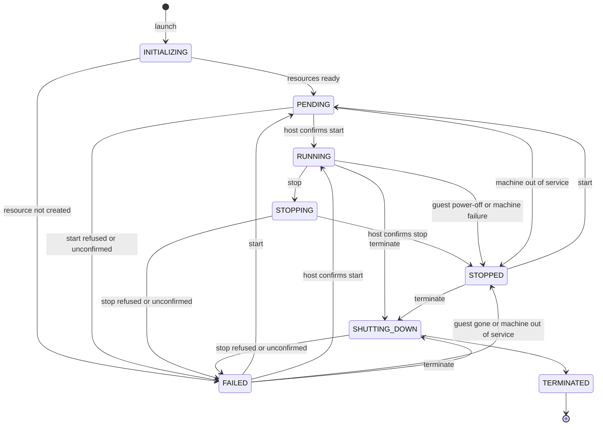

# Instance lifecycle

An instance's `status` is always one of eight values. Four of them are transitional and resolve on their own. `TERMINATED` is final. `RUNNING`, `STOPPED` and `FAILED` change when you ask for a change, and in a few cases without a request, described in [Changes nobody asked the platform for](#changes-nobody-asked-the-platform-for). Every lifecycle operation is asynchronous: the call returns once the platform accepts the request, and `status` tells you what happened.

The following diagram shows every transition you can observe.

You can also terminate an instance that is `INITIALIZING`, `PENDING` or `STOPPING`. The diagram leaves those edges out to stay readable.

## Statuses

`status` is a typed enum in the API. A client generated from the schema gets the full set, so compare against the enum rather than against strings you've seen in a response.

| `status` | What it means | Compute billed |
|---|---|---|
| `INITIALIZING` | Just launched. Its root disk and network interface are being created. Not running, not reachable. Moves on by itself. | No |
| `PENDING` | Everything it needs is ready and the platform has asked its host to start it. Moves on by itself. | No |
| `RUNNING` | The host confirmed the instance started. | Yes |
| `STOPPING` | A stop was requested. The guest may still be running until it shuts down. Moves on by itself. | No |
| `STOPPED` | Not running, but still yours. Its network interface stays reserved and its volumes stay attached. You can start it again. | No |
| `SHUTTING_DOWN` | A termination was requested. The guest is being shut down if it was running, and the instance's resources are being released. Moves on by itself. | No |
| `TERMINATED` | Permanently gone, and the resources it held are released. Nothing leaves this status. | No |
| `FAILED` | The host didn't do what it was asked, or something the instance needs could not be created. Always carries a `statusReason`. | No |

Compute usage stops being metered as soon as the instance leaves `RUNNING`. Volumes are billed separately for as long as they exist, so a `STOPPED` instance's root disk is still billed. For storage billing, see [Volumes](../../storage/volumes/index.md).

## Changes nobody asked the platform for

These transitions happen without a request from you:

- **Guest power-off.** When you shut the operating system down from inside the guest (`poweroff`, `shutdown -h`), the instance goes from `RUNNING` straight to `STOPPED`, without `STOPPING`. Its `statusReason` stays `null`. Start it again the usual way.
- **Machine failure.** When the platform can prove the machine under a running instance failed, it records the instance as `STOPPED` with a `statusReason` that says so. For details, see [When the machine under an instance fails](host-failure.md).
- **Planned move.** When the platform moves an instance off a machine that needs maintenance, it stops the instance and starts it again on another machine. The instance passes through `STOPPING`, `STOPPED` and `PENDING` back to `RUNNING`, and `statusReason` stays `null`. If the move is called off part-way, the instance stays `STOPPED`; start it yourself. For details, see [Planned moves](host-failure.md#planned-moves).
- **A `FAILED` instance settles.** `FAILED` doesn't say whether the guest is running. If the platform later learns the answer, the instance moves on: to `RUNNING` when its host confirms the start after all, or to `STOPPED` when its host reports the guest gone or its machine is taken out of service. A machine that restarts leaves a `FAILED` instance `FAILED`; start or terminate it.

## Polling

Poll through the transitional statuses: `INITIALIZING`, `PENDING`, `STOPPING` and `SHUTTING_DOWN`. Stop polling when the instance reaches `RUNNING`, `STOPPED`, `FAILED` or `TERMINATED`.

`RUNNING` means the host confirmed the start. It doesn't prove the guest's operating system and network are up. To know that, read the instance's health checks. For more information, see [Instance health checks](health-checks.md).

## When a lifecycle operation fails

If the host can't carry out a start or a stop, the instance ends up `FAILED`. It never stays in a transitional status waiting for something that isn't coming. `FAILED` means one thing: the platform can't confirm the instance is where you asked it to be. It doesn't promise that the guest is stopped or gone.

The common cases:

- **A launch or start that failed.** The host refused the start, or a volume or network interface the instance needs could not be created or attached. `statusReason` says which.
- **A stop that failed.** The guest may still be running.
- **An operation the host never confirmed.** If the instance's host is reachable but doesn't confirm a start or a stop, the platform sends the request again, three times in total, about 10 minutes apart. An instance can therefore sit in `PENDING`, `STOPPING` or `SHUTTING_DOWN` for about 30 minutes before it becomes `FAILED`, with a `statusReason` saying the host did not confirm.

A failure is not a termination. A `FAILED` instance stays listed, never retries on its own, and keeps everything it holds until you decide what happens to it:

- its network interface, with its private addresses and any public address on it, including one the platform assigned automatically at launch
- its volumes, including the root disk and the other volumes its launch created
- its capacity on its host, if it was placed on one

Compute usage isn't billed while an instance is `FAILED`, but what it keeps is. Its volumes are billed for as long as they exist, and a public IPv4 address on its interface is billed for as long as it's allocated, as any Floating IP is. See [Floating IPs](../../network/internet-access/floating-ips.md).

You have two ways forward:

- **Start it.** `start-instance` moves it to `PENDING` and back into the normal lifecycle. There is no separate "retry the stop": start it, then stop it again.
- **Terminate it.** Terminating a `FAILED` instance doesn't wait for its host to confirm the guest is gone, because the host may not answer at all. The platform releases the instance's resources as for any termination: what the launch created is deleted, and what you brought is detached and stays yours. It stops billing and reports `TERMINATED`. For which resource goes where, see [What happens to the instance's resources](terminate.md#what-happens-to-the-instances-resources).

You can't change a `FAILED` instance's type. Don't leave one sitting indefinitely. Every possible `statusReason` is listed in [Status reasons](../reference/status-reasons.md).

## Terminated instances

A terminated instance stays in `list-instances` for 2 hours after it terminates, then drops out of the default list. You can still read it by its URN with `get-instance`, however long ago it terminated.

## Related

- [Stop and start an instance](stop-start.md)
- [Terminate an instance](terminate.md)
- [Status reasons](../reference/status-reasons.md)
- [Troubleshoot Compute](../troubleshooting/index.md)
