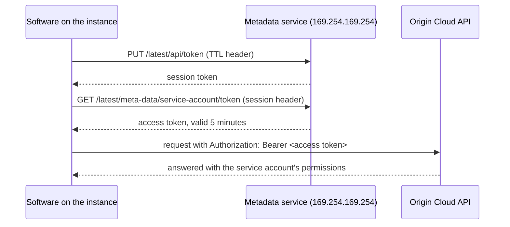

# Run an instance as a service account

An instance can run as a `WORKLOAD` service account of its organization. Software on the instance then gets the account's credential from the instance's metadata service: it lives five minutes, is signed by the machine the instance runs on, and is accepted only while the instance runs there as that account. Nothing secret is stored on the instance, in its image or in its snapshots.



## Before you begin

- A `WORKLOAD` service account of the instance's organization. Create one with `type` set to `WORKLOAD`; see [Use service accounts](../../iam/service-accounts.md).
- The roles the software needs, bound to that service account. It can do what its role bindings allow, and nothing else.
- `iam.service_account.act_as` on the organization, which [`roles/iam/service-account-user`](../../iam/roles.md#rolesiamservice-account-user) grants, besides the permission to launch or update the instance. You can only hand an instance an identity you could use yourself.

## Launch the instance with the service account

1. Launch the instance with its `serviceAccount` set to the service account's resource name, `organizations/<org-id>/serviceAccounts/<service-account-id>`, alongside the fields described in [Launch an instance](launch.md).

   ```sh
   curl -s -X POST \
     "https://compute.origincloudapis.eu/v1beta1/projects/<project-id>/zones/eu-central1-az1/instances" \
     -H "Authorization: Bearer $(origin id token --raw)" \
     -H "Content-Type: application/json" \
     -d '{
       "instanceType": "instanceTypes/gp1.core.2",
       "imageFamily": "imageFamilies/<family>",
       "keyPair": "projects/<project-id>/keyPairs/<key-pair-id>",
       "networkInterfaces": ["projects/<project-id>/zones/eu-central1-az1/networkInterfaces/<interface-id>"],
       "serviceAccount": "organizations/<org-id>/serviceAccounts/<service-account-id>"
     }'
   ```

   A service account of another organization is refused as not found. An `EXTERNAL` or deleted one is refused as an invalid argument.

2. Verify that the instance shows the service account: `GET` the instance and check its `serviceAccount`.

## Get the credential on the instance

On the instance, request a session token, then the credential with it. The session may last from 1 second to 6 hours.

With `curl`:

```sh
SESSION=$(curl -s -X PUT http://169.254.169.254/latest/api/token \
  -H "X-Origincloud-Metadata-Token-TTL-Seconds: 3600")
curl -s http://169.254.169.254/latest/meta-data/service-account/token \
  -H "X-Origincloud-Metadata-Token: $SESSION"
```

With Python, which the platform's Debian images include and `curl` they don't:

```sh
python3 - <<'EOF'
import json, urllib.request as request

metadata = "http://169.254.169.254"
session = request.urlopen(request.Request(
    metadata + "/latest/api/token", method="PUT",
    headers={"X-Origincloud-Metadata-Token-TTL-Seconds": "3600"})).read().decode()
credential = json.load(request.urlopen(request.Request(
    metadata + "/latest/meta-data/service-account/token",
    headers={"X-Origincloud-Metadata-Token": session})))
print(credential["access_token"])
EOF
```

The response is JSON with the `access_token`, its `token_type` (`Bearer`) and its `expires_at`. Request a new one before it expires.

The `origin` CLI and the SDKs send an access token from `ORIGINCLOUD_ACCESS_TOKEN` as it is:

```sh
export ORIGINCLOUD_ACCESS_TOKEN=$(curl -s http://169.254.169.254/latest/meta-data/service-account/token \
  -H "X-Origincloud-Metadata-Token: $SESSION" | python3 -c 'import json,sys; print(json.load(sys.stdin)["access_token"])')
origin compute list-instances
```

| Response | Meaning |
|---|---|
| `401` | No session token, or one that expired or was issued to another address. Request a new session. |
| `403` | The session request came through a proxy (it carried `X-Forwarded-For`). |
| `404` | The instance runs as no service account. |
| `503` | The machine can't sign right now. Try again. |

## Change or remove the service account

Update the instance with `serviceAccount` in the update mask: a resource name sets or replaces the service account, an empty value removes it. Setting one needs `iam.service_account.act_as`; removing one doesn't. A terminated instance's service account can't change.

```sh
curl -s -X PATCH \
  "https://compute.origincloudapis.eu/v1beta1/projects/<project-id>/zones/eu-central1-az1/instances/<instance-id>?updateMask=serviceAccount" \
  -H "Authorization: Bearer $(origin id token --raw)" \
  -H "Content-Type: application/json" \
  -d '{"serviceAccount": "organizations/<org-id>/serviceAccounts/<service-account-id>"}'
```

A credential issued before the change is refused from the moment the instance shows the change. So is one of an instance that stopped, or one of a service account that was deleted.

## Related

- [Use service accounts](../../iam/service-accounts.md)
- [Built-in roles](../../iam/roles.md)
- [Launch an instance](launch.md)
