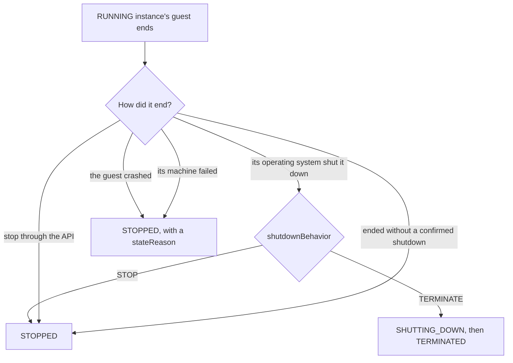

# Choose what a guest shutdown does

An instance's `shutdownBehavior` decides what happens when its own operating system shuts it down, for example with `sudo poweroff` inside the guest:

- `STOP`, the default: the instance goes from `RUNNING` to `STOPPED`. It keeps its volumes and addresses, and you can start it again.
- `TERMINATE`: the instance is terminated, exactly as if you had terminated it. It goes from `RUNNING` through `SHUTTING_DOWN` to `TERMINATED`, and its resources are released. See [What happens to the instance's resources](terminate.md#what-happens-to-the-instances-resources).

`TERMINATE` suits instances that do one job and then end, such as an ephemeral CI runner: the job's last step shuts the guest down, and nothing is left behind to pay for.



Only a shutdown the guest starts itself terminates. These always leave the instance `STOPPED`, whatever its `shutdownBehavior`:

- A stop you request through the API or the CLI.
- A stop the platform makes, such as when it moves the instance off a machine or the machine fails. See [When the machine fails](host-failure.md).
- A crash of the guest's operating system. The instance reads `STOPPED` with a `stateReason` saying so. See [Status reasons](../reference/status-reasons.md).
- An ending the platform can't confirm was a shutdown, for example because the virtual machine's process on its machine ended unexpectedly. The instance reads `STOPPED`.

> **Warning:** A terminated instance can't be brought back. Its boot volume is deleted with it unless a snapshot of the volume exists. Use `TERMINATE` only for instances whose disks you can lose.

## Before you begin

- `compute.instance.create` to launch, or `compute.instance.update` to change an existing instance.
- An instance that isn't `SHUTTING_DOWN` or `TERMINATED`, to change one.

## Launch an instance that terminates on shutdown

Launch the instance with `shutdownBehavior` set to `TERMINATE`, alongside the fields described in [Launch an instance](launch.md):

```sh
curl -sS -X POST \
  "https://compute.origincloudapis.eu/v1beta1/projects/<project-id>/zones/<zone>/instances" \
  -H "$(origin id token --as-header --raw)" \
  -H "Content-Type: application/json" \
  -d '{
    "instanceType": "//compute.origincloudapis.eu/instanceTypes/gp1.core.2",
    "imageFamily": "//compute.origincloudapis.eu/imageFamilies/<family>",
    "keyPair": "//compute.origincloudapis.eu/projects/<project-id>/keyPairs/<key-pair-id>",
    "networkInterfaces": ["//network.origincloudapis.eu/projects/<project-id>/zones/<zone>/networkInterfaces/<interface-id>"],
    "shutdownBehavior": "TERMINATE"
  }'
```

A launch template's recipe takes the same `shutdownBehavior`, and a launch from the template can override it. See [Launch from a template](../launch-templates/launch.md).

## Change it on an existing instance

`PATCH` the instance with `updateMask=shutdownBehavior`. The instance can be running or stopped, and the change applies to the next shutdown. The request returns an operation:

```sh
curl -sS -X PATCH \
  "https://compute.origincloudapis.eu/v1beta1/projects/<project-id>/zones/<zone>/instances/<instance-id>?updateMask=shutdownBehavior" \
  -H "$(origin id token --as-header --raw)" \
  -H "Content-Type: application/json" \
  -d '{"shutdownBehavior": "TERMINATE"}'
```

Set it back to `STOP` the same way. Left unspecified under the mask, it is `STOP`.

## Verify

`GET` the instance and check its `shutdownBehavior`. It always reads `STOP` or `TERMINATE`, never unspecified.

## If this fails

- **[`CONFLICT`](../../platform/reference/errors.md#conflict) on an update.** The instance is `SHUTTING_DOWN` or `TERMINATED`; there is no guest left to shut down.
- **`INVALID_ARGUMENT` on `shutdownBehavior`.** The value isn't `STOP` or `TERMINATE`.

## Related

- [Instance lifecycle](lifecycle.md)
- [Stop and start an instance](stop-start.md)
- [Terminate an instance](terminate.md)
