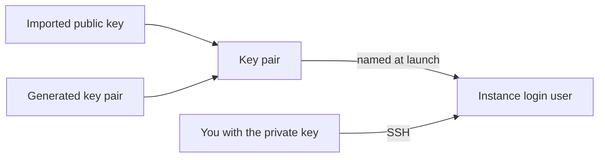

# Key pairs

A key pair is an SSH key registered in a project. Every launch names one, and the platform installs its public half for the instance's login user. You log in with the matching private key. There is no password login and no shared fallback key: a launch without a key pair is refused.

The following diagram shows how a key pair gets into an instance.

## Key concepts

**Imported key pair**  
You upload the public half of a key you already have. The private key never leaves your machine. Accepted key types are `ssh-ed25519`, `ssh-rsa`, `ssh-dss` and `ecdsa-sha2-nistp256`, `-nistp384` and `-nistp521`.

**Generated key pair**  
The platform generates an `ssh-ed25519` key pair and returns the private key in the response, once. The platform stores only the public half, so the private key can never be retrieved again.

**Login user**  
The account the public key is installed for. See [Guest environment](../instances/guest-environment.md#login-user).

## What you can do

- [Create a key pair](create.md), by importing or generating it
- List key pairs with `origin compute list-key-pairs` and read one with `origin compute get-key-pair`
- Change its tags with `origin compute update-key-pair`, and delete it with `origin compute delete-key-pair --yes`

Deleting a key pair doesn't change instances already launched with it. Their login user keeps the public key, and the matching private key still logs in. You can no longer launch new instances with it.

## Related

- [Launch an instance](../instances/launch.md)
- [`origin compute` commands](../reference/cli.md)
