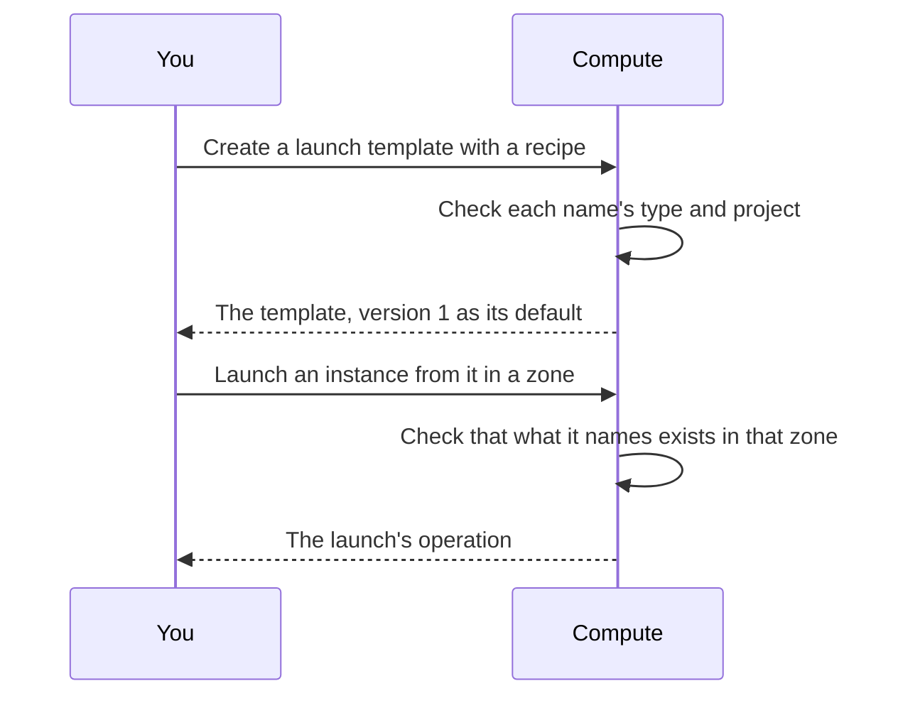
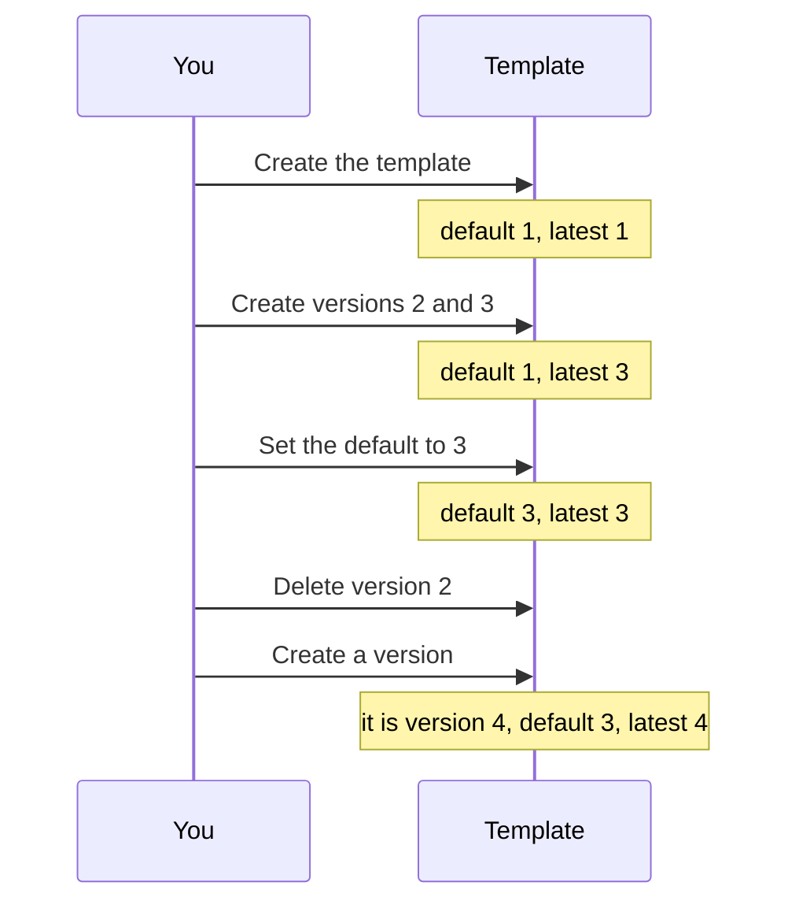

# How launch templates work

A launch template is a resource of its project: `projects/<project-id>/launchTemplates/<launch-template-id>`, with no zone in its name. You can use the same template to launch an instance in any zone of the project.

## What is checked, and when

A recipe names resources that live in a zone or a region: an image, a subnet, a network interface, security groups. A template doesn't, so these names are checked in two steps.

When you create the template, each name is checked for what it says on its own:

- It is a full name of the right type, such as a key pair for `keyPair` and a subnet for a spec's `subnet`.
- A key pair, an image of your own, a subnet, a network interface or a security group is in the template's project.
- A service account is one of the project's organization.
- The recipe sets exactly one of `image` and `imageFamily`, and holds at most one network interface.

When you [launch an instance from the template](launch.md), the recipe, with any fields the launch overrides, is checked as a launch from a recipe is: that each resource exists, is in the zone you launch in, and can be used. A template that names a key pair you deleted can still be created and kept; a launch from it is refused.

The following diagram shows the two checks.

## Versions

A template's recipe is kept in numbered versions, and a version never changes once it is created. To change the recipe, you create a new version. Updating a template changes only its tags and which version is its default; no request changes the recipe of a version.

- **Numbers.** Creating a template creates version 1. Each version you add gets one more than the highest number the template has ever given, so a deleted version's number is never used again, and a version's number always means the same recipe.
- **`@default`.** The default version is the one a launch uses when it names none, and the one the template's bare name reads. It is version 1 until you set another one, and creating a version doesn't change it. It must be a version the template has, so the default version can't be deleted.
- **`@latest`.** The newest version the template has. It changes when you create a version, and when you delete the newest one it becomes the highest number left.
- **A version's name.** A version is named by the template's name, `@` and its number: `projects/<project-id>/launchTemplates/<launch-template-id>@3`, with the full name `//compute.origincloudapis.eu/projects/<project-id>/launchTemplates/<launch-template-id>@3`. `@default` and `@latest` read whichever version they pick now, and the answer is named with that version's number.

A template holds at most 100 versions. Deleting a template deletes every version of it. Instances launched from it keep running, and keep showing the version they were launched from in `launchTemplate`.

The following diagram shows how the numbers move.

## A template keeps its project

A project that has a launch template can't be deleted. Delete its templates first, as you delete its instances and key pairs.

## Related

- [Create a launch template](create.md)
- [Create a launch template version](versions-create.md)
- [Set a launch template's default version](versions-default.md)
- [Launch an instance](../instances/launch.md)
