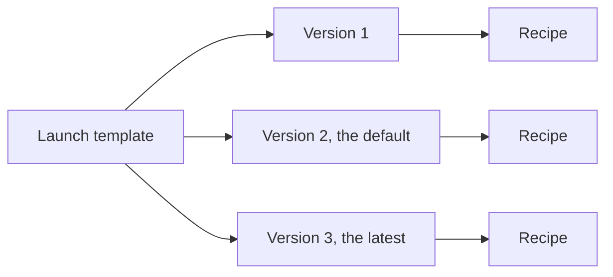

# Launch templates

A launch template keeps the recipe of an instance under a name, so that you don't have to send the whole recipe with every launch. The recipe is the same `launchTemplateData` a launch from a recipe takes: the instance type, the image or image family, the key pair, the login user, the boot volume, the service account, the instance's tags, its network interface and its local disks.

A template belongs to a project and can be used in every zone. It holds numbered versions of its recipe. A version never changes once it is created, and one version is the template's default.

The following diagram shows what a template holds.

## Key concepts

**Version**  
A numbered recipe. Creating a template creates its version 1, which is its default. Each version you add gets the next number. No request changes a version's recipe.

**Default version**  
The version a launch uses when it names none, and the one `@default` or the template's bare name reads. A template shows its default version's recipe in `launchTemplateData`, and the numbers of its default and newest versions in `defaultVersion` and `latestVersion`. It changes only when you set it.

**Latest version**  
The newest version the template has, the one `@latest` reads.

See [How launch templates work](how-it-works.md) for what is checked when, and why a template isn't in a zone.

## What you can do

- [Create a launch template](create.md)
- [View launch templates](view.md)
- [Delete a launch template](delete.md)
- [Create a launch template version](versions-create.md)
- [View launch template versions](versions-view.md)
- [Set a launch template's default version](versions-default.md)
- [Delete a launch template version](versions-delete.md)
- [Launch an instance from a launch template](launch.md)

## Related

- [Launch an instance](../instances/launch.md)
- [Key pairs](../key-pairs/index.md)
