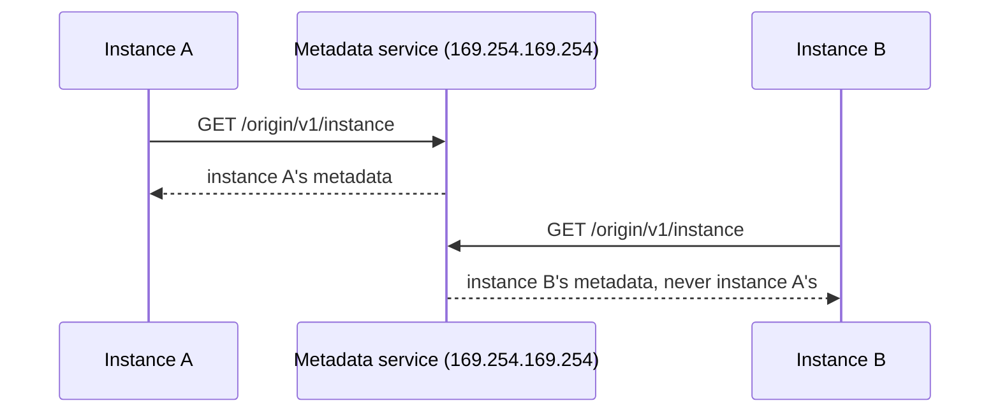

# Instance metadata service

Software on an instance can read facts about the instance from the metadata service at `http://169.254.169.254`. The service answers only the instance asking, by the address the request comes from. It doesn't need credentials, and nothing outside the instance can reach it.



## Instance metadata

`GET /origin/v1/instance` returns the instance's metadata as JSON. This is the documented form:

```json
{
  "name": "//compute.origincloudapis.eu/projects/<project-id>/zones/eu-central1-az1/instances/<instance-id>",
  "instanceId": "<instance-id>",
  "zone": "eu-central1-az1",
  "hostname": "ip-10-0-1-5.internal",
  "loginUser": "cloud",
  "publicKeys": ["ssh-ed25519 AAAA... me@example.com"],
  "networkInterfaces": [
    {
      "name": "//network.origincloudapis.eu/projects/<project-id>/zones/eu-central1-az1/networkInterfaces/<interface-id>",
      "privateIpv4": "10.0.1.5",
      "ipv6": "2001:db8::5",
      "publicIpv4": "203.0.113.20"
    }
  ]
}
```

| Field | Value |
|---|---|
| `name` | The instance's full name. |
| `instanceId` | The instance's id. |
| `zone` | The zone the instance runs in. |
| `hostname` | The instance's hostname, from its first network interface's private IPv4 address. |
| `loginUser` | The login user the platform created. See [Guest environment](../instances/guest-environment.md#login-user). |
| `publicKeys` | The public key of the instance's key pair. |
| `networkInterfaces` | Each network interface: its full `name`, its `privateIpv4` and `ipv6` addresses, and `publicIpv4`, the floating IP associated with it. `publicIpv4` is left out for an interface without one. |

For example, with Python, which the platform's Debian images include:

```sh
python3 -c 'import json, urllib.request as r; print(json.load(r.urlopen("http://169.254.169.254/origin/v1/instance"))["zone"])'
```

## EC2-compatible paths

Tools written for EC2's metadata service can read the same facts under `/latest/meta-data/`, one plain-text value per path.

| Path | Value |
|---|---|
| `/latest/meta-data/` | The paths below that have a value for this instance, one per line. |
| `/latest/meta-data/instance-id` | The instance's id. |
| `/latest/meta-data/hostname` | The instance's hostname. |
| `/latest/meta-data/local-hostname` | The same hostname. |
| `/latest/meta-data/local-ipv4` | The first network interface's private IPv4 address. |
| `/latest/meta-data/ipv6` | The first network interface's IPv6 address. |
| `/latest/meta-data/public-ipv4` | The floating IP associated with the first network interface. `404` without one. |
| `/latest/meta-data/placement/availability-zone` | The zone, such as `eu-central1-az1`. |
| `/latest/meta-data/public-keys/0/openssh-key` | The public key of the instance's key pair. |

Paths EC2 has and this list doesn't answer `404`.

## Boot configuration

cloud-init's NoCloud datasource reads the instance's boot configuration from `http://169.254.169.254/nocloud/`. The instance's firmware names that address in its system serial number, `ds=nocloud-net;s=http://169.254.169.254/nocloud/`, so cloud-init finds it with no configuration disk. See [Guest environment](../instances/guest-environment.md).

| Path | Value |
|---|---|
| `/nocloud/meta-data` | The instance id and hostname. |
| `/nocloud/vendor-data` | The platform's cloud-config: the login user with your public key, time synchronization and the resolver. See [Guest environment](../instances/guest-environment.md). |
| `/nocloud/user-data` | Empty. |

## Credentials

An instance that runs as a service account gets its credential from `/latest/meta-data/service-account/token`, with a session token from `PUT /latest/api/token`. These paths are described in [Run an instance as a service account](../instances/service-account.md#get-the-credential-on-the-instance). They're the only ones that need a session token.

## Responses

| Response | Meaning |
|---|---|
| `200` | The value. |
| `403` | The request came through a proxy (it carried `X-Forwarded-For`). |
| `404` | The path has no value for this instance, or the request didn't come from an instance's own address. An instance started before the boot configuration and the instance metadata were served gets `404` on those paths until it's stopped and started; `instance-id` and credentials answer it as before. |

## Related

- [Guest environment](../instances/guest-environment.md)
- [Run an instance as a service account](../instances/service-account.md)
