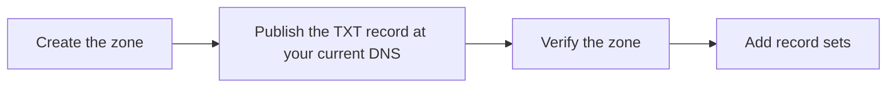

# Create a public zone and verify it

Create a public zone for your domain, prove you control the domain, and add the zone's record sets.


> **Note:** Origin Cloud's name servers don't answer for customer zones yet, so a public zone isn't answered on the internet. You can create and verify a zone and add its record sets; don't delegate the domain.

The following diagram shows the steps and where each one happens.



## Before you begin

- A domain you control, and access to its current DNS records.
- The `origin` CLI, logged in, with a default project or `--project` on each command. See [Use the CLI](../../platform/access/cli.md).
- A valid billing setup for the project. See [Add a payment method](../../platform/billing/payment-method.md).

## Create the zone

1. Create the zone:

   ```sh
   origin dns create-hosted-zone --dns-name example.com --visibility PUBLIC \
     --tag origin:name=example
   ```

2. Note the zone's id, the last segment of its `name`, and its `challenge` and `nameServers`.

   Example output:

   ```text
   name         projects/my-project/hostedZones/hz-Oqu2Vgc2nt6
   state        PENDING_VERIFICATION
   urn          urn:origin:cloud:dns::<org-id>:my-project:hz-Oqu2Vgc2nt6
   dnsName      example.com
   visibility   PUBLIC
   nameServers  ns1.origincloud.eu, ns2.origincloud.eu, ns3.origincloud.eu
   creator      user:<user-id>
   createTime   2026-11-08T09:18:04.510953Z (0s ago)
   challenge
     dnsName     _origin-challenge.example.com
     token       1403902588d38440aa94538c1a9c0305
     expireTime  2026-11-15T09:18:04.510953Z (in 6d)
   tags
     origin:name  example
   ```

The zone is `PENDING_VERIFICATION`: it isn't answered yet. It's deleted at `challenge.expireTime` unless it verifies first. `origin dns get-hosted-zone --hosted-zone <zone-id>` shows it again, and `origin dns list-hosted-zones` lists the project's zones.

## Prove you control the domain

1. At the DNS provider that hosts the domain now, create a TXT record named as `challenge.dnsName`, `_origin-challenge.example.com`, whose value is `challenge.token`.

2. Check that the record answers:

   ```sh
   dig +short TXT _origin-challenge.example.com
   ```

3. Verify the zone:

   ```sh
   origin dns verify-hosted-zone --hosted-zone <zone-id>
   ```

4. Check `state` and `challenge.lastCheck` in the output. `ACTIVE` with `OK` means the zone holds the domain. `NOT_FOUND` means the record isn't visible yet: wait for the TXT record's TTL at your DNS provider and verify again. A verify within 30 seconds of the zone's last check answers with that check's outcome, so leave at least half a minute between calls. For `NAME_HELD`, see [A public zone stays pending](../troubleshooting/index.md#a-public-zone-stays-pending).

   Example output, for a record that doesn't answer yet (shortened):

   ```text
   name         projects/my-project/hostedZones/hz-Oqu2Vgc2nt6
   state        PENDING_VERIFICATION
   ...
   challenge
     dnsName     _origin-challenge.example.com
     token       1403902588d38440aa94538c1a9c0305
     expireTime  2026-11-15T09:18:04.510953Z (in 6d)
     lastCheck   NOT_FOUND
   ```

You don't have to verify the zone yourself: the platform checks pending zones on its own. `verify-hosted-zone` checks right away.

## Add record sets

Create the zone's record sets. Copy every record your domain needs from its current DNS, such as its mail exchangers and existing TXT records, so the zone answers fully from the moment the domain points at it. See [Add, change and delete record sets](../record-sets/manage.md).

## Delegate the domain

> **Important:** Don't change your domain's delegation at your registrar yet. Origin Cloud's name servers don't answer for customer zones yet, so a domain delegated to them stops resolving. Until they do, keep the domain at its current DNS provider, and keep the `_origin-challenge` TXT record there: it's what keeps your zone's hold on the domain.


## Related

- [Domain ownership](ownership.md)
- [Hosted zones](index.md)
- [`create-hosted-zone` reference](../reference/cli.md#create-hosted-zone)
- [`verify-hosted-zone` reference](../reference/cli.md#verify-hosted-zone)
- [Troubleshoot DNS](../troubleshooting/index.md)
