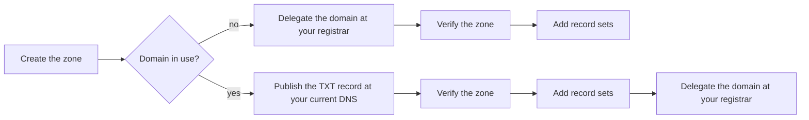

# Create a public zone and verify it

Create a public zone for your domain, prove you control the domain, and add the zone's record sets. Once the domain is delegated to the zone's name servers, Origin Cloud answers for it on the internet.

How you prove control depends on whether the domain is in use:

- **A new domain, or one nothing depends on yet:** delegate it to the zone's name servers at its registrar. The delegation is the proof.
- **A domain in use:** publish the zone's token as a TXT record at its current DNS provider, verify the zone, add its record sets, and delegate the domain last, so it keeps resolving throughout.

The following diagram shows both paths.



## Before you begin

- A domain you control: access to its name servers at the registrar, or to its current DNS records.
- The `origin` CLI, logged in, with a default project or `--project` on each command. See [Use the CLI](../../platform/access/cli.md).
- A valid billing setup for the project. See [Add a payment method](../../platform/billing/payment-method.md).

## Create the zone

1. Create the zone:

   ```sh
   origin dns create-hosted-zone --dns-name example.com --visibility PUBLIC \
     --tag origin:name=example
   ```

2. Note the zone's id, the last segment of its `name`, and its `challenge` and `nameServers`.

   Example output:

   ```text
   name         projects/my-project/hostedZones/hz-Oqu2Vgc2nt6
   state        PENDING_VERIFICATION
   urn          urn:origin:cloud:dns::<org-id>:my-project:hz-Oqu2Vgc2nt6
   dnsName      example.com
   visibility   PUBLIC
   nameServers  k7q2m9x4p1za.ns1.origincloud.eu, k7q2m9x4p1za.ns2.origincloud.eu, k7q2m9x4p1za.ns3.origincloud.eu
   creator      user:<user-id>
   createTime   2026-11-08T09:18:04.510953Z (0s ago)
   challenge
     dnsName     _origin-challenge.example.com
     token       1403902588d38440aa94538c1a9c0305
     expireTime  2026-11-15T09:18:04.510953Z (in 6d)
   tags
     origin:name  example
   ```

The zone is `PENDING_VERIFICATION`: it isn't answered yet. It's deleted at `challenge.expireTime` unless it verifies first. `origin dns get-hosted-zone --hosted-zone <zone-id>` shows it again, and `origin dns list-hosted-zones` lists the project's zones.

The zone's `nameServers` are its own: no other zone has them. See [Domain ownership](ownership.md#delegation-to-the-zones-name-servers).

## Prove control of a new domain

For a domain that doesn't resolve yet, or whose resolution can wait until the zone is `ACTIVE`:

1. At the domain's registrar, set the domain's name servers to the zone's `nameServers`, all of them, exactly as listed. You can do this while you register the domain, once the zone exists.
2. Check that the registry publishes the delegation:

   ```sh
   dig NS example.com @a.gtld-servers.net +noall +authority
   ```

   Ask a server of the zone that holds the delegation: the domain's top-level domain for a registered domain (`dig +short NS com` lists them for `.com`), or the parent domain's DNS for a subdomain. It must print the zone's `nameServers`.

3. Verify the zone:

   ```sh
   origin dns verify-hosted-zone --hosted-zone <zone-id>
   ```

   `ACTIVE` with `lastCheck` `OK` means the zone holds the domain, and Origin Cloud answers for it. `NOT_FOUND` means the registry doesn't delegate the domain to the zone's name servers yet: registries publish changes within minutes to hours. Verify again later, or let the platform's own checks pick it up.

Then [add the zone's record sets](#add-record-sets). There's nothing left to delegate.

> **Note:** Some registries check a domain's name servers before they accept a delegation, `.de` (DENIC) among them. Origin Cloud's name servers don't answer for a pending zone, so such a registry refuses the delegation. For a domain under such a registry, prove control with the TXT record instead: host the domain at another DNS provider first, then delegate it once the zone is `ACTIVE`.

## Prove control of a domain in use

1. At the DNS provider that hosts the domain now, create a TXT record named as `challenge.dnsName`, `_origin-challenge.example.com`, whose value is `challenge.token`.

2. Check that the record answers:

   ```sh
   dig +short TXT _origin-challenge.example.com
   ```

3. Verify the zone:

   ```sh
   origin dns verify-hosted-zone --hosted-zone <zone-id>
   ```

4. Check `state` and `challenge.lastCheck` in the output. `ACTIVE` with `OK` means the zone holds the domain. `NOT_FOUND` means the record isn't visible yet: wait for the TXT record's TTL at your DNS provider and verify again. A verify within 30 seconds of the zone's last check answers with that check's outcome, so leave at least half a minute between calls. For `NAME_HELD`, see [A public zone stays pending](../troubleshooting/index.md#a-public-zone-stays-pending).

   Example output, for a record that doesn't answer yet (shortened):

   ```text
   name         projects/my-project/hostedZones/hz-Oqu2Vgc2nt6
   state        PENDING_VERIFICATION
   ...
   challenge
     dnsName     _origin-challenge.example.com
     token       1403902588d38440aa94538c1a9c0305
     expireTime  2026-11-15T09:18:04.510953Z (in 6d)
     lastCheck   NOT_FOUND
   ```

You don't have to verify the zone yourself: the platform checks pending zones on its own. `verify-hosted-zone` checks right away.

## Add record sets

Create the zone's record sets. Copy every record your domain needs from its current DNS, such as its mail exchangers and existing TXT records, so the zone answers fully from the moment the domain points at it. See [Add, change and delete record sets](../record-sets/manage.md).

## Delegate the domain

For a domain you proved control of with the TXT record.

> **Important:** Delegate a domain in use only once the zone is `ACTIVE` and holds every record set the domain needs. Origin Cloud's name servers don't answer for a pending zone, so a domain delegated to one stops resolving.

To delegate the domain:

1. At your domain's registrar, replace the domain's name servers with the zone's `nameServers`, all of them, exactly as listed. Origin Cloud's name servers also answer under other names, such as `ns1.origincloud.eu` without the zone's label, but a domain delegated to those doesn't prove control: the zone's daily checks fail, and after several it's suspended.
2. Check the delegation once the registrar has published it:

   ```sh
   dig +short NS example.com
   ```

The zone's records are answered on the internet once Origin Cloud's public name servers serve the zone. Resolvers that cached the old name servers keep using them until their TTL runs out.

Once the domain is delegated, you can remove the `_origin-challenge` TXT record. The zone keeps its domain as long as the delegation stays. See [Daily checks and suspension](ownership.md#daily-checks-and-suspension).

## Related

- [Domain ownership](ownership.md)
- [Hosted zones](index.md)
- [`create-hosted-zone` reference](../reference/cli.md#create-hosted-zone)
- [`verify-hosted-zone` reference](../reference/cli.md#verify-hosted-zone)
- [Troubleshoot DNS](../troubleshooting/index.md)
