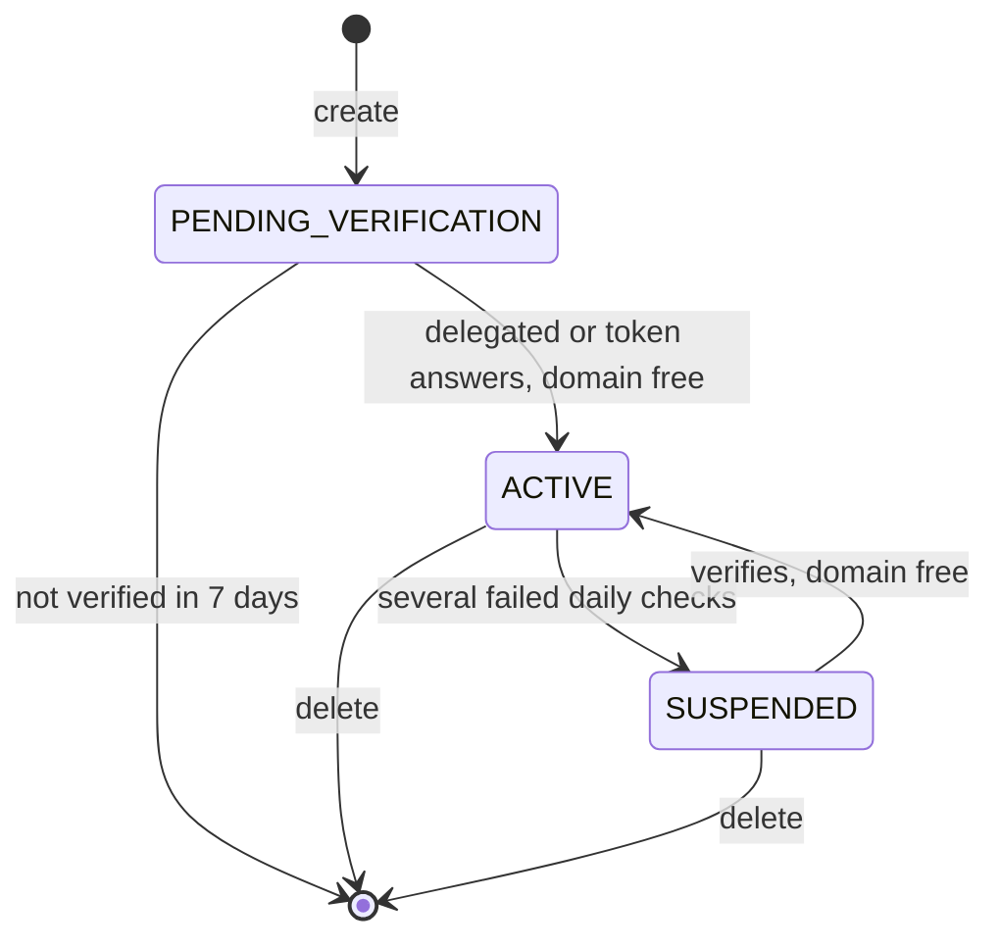

# Domain ownership

Every public zone is answered by the same servers, so a zone could otherwise claim a domain that isn't yours and hold it against its real owner. A public zone therefore holds its domain only once it proves control of it, and keeps that domain only while the proof holds. Any project may create a public zone for any domain, and several zones of the same domain may be pending at once; the first to prove control holds it.

A zone proves control of its domain in either of two ways:

- **Delegation:** the domain's registrar delegates it to the zone's own name servers.
- **Challenge:** a TXT record holding the zone's token answers at the domain's current DNS provider.

## Delegation to the zone's name servers

Each public zone has name servers of its own, listed in its `nameServers`, such as `k7q2m9x4p1za.ns1.origincloud.eu`. No other zone is ever given them, a deleted zone's included. Only the domain's owner can set its name servers at the registrar, so a domain delegated to them proves the zone is yours. The delegation is read from the domain's parent, such as the registry of `.com`, never from Origin Cloud's own name servers.

This is the way to go for a new domain: set the zone's `nameServers` when you register it, or right after creating the zone, and the zone verifies with no TXT record. A delegation to another zone's name servers, or to `ns1.origincloud.eu` and its siblings without a label, proves nothing. If you create the zone again, delegate the domain to the new zone's `nameServers`.

For a pending zone, Origin Cloud answers its SOA and NS records at most, never its record sets, so a domain delegated to one doesn't resolve until the zone is `ACTIVE`. A resolver that asked for a name meanwhile keeps its "no such name" answer for up to 15 minutes after the zone becomes active. For a domain that is in use, prove control with the challenge first and delegate afterwards; see [Create a public zone and verify it](create-public.md).

## The ownership challenge

When you create a public zone, its `challenge` tells you what to publish:

| Field | Meaning |
|---|---|
| `challenge.dnsName` | The name of the TXT record to create: `_origin-challenge.` followed by the zone's domain, such as `_origin-challenge.example.com`. |
| `challenge.token` | The value the TXT record holds. |
| `challenge.expireTime` | When the zone is deleted if it hasn't verified by then. |

Create the TXT record where the domain is hosted now, at the DNS provider its registrar currently delegates it to. The challenge is checked at the domain's current name servers, never at Origin Cloud's own, so the record has to be there and not in the pending zone. A domain delegated to the zone's name servers needs no TXT record.

## Verification

The platform checks pending zones on its own, more often at first and more rarely the longer a zone stays pending. To check one right away, verify it with `origin dns verify-hosted-zone --hosted-zone <zone-id>`, or the API's `VerifyHostedZone` method. The answer is the zone as it is after the check, with the check's outcome in `challenge.lastCheck`:

| `lastCheck` | Meaning |
|---|---|
| `OK` | The domain is delegated to the zone's name servers or the token answers, and the zone holds its domain. It's `ACTIVE`. |
| `NOT_FOUND` | Neither proof was found, or the domain's DNS couldn't be asked. The zone stays as it was. For an `ACTIVE` zone, its proof is lost: the daily checks suspend it unless the proof comes back. |
| `NAME_HELD` | The zone proved control, but another zone holds the domain. The zone stays pending. |

A call within 30 seconds of the zone's last check answers with that check's outcome without asking the domain's DNS again, so wait half a minute after publishing the TXT record or changing the delegation before checking again. When the domain's DNS doesn't answer in time, or too many checks are under way, the call is refused with the retryable [`SERVICE_UNAVAILABLE`](../../platform/reference/errors.md#service_unavailable). Verifying an active zone checks its proof and changes nothing, so you can repeat the call safely. A private zone has no challenge, and verifying one is refused with `BAD_REQUEST`.

The first zone of a domain to verify becomes `ACTIVE` and holds the domain; other zones of that domain stay pending. A pending zone that hasn't verified 7 days after its creation, at its `challenge.expireTime`, is deleted with its record sets. Verifying it after that is refused with `NOT_FOUND`.

Once a zone is active, `challenge.verifyTime` shows when it verified. Once its domain is also delegated to the zone's name servers, you can remove the TXT record: the delegation keeps the zone's hold on the domain from then on. Until the domain is delegated, keep the TXT record at its current DNS provider.

A zone whose `nameServers` are `ns1.origincloud.eu` and its siblings without a label shares them with other zones. While it's `ACTIVE`, a delegation to them keeps its domain; once suspended, it becomes active again only by its challenge. While pending, it verifies only by its challenge: to verify by delegation instead, delete it and create the zone again, which gives it name servers of its own.

## Daily checks and suspension

An active public zone is checked again every day. It keeps its domain while either of these is true:

- The domain is delegated to the zone's name servers.
- The token still answers at the domain's other name servers.

When several checks in a row find the domain delegated elsewhere without the token, or delegated to other Origin Cloud name servers than the zone's, the zone is suspended: its state is `SUSPENDED`, `challenge.suspendTime` says when, and `challenge.suspensionReason` is `CHALLENGE_LOST`. A suspended zone isn't answered and keeps its record sets, and its domain is free for another zone to verify. A check where the domain's DNS can't be asked never counts against a zone.

Verifying a suspended zone makes it active again when the domain is delegated to its name servers or its token answers, provided no other zone holds its domain by then.

The following diagram shows how a public zone moves between its states.

## Related

- [Create a public zone and verify it](create-public.md)
- [A public zone stays pending](../troubleshooting/index.md#a-public-zone-stays-pending)
- [A public zone is suspended](../troubleshooting/index.md#a-public-zone-is-suspended)
