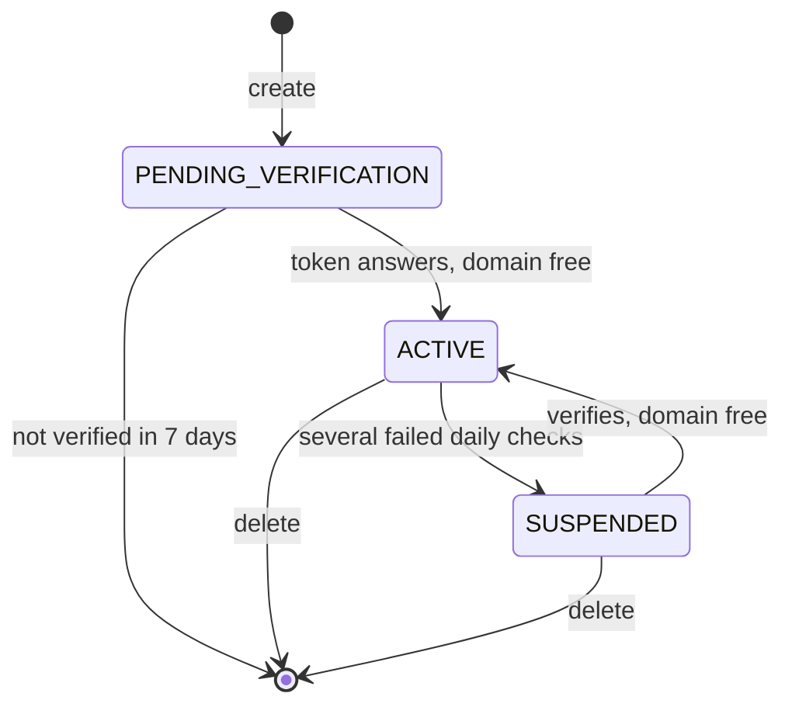

# Domain ownership

Every public zone is answered by the same name servers, so a zone could otherwise claim a domain that isn't yours and hold it against its real owner. A public zone therefore holds its domain only once it proves control of it, and keeps that domain only while the proof holds. Any project may create a public zone for any domain, and several zones of the same domain may be pending at once; the first to prove control holds it.

## The ownership challenge

When you create a public zone, its `challenge` tells you what to publish:

| Field | Meaning |
|---|---|
| `challenge.dnsName` | The name of the TXT record to create: `_origin-challenge.` followed by the zone's domain, such as `_origin-challenge.example.com`. |
| `challenge.token` | The value the TXT record holds. |
| `challenge.expireTime` | When the zone is deleted if it hasn't verified by then. |

Create the TXT record where the domain is hosted now, at the DNS provider its registrar currently delegates it to. The challenge is checked at the domain's current name servers, never at Origin Cloud's own, so the record has to be there and not in the pending zone.

## Verification

The platform checks pending zones on its own, more often at first and more rarely the longer a zone stays pending. To check one right away, verify it with `origin dns verify-hosted-zone --hosted-zone <zone-id>`, or the API's `VerifyHostedZone` method. The answer is the zone as it is after the check, with the check's outcome in `challenge.lastCheck`:

| `lastCheck` | Meaning |
|---|---|
| `OK` | The token answers and the zone holds its domain. It's `ACTIVE`. |
| `NOT_FOUND` | The token doesn't answer at the TXT record's name, or the domain's DNS couldn't be asked. The zone stays as it was. |
| `NAME_HELD` | The token answers, but another zone holds the domain. The zone stays pending. |

A call within 30 seconds of the zone's last check answers with that check's outcome without asking the domain's DNS again, so wait half a minute after publishing the TXT record before checking again. When the domain's DNS doesn't answer in time, or too many checks are under way, the call is refused with the retryable [`SERVICE_UNAVAILABLE`](../../platform/reference/errors.md#service_unavailable). Verifying an active zone changes nothing, so you can repeat the call safely. A private zone has no challenge, and verifying one is refused with `BAD_REQUEST`.

The first zone of a domain to verify becomes `ACTIVE` and holds the domain; other zones of that domain stay pending. A pending zone that hasn't verified 7 days after its creation, at its `challenge.expireTime`, is deleted with its record sets. Verifying it after that is refused with `NOT_FOUND`.

Once a zone is active, `challenge.verifyTime` shows when it verified. Once its domain is also delegated to the zone's name servers, you can remove the TXT record: the delegation keeps the zone's hold on the domain from then on. Until the domain is delegated, keep the TXT record at its current DNS provider.

## Daily checks and suspension

An active public zone is checked again every day. It keeps its domain while either of these is true:

- The domain is delegated to the zone's name servers.
- The token still answers at the domain's other name servers.

When several checks in a row find the domain delegated elsewhere without the token, the zone is suspended: its state is `SUSPENDED`, `challenge.suspendTime` says when, and `challenge.suspensionReason` is `CHALLENGE_LOST`. A suspended zone isn't answered and keeps its record sets, and its domain is free for another zone to verify. A check where the domain's DNS can't be asked never counts against a zone.

Verifying a suspended zone makes it active again, provided no other zone holds its domain by then.

The following diagram shows how a public zone moves between its states.

## Related

- [Create a public zone and verify it](create-public.md)
- [A public zone stays pending](../troubleshooting/index.md#a-public-zone-stays-pending)
- [A public zone is suspended](../troubleshooting/index.md#a-public-zone-is-suspended)
