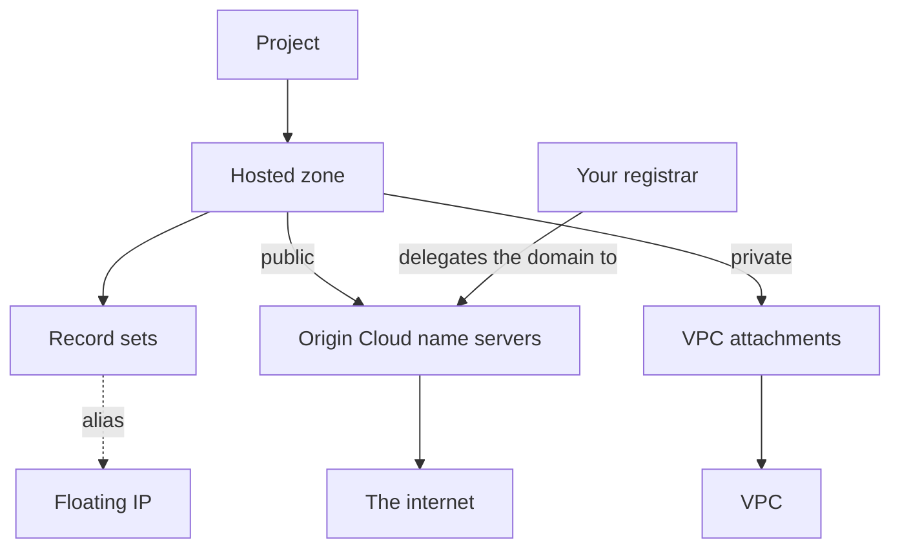

# What is Origin Cloud DNS?

DNS answers the names of your own domains. You create a hosted zone for a domain, such as `example.com`, and fill it with record sets: the addresses, mail exchangers, text and other records its names answer with. A public zone is answered on the internet by Origin Cloud's name servers. A private zone is answered only inside the VPCs you attach it to.

> **Note:** DNS is a preview (`v1beta1`): names and fields may still change.

The following diagram shows how the parts relate.

A hosted zone belongs to a project and to no region: it's global, and so is the DNS API.

## Key concepts

**Hosted zone**  
A domain the platform answers for, public or private. A public zone answers only once it has proved control of its domain with a TXT record, and the domain is delegated to the zone's name servers. See [Hosted zones](hosted-zones/index.md) and [Domain ownership](hosted-zones/ownership.md).

**Record set**  
Every record of one name and type in a zone, such as all `A` records of `www.example.com`. Its values are your own, or it's an alias that follows a Floating IP's address. See [Record sets](record-sets/index.md).

**VPC attachment**  
Makes a private zone's names resolve from every instance in one VPC of the zone's project. See [Private zones](private-zones/index.md).

## Features

**Public zones**  
Serve your domain's records on the internet. Origin Cloud checks that you control the domain before it answers for it, and keeps checking every day. See [Create a public zone](hosted-zones/create-public.md).

**Private zones**  
Names for your services that resolve only inside the VPCs you choose, such as `db.corp.example`. See [Create a private zone](private-zones/create.md).

**Record types and aliases**  
`A`, `AAAA`, `CNAME`, `TXT`, `MX`, `SRV` and `CAA` record sets, and `A` aliases that follow a Floating IP. See [Record value formats](reference/record-values.md).

**Batch changes**  
Delete, change and create several record sets of a zone together, all or none, such as replacing an `A` record set with a `CNAME`. See [Change several record sets at once](record-sets/batch-changes.md).

## Ways to access DNS

**CLI**  
The `origin dns` commands, such as `origin dns create-hosted-zone`. This guide's examples use them. See [Use the CLI](../platform/access/cli.md) to install the CLI and log in, and [`origin dns` commands](reference/cli.md) for every command.

**REST API**  
The DNS API answers at `https://dns.origincloudapis.eu`, the same host for every region. It's a preview (`v1beta1`): names and fields may still change. See [Call the DNS API](reference/index.md#call-the-dns-api) and [DNS API methods](reference/index.md#api-methods).

## Access

Each method needs a `dns.*` permission on the project: `dns.hosted_zone.*`, `dns.record_set.*` or `dns.vpc_attachment.*`. Owner holds them all and Viewer the reads. For a program that only keeps records in step, such as [external-dns](record-sets/external-dns.md) or an ACME client, assign [`roles/dns/editor`](../iam/roles.md#rolesdnseditor) to its service account: it manages record sets and reads zones, but can't create or delete a zone. See [Built-in roles](../iam/roles.md).

## Quotas

Each organization has a quota of hosted zones, 20 by default, and of record sets across all its zones, 10,000 by default. A project budget, where one is set, caps a single project below that. See [DNS limits](reference/limits.md).

## Pricing

Creating a hosted zone requires a valid billing setup for the project; see [Add a payment method](../platform/billing/payment-method.md).

- **Hosted zones** are billed for the time they exist, public and private alike, from creation until you delete them. A public zone that is still pending verification, or is suspended, is billed too.
- **Queries** to your public zones have a rate per million in the price list (`dns_query`), which applies once Origin's public name servers answer for public zones. Queries answered inside a VPC for a private zone aren't billed.

The rates are in the [price list](../pricing/reference/price-list-api.md), under `dns_hosted_zone` and `dns_query`.

## Related services

- [Network](../network/index.md) – VPCs, which private zones attach to, Floating IPs, which aliases follow, and the internal hostnames of instances
- [Platform](../platform/index.md) – organizations, projects, billing and access

## Next steps

- [Create a public zone and verify it](hosted-zones/create-public.md)
- [Add, change and delete record sets](record-sets/manage.md)
- [Use external-dns with Origin Cloud DNS](record-sets/external-dns.md)
- [Create a private zone and attach it to a VPC](private-zones/create.md)
- [Troubleshoot DNS](troubleshooting/index.md)
