# Use external-dns with Origin Cloud DNS

[external-dns](https://kubernetes-sigs.github.io/external-dns/) creates the DNS records of a Kubernetes cluster's Services and Ingresses, and deletes them when they go. With Origin Cloud's webhook provider, it keeps them as record sets in your hosted zones. You run the provider next to external-dns, as a second container in its pod, with a service account's credential.

> **Note:** The webhook provider is a preview, like the DNS API. Its configuration may still change between minor versions. Its source, releases and the full list of settings are in [origincloudhq/external-dns-origincloud-webhook](https://github.com/origincloudhq/external-dns-origincloud-webhook).

The following diagram shows how a record reaches your zone.

```mermaid
flowchart LR
  accTitle: How external-dns writes records through the webhook provider
  accDescr: external-dns reads Services and Ingresses from the Kubernetes API, plans the records they need, and sends the changes to the webhook provider in its own pod. The provider makes them through the DNS API, with one batch change per hosted zone.
  k8s[Kubernetes API] -->|Services, Ingresses| edns[external-dns]
  edns -->|changes, on localhost| hook[Webhook provider]
  hook -->|one batch change per zone| api[DNS API]
  api --> zone[Hosted zone]
```



## Before you begin

- A Kubernetes cluster, and [Helm](https://helm.sh/) to install external-dns in it.
- The `origin` CLI, logged in, with a default project or `--project` on each command. See [Use the CLI](../../platform/access/cli.md).
- A hosted zone for the domain the records go in, in your project. See [Create a public zone and verify it](../hosted-zones/create-public.md) or [Create a private zone](../private-zones/create.md). The provider writes the records of a zone that is still pending verification too; they're answered once it's active.
- An org-wide `roles/owner` assignment, to create the service account. See [Use service accounts](../../iam/service-accounts.md).

## Install external-dns with the webhook provider

1. Create a service account for external-dns.

   ```sh
   origin iam create-service-account --organization <org-id> \
     --display-name external-dns-my-cluster
   ```

   Store the `clientId` and `clientSecret` from the output: the secret is shown only once. The output's `member` names the service account in the next step.

2. Grant it [`roles/dns/editor`](../../iam/roles.md#rolesdnseditor) on the project that holds the zone. It manages record sets and reads zones, but can't create or delete a zone. The `origin iam` commands write the role as `roles/dns.editor`.

   ```sh
   origin iam create-role-binding --organization <org-id> \
     --member serviceAccount:<service-account-id> \
     --role roles/dns.editor \
     --project projects/<project-id>
   ```

3. Store the credential in a Kubernetes secret, in the namespace you install external-dns in.

   ```sh
   kubectl create secret generic origincloud-dns \
     --from-literal=client-id=<client-id> \
     --from-literal=client-secret=<client-secret>
   ```

4. Write the values for external-dns's Helm chart to `values.yaml`. They run the webhook provider as the chart's `webhook` container, and name the project and the domain it manages:

   ```yaml
   # Owns the records this cluster creates. Each cluster needs its own.
   txtOwnerId: my-cluster
   # sync deletes the records of deleted Services and Ingresses.
   policy: sync
   sources: [service, ingress]
   domainFilters: [example.com]

   provider:
     name: webhook
     webhook:
       image:
         repository: ghcr.io/origincloudhq/external-dns-origincloud-webhook
         tag: "0.1.1"
       env:
         - name: ORIGINCLOUD_PROJECT
           value: <project-id>
         - name: DOMAIN_FILTER
           value: example.com
         - name: ORIGINCLOUD_CLIENT_ID
           valueFrom: {secretKeyRef: {name: origincloud-dns, key: client-id}}
         - name: ORIGINCLOUD_CLIENT_SECRET
           valueFrom: {secretKeyRef: {name: origincloud-dns, key: client-secret}}
       readinessProbe:
         httpGet: {path: /readyz, port: http-webhook}
       securityContext:
         runAsNonRoot: true
         readOnlyRootFilesystem: true
         allowPrivilegeEscalation: false
         capabilities: {drop: [ALL]}
   ```

   The image tag is the provider's release, without a `v`. Keep `DOMAIN_FILTER` and `domainFilters` the same: the provider manages only the names its filter matches, in the zones that hold them. The image runs as a numeric non-root user (65532), so the chart's `runAsNonRoot` holds without setting a user.

5. Install external-dns from its chart, version 1.23 or later:

   ```sh
   helm upgrade --install external-dns external-dns \
     --repo https://kubernetes-sigs.github.io/external-dns/ \
     --version 1.23.0 \
     --values values.yaml
   ```

6. Check that the provider found your zone. Its log names each zone it manages:

   ```sh
   kubectl logs deployment/external-dns -c webhook
   ```

   ```text
   time=<time> level=INFO msg="managing zone" zone=projects/<project-id>/hostedZones/<zone-id> dnsName=example.com state=ACTIVE
   ```

## Check that a record is created

1. Annotate a Service of type `LoadBalancer` with the name it should answer for:

   ```sh
   kubectl annotate service my-app \
     external-dns.kubernetes.io/hostname=app.example.com
   ```

   external-dns 0.23, which chart 1.23 runs, reads annotations with the `external-dns.kubernetes.io/` prefix. An Ingress needs no annotation: its hosts are its names, and the address its ingress controller publishes in its status is their value.

2. Wait for external-dns's next sync, a minute by default, then list the zone's record sets. See [List and read record sets](manage.md#list-and-read-record-sets).

   ```sh
   origin dns list-record-sets --hosted-zone <zone-id>
   ```

   Example output:

   ```text
   NAME                DNS NAME            TYPE   TTL    VALUES                                                                                             FLOATING IP
   rrset-Oex8LtTifZB   a-app.example.com   TXT    300s   heritage=external-dns,external-dns/owner=my-cluster,external-dns/resource=service/default/my-app
   rrset-mU9sSBMUk2b   app.example.com     A      300s   192.0.2.10
   ```

   The `A` record set `app.example.com` holds the load balancer's address. Its ownership record is the `TXT` record set next to it, `a-app.example.com`, which names the cluster's `txtOwnerId` and the Service. Deleting the Service deletes both at the next sync.

   With `triggerLoopOnEvent: true` in the chart's values, external-dns also syncs within seconds of a change to a Service or an Ingress, not only once a minute.

## Share a zone between clusters

Several clusters can manage records in one zone. external-dns's TXT registry keeps an ownership record next to each record it creates, holding the `txtOwnerId` of the cluster that created it: `a-app.example.com` for the `A` record set of `app.example.com`, `cname-www.example.com` for a `CNAME`. A cluster changes and deletes only the records it owns. A name that another cluster owns is left as it is, even when this cluster asks for it, until the owner deletes its record.

Give every cluster its own `txtOwnerId`. Two clusters with the same one treat each other's records as their own, and delete them.

## What the provider manages

**Record types**  
`A`, `AAAA`, `CNAME`, `TXT`, `MX` and `SRV`. external-dns manages `A`, `AAAA` and `CNAME` unless its `--managed-record-types` names others. An endpoint of another type, or with a routing policy's set identifier, is left out with a warning in the provider's log. The zone's `CAA` record sets and its [aliases](alias.md) are never changed.

**Values**  
A record set holds every value external-dns asks for at its name and type. A `TXT` value external-dns writes in quotes is stored as its text, without them. For each type's value format, see [Record value formats](../reference/record-values.md).

**TTL**  
The `external-dns.kubernetes.io/ttl` annotation sets a record set's TTL, kept between 30 seconds and 7 days. Without it, a record set gets the default, 300 seconds.

**Changes**  
Each sync's changes to a zone are made in one batch change, all or none, up to 1,000 changes, so a `CNAME` can take the place of an `A` record set in one sync. See [Change several record sets at once](batch-changes.md). A change the API refuses is retried at the next sync, and the provider's log says which zone and why.

**Zones**  
Every zone of the project that holds a name the domain filter matches. `ORIGINCLOUD_ZONE_IDS` limits it to the zones you name, and `ORIGINCLOUD_ZONE_VISIBILITY`, `public` or `private`, to one kind. A project with a public and a private zone of the same domain needs one of them.

## If this fails

- **The webhook container doesn't start: `container has runAsNonRoot and image has non-numeric user (nonroot)`.** Release 0.1.0's image named its user rather than numbering it: use 0.1.1 or later, or give the container `runAsUser: 65532`.
- **external-dns exits with `failed to sync *v1.Node`.** With `namespaced: true`, the chart grants external-dns no access to nodes, which its `service` source reads to publish `NodePort` Services. Add `--service-type-filter` for the types you publish, such as `--service-type-filter=LoadBalancer`, to the chart's `extraArgs`, or leave `namespaced` off.
- **The webhook container isn't ready.** It's ready once it has listed the project's zones. Its log says why it can't: an `ORIGINCLOUD_PROJECT` that doesn't exist, a credential that is wrong, or a service account without `roles/dns/editor` on the project.
- **An Ingress's record is missing.** external-dns publishes it once the ingress controller has written the Ingress's address into its status. `kubectl get ingress` shows the address under `ADDRESS`.
- **external-dns logs `failed to apply changes with code 500`.** The provider's log names the zone and the API's error. For the error codes, see [DNS errors](../reference/errors.md).
- **A record isn't created.** The zone may hold a record set of that name and type that this cluster doesn't own: another cluster's, or one you created yourself, which no cluster owns. external-dns leaves it as it is, and says so at `--log-level=debug`: `Skipping endpoint … because owner id does not match`. Delete the record set, or give the Service another name.

## Related

- [Record sets](index.md)
- [Use service accounts](../../iam/service-accounts.md)
- [DNS limits](../reference/limits.md)
