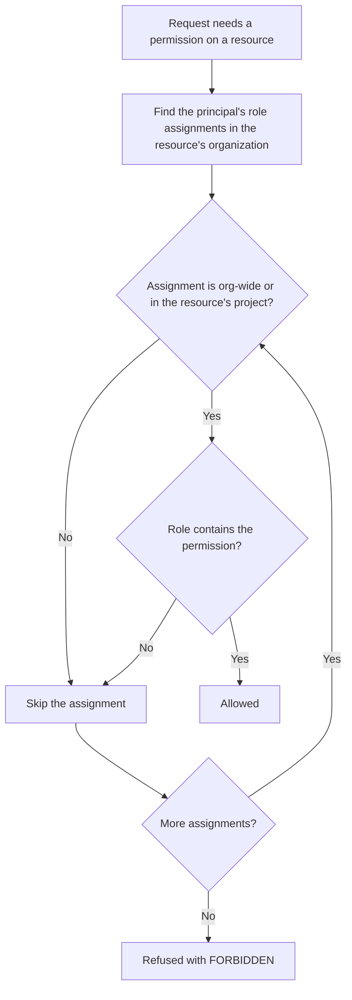

# Access model

Access in Origin Cloud is granted by role assignments. A role assignment gives one principal one built-in role, either across the whole organization or for a single project. Every request is allowed only if one of the caller's assignments covers the resource and carries the permission the request needs.

## Principals

A principal is whoever or whatever is granted access: a user, a service account, or a service agent of the platform. The `origin iam` commands and the REST API call it a member and write a user by email; the GraphQL API writes a user by ID.

| Principal | CLI and REST API | GraphQL API |
|---|---|---|
| User | `user:<email>`, the verified email address of the user's account | `user:<user-id>` |
| Service account | `serviceAccount:<service-account-id>` | `service_account:<service-account-id>` |
| Service agent | `serviceAgent:<name>`, such as `serviceAgent:compute` | `serviceAgent:<name>` |

A binding made for an email address holds on to the account, not the address: it follows a later change of address and is always shown with the account's current one. A user whose address isn't verified is shown as `userId:<user-id>`, and one whose account is gone as `deleted:user:<user-id>`. Your own user ID and member are in [`origin iam get-user --user me`](reference/cli.md#get-user); a service account's ID is in its resource name, from [`list-service-accounts`](reference/cli.md#list-service-accounts).

Both IDs are UUIDs. A user ID belongs to the person's account and is the same in every organization they're a member of.

A service agent is the identity one of the platform's own services acts as in your organization. It's the platform's, not your organization's: you can bind it a role its service needs, or remove that binding, but nobody outside the platform can act as it. See [Service agents](service-agents.md).

## Roles

A role is a named, fixed set of permissions. Every role is built in: you can assign and revoke them, but you can't create, change or delete a role. Each role has a short ID such as `roles/owner` or `roles/iam/editor`. The `origin iam` commands and the REST API name a role with the slashes after `roles/` written as dots, such as `roles/iam.editor`; the GraphQL API takes its URN, such as `urn:origin:cloud:iam::::builtin/role/roles/iam/editor`. The [`list-roles`](reference/cli.md#list-roles) command shows every role with its permissions. For the full catalog, see [Built-in roles](roles.md).

## Permissions

A permission allows one action on one kind of resource. Its key has three dotted parts: the service, the resource type and the action, for example `network.vpc.list` or `iam.member.create`. Each API operation requires exactly one permission. When a request is refused, the error names the permission it needed:

```text
Insufficient permissions. This operation requires permission `iam.member.create` on `org/<org-id>`
```

The [`list-permissions`](reference/cli.md#list-permissions) command lists every permission the platform defines.

## Role assignments and scopes

A role assignment links a principal, a role and a scope. The scope is either the whole organization or one project in it. The `origin iam` commands and the REST API call an assignment a role binding.

**Org-wide**  
The role applies to the organization itself and to every resource in every project of the organization, including projects created later.

**Project scope**  
The role applies only to resources inside that one project. It doesn't apply to the organization itself.

All IAM operations, such as inviting members, assigning roles and creating service accounts, act on the organization. A project-scoped assignment therefore never allows them, even for `roles/owner`. To let someone manage access, assign the role org-wide. The billing roles must always be assigned org-wide; see [Billing access](../platform/billing/billing-access.md).

Whoever creates an organization receives `roles/owner` and `roles/billing/administrator` org-wide, and compute's service agent receives `roles/kms/grant-delegate` org-wide ([Service agents](service-agents.md)). Anyone else holds only the roles you assign to them.

## Who can assign a role

Assigning and revoking roles needs `iam.role.assign` or `iam.role.revoke` on the organization. On top of that, you can only assign or revoke a role whose permissions you hold yourself at the scope of the grant. For an org-wide grant, your org-wide assignments count. For a project-scoped grant, your org-wide assignments and your assignments in that project count. Nobody can use role management to gain access they don't already have.

This applies to every path that changes a grant:

- [Assigning and revoking a role](assign-roles.md).
- [Inviting a member](manage-members.md): you can only invite with a role you could assign. A pending invite is checked again when it's applied. If the person who sent it can no longer assign the role by then, the invite is dropped.
- [Removing a member](manage-members.md#remove-a-member): you must be able to revoke every role the member holds.

A request that would go beyond your own permissions is refused with [`FORBIDDEN`](../platform/reference/errors.md#forbidden). The error names the role and some of the permissions you lack. For example, Owner holds no billing permission, so an Owner can assign a billing role only if it also holds `roles/billing/administrator`. An IAM Editor can't assign Owner.

## How a request is authorized

The following diagram shows how the platform decides whether to allow a request.



Permissions only add up. There are no deny rules, so holding a role never takes access away. The check runs on every request, so assigning or revoking a role takes effect on the principal's next request. A refused request fails with the [`FORBIDDEN`](../platform/reference/errors.md#forbidden) error.

## Repeated assignments and revocations

In the `origin iam` commands and the REST API, binding a role that the member already holds at the same scope is refused with [`CONFLICT`](../platform/reference/errors.md#conflict), and a binding is revoked by deleting it by its ID, so it can't miss the scope. A retry with the same request ID within a day answers as the first request did.

In the GraphQL API, assigning and revoking are idempotent. Assigning a role that the principal already holds at the same scope, with the same role URN, succeeds and changes nothing. Revoking a role that the principal doesn't hold at that scope also succeeds and changes nothing.

A GraphQL revocation matches the role URN and the scope exactly. An org-wide grant needs an org-wide revoke, and a project-scoped grant needs the same project. Use the role URN as it appears in the principal's grants, because a grant created together with the organization carries the organization ID inside its URN. For the steps, see [Assign and revoke roles](assign-roles.md).

## The last owner is protected

An organization always keeps at least one principal with an org-wide `roles/owner` assignment. The platform refuses with [`CONFLICT`](../platform/reference/errors.md#conflict) any revocation or member removal that would take the last org-wide owner away, including your own. A project-scoped owner doesn't count. To hand over ownership, assign `roles/owner` org-wide to the new owner first, then revoke the old grant.

## Related

- [Built-in roles](roles.md)
- [Assign and revoke roles](assign-roles.md)
- [Check access](check-access.md)
- [Organizations and projects](../platform/organizations/index.md)
