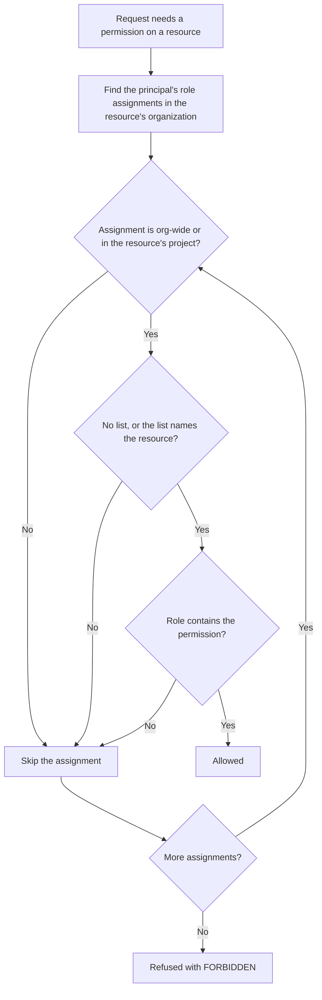

# Access model

Access in Origin Cloud is granted by role assignments. A role assignment gives one principal one built-in role, either across the whole organization or for a single project. Every request is allowed only if one of the caller's assignments covers the resource and carries the permission the request needs.

## Principals

A principal is whoever or whatever is granted access: a user, a service account, or a service agent of the platform. The `origin iam` commands and the REST API call it a member, and take and show it by its full name only.

| Principal | Full name |
|---|---|
| User | `//iam.origincloudapis.eu/users/<user-id>` |
| Service account | `//iam.origincloudapis.eu/organizations/<org-id>/serviceAccounts/<service-account-id>` |
| Service agent | `//iam.origincloudapis.eu/serviceAgents/<name>`, such as `//iam.origincloudapis.eu/serviceAgents/compute` |

A user must have an enabled account, and a service account must be one of the organization's own: either is refused with `NOT_FOUND` otherwise. To bind someone you know by address, name them as `user:<email>`: the binding is made to the account that verified the address. An address no account has verified gets a [pending role binding](assign-roles.md#pending-role-bindings), which grants nothing until someone signs up with it. [`origin iam lookup-user`](reference/cli.md#lookup-user) answers the full name behind an address without granting anything.

A binding holds on to the account, not to an address, so it follows a later change of address. Your own full name is the `member` of [`origin iam get-user --user me`](reference/cli.md#get-user), and a service account's is the `member` of [`get-service-account`](reference/cli.md#get-service-account).

Both IDs are UUIDs. A user ID belongs to the person's account and is the same in every organization they're a member of.

A service agent is the identity one of the platform's own services acts as in your organization. It's the platform's, not your organization's: you can bind it a role its service needs, or remove that binding, but nobody outside the platform can act as it. See [Service agents](service-agents.md).

## Roles

A role is a named, fixed set of permissions. Every role is built in: you can assign and revoke them, but you can't create, change or delete a role. Each role has a short ID such as `roles/owner` or `roles/iam.editor`. `origin iam get-role` and the REST API's `GetRole` take a role by its ID; a role binding's `role`, in the CLI and the REST API, takes its full name, such as `//iam.origincloudapis.eu/roles/iam.editor`. The [`list-roles`](reference/cli.md#list-roles) command shows every role with its permissions. For the full catalog, see [Built-in roles](roles.md).

## Permissions

A permission allows one action on one kind of resource. Its key has three dotted parts: the service, the resource type and the action, for example `network.vpc.list` or `iam.member.create`. Each API operation requires exactly one permission. When a request is refused, the error names the permission it needed:

```text
Insufficient permissions. This operation requires permission `iam.member.create` on `org/<org-id>`
```

The [`list-permissions`](reference/cli.md#list-permissions) command lists every permission the platform defines.

## Role assignments and scopes

A role assignment links a principal, a role and a scope. The scope is the whole organization, one project in it, or one of its service accounts. The `origin iam` commands and the REST API call an assignment a role binding.

**Org-wide**  
The role applies to the organization itself and to every resource in every project of the organization, including projects created later.

**Project scope**  
The role applies only to resources inside that one project. It doesn't apply to the organization itself.

**Service account scope**  
The role applies only to that one service account, and to nothing on the organization or its projects. Only [`roles/iam.service-account-token-creator`](roles.md#rolesiamservice-account-token-creator) can be bound so, to let its holder impersonate that account alone. A binding on a service account is removed when the account is revoked.

### Bindings limited to a list of resources

An org-wide or project-scoped binding can be limited further, to a list of up to 100 resources inside its scope, named by their full names. Such a binding grants its role on the listed resources only. It grants nothing on the rest of its scope, and nothing on the organization or the project itself, so it never allows listing or creating resources there. A binding with no list covers its whole scope, as described above.

A binding can list only the kinds of resource a service offers per-resource access for. The one kind so far is a Secret Manager secret, `//secretmanager.origincloudapis.eu/projects/<project-id>/regions/<region>/secrets/<secret>`, and a binding listing anything else is refused with [`BAD_REQUEST`](../platform/reference/errors.md#bad_request). Secret Manager itself isn't offered yet, so such a binding grants nothing until it is. A binding listing a secret grants only the permissions that act on one secret: reading, changing, deleting and restoring it, and everything on its versions. Creating and listing secrets need a binding on the project.

How the scopes nest:

| A binding on | Grants on |
|---|---|
| The organization, no list | The organization, and every resource in every project |
| The organization, with a list | The listed resources, in any of its projects |
| A project, no list | Every resource in that project |
| A project, with a list | The listed resources of that project |
| A service account | That account alone |

A list names resources, not resource objects. Deleting a listed resource keeps the binding and its list, and a resource created later under the same name is covered by the binding again. To stop granting on a name, remove it from the binding's list with `origin iam update-role-binding` or `UpdateRoleBinding` ([Add or remove a resource from a binding](assign-roles.md#add-or-remove-a-resource-from-a-binding)), or delete the binding.

A member can hold the same role at the same scope in one binding only for now, with or without a list: a second one is refused with [`CONFLICT`](../platform/reference/errors.md#conflict) naming the binding the member holds. Delete that binding to replace it. A [pending role binding](assign-roles.md#pending-role-bindings) for an address whose account then holds the role org-wide with a list is used up when it would activate, and grants nothing more; the [audit log](audit-log.md) records the activation as failed.

All IAM operations, such as inviting members, assigning roles and creating service accounts, act on the organization. A project-scoped assignment therefore never allows them, even for `roles/owner`. To let someone manage access, assign the role org-wide. The billing roles must always be assigned org-wide; see [Billing access](../platform/billing/billing-access.md).

Whoever creates an organization receives `roles/owner` and `roles/billing.administrator` org-wide, compute's service agent receives `roles/kms.grant-delegate` org-wide, storage's service agent `roles/kms.grant-issuer` and `roles/kms.volume-keys-agent` org-wide, and Secret Manager's service agent `roles/kms.secret-keys-agent` org-wide ([Service agents](service-agents.md)). Anyone else holds only the roles you assign to them.

## Who can assign a role

Assigning and revoking roles needs `iam.role.assign` or `iam.role.revoke` on the organization. On top of that, you can only assign or revoke a role whose permissions you hold yourself at the scope of the grant. For an org-wide grant, your org-wide assignments count. For a project-scoped grant, your org-wide assignments and your assignments in that project count. For a grant on one service account, your org-wide assignments and your assignments on that account count. For a grant with a list of resources, your assignments that cover every listed resource count, including one with a list holding all of them; an assignment with a list never counts toward a grant without one. Changing a binding's list needs `iam.role.assign`, and the role's permissions on every resource of both the new and the old list, counted the same way. Nobody can use role management to gain access they don't already have.

This applies to every path that changes a grant:

- [Assigning and revoking a role](assign-roles.md).
- [Granting a role to an email address](manage-members.md#add-a-member) that has no account yet: you can only grant a role you could assign, and it also needs `iam.member.create`. The pending binding is checked again when it activates. If the person who created it can no longer assign the role by then, it's dropped.
- [Removing a member](manage-members.md#remove-a-member): you must be able to revoke every role the member holds.

A request that would go beyond your own permissions is refused with [`FORBIDDEN`](../platform/reference/errors.md#forbidden). The error names the role and some of the permissions you lack. For example, Owner holds no billing permission, so an Owner can assign a billing role only if it also holds `roles/billing.administrator`. An IAM Editor can't assign Owner.

## How a request is authorized

The following diagram shows how the platform decides whether to allow a request.



Permissions only add up. There are no deny rules, so holding a role never takes access away. The check runs on every request, so assigning or revoking a role takes effect within seconds: each zone answers from its own copy of the role bindings, which follows a change a moment after it is made. A refused request fails with the [`FORBIDDEN`](../platform/reference/errors.md#forbidden) error.

## Repeated assignments and revocations

In the `origin iam` commands and the REST API, binding a role that the member already holds at the same scope, with or without a list of resources, is refused with [`CONFLICT`](../platform/reference/errors.md#conflict), and a binding is revoked by deleting it by its ID, so it can't miss the scope. A retry with the same request ID within a day answers as the first request did.

Deleting a binding removes exactly that binding: an org-wide grant needs its own delete, and a project-scoped grant its own. For the steps, see [Assign and revoke roles](assign-roles.md).

## The last owner is protected

An organization always keeps at least one principal with an org-wide `roles/owner` assignment. The platform refuses with [`CONFLICT`](../platform/reference/errors.md#conflict) any revocation or member removal that would take the last org-wide owner away, including your own. A project-scoped owner doesn't count. To hand over ownership, assign `roles/owner` org-wide to the new owner first, then revoke the old grant.

## Related

- [Built-in roles](roles.md)
- [Assign and revoke roles](assign-roles.md)
- [Check access](check-access.md)
- [Organizations and projects](../platform/organizations/index.md)
