# Assign and revoke roles

Assign a role to give a user or service account access, and revoke it to take that access away. In the `origin iam` commands and the REST API, each assignment is a role binding: one role for one member, org-wide or in one project. A change takes effect within seconds. You can name a user by their email address: if they have no Origin Cloud account yet, the binding waits for them as a [pending role binding](#pending-role-bindings) and the platform emails them an invitation.

## Before you begin

- An org-wide `roles/owner` or `roles/iam.editor` assignment, and every permission of the role you assign or revoke at the scope of the binding. For example, an Owner needs `roles/billing.administrator` as well to assign a billing role. See [Who can assign a role](access-model.md#who-can-assign-a-role).
- Your organization ID (`<org-id>`) and, for a project-scoped binding, the project ID (`<project-id>`).
- The member, one of:
  - A user by email address, `user:<email>`, such as `user:jane@example.com`. If one enabled account has verified the address, the binding is made to that account. If none has, the binding is pending until someone signs up with the address; see [Pending role bindings](#pending-role-bindings).
  - A member by its full name: a user, `//iam.origincloudapis.eu/users/<user-id>`, one of the organization's service accounts, `//iam.origincloudapis.eu/organizations/<org-id>/serviceAccounts/<service-account-id>`, or a platform service agent such as `//iam.origincloudapis.eu/serviceAgents/compute`, which can hold only the roles its service needs.

  To find a user's full name by their verified address without granting anything, run `origin iam lookup-user --email jane@example.com --organization //resourcemanager.origincloudapis.eu/organizations/<org-id>`. See [Principals](access-model.md#principals) and [Service agents](service-agents.md).

## Assign a role

1. Find the role's name, such as `roles/iam.editor` for IAM Editor; a binding takes its full name, `//iam.origincloudapis.eu/roles/iam.editor`. The command lists every built-in role with its permissions.

   ```sh
   origin iam list-roles
   ```

   For the permissions of each role, see [Built-in roles](roles.md).

2. Bind the role to the member. Omit `--project` for an org-wide binding.

   ```sh
   origin iam create-role-binding --organization <org-id> \
     --member //iam.origincloudapis.eu/users/<user-id> \
     --role //iam.origincloudapis.eu/roles/viewer
   ```

   To name a user by email address, pass `--member user:jane@example.com`. The answer's `member` is the user's full name when the address has an account, and `user:jane@example.com` with `state` `PENDING` when it has none.

   To limit the binding to one project, add `--project //resourcemanager.origincloudapis.eu/projects/<project-id>`. A project-scoped binding applies only to resources in that project; it never allows IAM operations. See [Role assignments and scopes](access-model.md#role-assignments-and-scopes). To let someone impersonate one service account alone, bind `roles/iam.service-account-token-creator` with `--service-account` and the account's full name instead; see [Grant impersonation of one service account](service-accounts.md#grant-impersonation-of-one-service-account). To limit the binding to some resources of its organization or project, add `--resource` with each one's full name; see [Limit a binding to a list of resources](#limit-a-binding-to-a-list-of-resources).

3. Verify the binding. The output lists the member's bindings, each with its role and project.

   ```sh
   origin iam list-role-bindings --organization <org-id> --member //iam.origincloudapis.eu/users/<user-id>
   ```

The platform refuses the binding, and changes nothing, in these cases:

- The user has no enabled account, or the service account is another organization's: [`NOT_FOUND`](../platform/reference/errors.md#not_found).
- The member, role or project isn't a full name or, for the member, `user:<email>`, such as `roles/viewer` or a bare `jane@example.com`: [`BAD_REQUEST`](../platform/reference/errors.md#bad_request).
- More than one account has verified the address: [`CONFLICT`](../platform/reference/errors.md#conflict). Bind the user by their full name instead.
- The member already holds the role at that scope, with or without a list of resources: [`CONFLICT`](../platform/reference/errors.md#conflict), naming the binding they hold. A retry of the command with the same `--request-id` within a day returns the binding the first one created instead.
- The role has permissions you don't hold yourself at that scope: [`FORBIDDEN`](../platform/reference/errors.md#forbidden).
- The member is a deleted service account: [`BAD_REQUEST`](../platform/reference/errors.md#bad_request).

## Revoke a role

1. Find the binding's ID in the member's bindings.

   ```sh
   origin iam list-role-bindings --organization <org-id> --member //iam.origincloudapis.eu/users/<user-id>
   ```

2. Delete the binding. Deleting can't be undone, so the command needs `--yes`.

   ```sh
   origin iam delete-role-binding --organization <org-id> \
     --role-binding <role-binding-id> --yes
   ```

3. Optionally, run `list-role-bindings` again to check that the binding is gone.

Deleting a pending binding withdraws the invitation; see [Pending role bindings](#pending-role-bindings). Deleting a binding removes that one binding only, whoever created it: another binding of the same role at another scope stays. Deleting a binding needs `iam.role.revoke` on the organization and every permission of its role at its scope, so a binding of a role with permissions you don't hold yourself is refused with [`FORBIDDEN`](../platform/reference/errors.md#forbidden).

If the binding is the organization's last org-wide `roles/owner` binding, the platform refuses with [`CONFLICT`](../platform/reference/errors.md#conflict) and removes nothing. Bind `roles/owner` org-wide to someone else first. See [The last owner is protected](access-model.md#the-last-owner-is-protected).

To take away every role a member holds in the organization, delete each of their bindings, or [remove the member](manage-members.md#remove-a-member) in the console.

## Pending role bindings

A role granted to an email address that has no account yet is a pending role binding. You create one with `create-role-binding --member user:<email>` when no enabled account has verified the address. The platform then emails the address an invitation to sign up. Delivery is best effort: a bounced or delayed email doesn't affect the binding.

```sh
origin iam create-role-binding --organization <org-id> \
  --member user:jane@example.com \
  --role //iam.origincloudapis.eu/roles/viewer
```

`list-role-bindings` and the REST API show a pending binding with `state` `PENDING` and the address as its member, `user:<email>`, as you typed it. An active binding has `state` `ACTIVE`.

A pending binding grants nothing and counts toward no permission check. It is always org-wide. When someone signs up with its address and verifies it, and then signs in with a client that calls `ActivatePendingRoleBindings`, such as the console, it becomes active: its member becomes the new user's full name, and its name stays the same. A person can also call [`ActivatePendingRoleBindings`](reference/index.md#rest-api) themselves with `POST /v1beta1/users/me:activatePendingRoleBindings`; an address their account hasn't verified activates nothing. It activates only while whoever created it can still assign the role; otherwise it's dropped.

```mermaid
stateDiagram-v2
    accTitle: Lifecycle of a role binding
    accDescr: A pending binding becomes active when the person verifies its address and signs in, or ends when withdrawn or dropped; an active binding ends when deleted.
    [*] --> PENDING: create-role-binding user:<email>, no account has the address
    PENDING --> ACTIVE: the person verifies the address and signs in with a client that activates it
    PENDING --> [*]: deleted (withdrawn), or creator can no longer assign the role
    ACTIVE --> [*]: deleted (revoked)
```



Creating a pending binding needs, besides what any binding needs, `iam.member.create` on the organization, which `roles/owner` has and `roles/iam.editor` doesn't. So an IAM Editor can bind people who already have an account by their address, but can't make the platform email an address that has none. The platform also refuses a pending binding, and changes nothing, in these cases:

- `--project` or a list of resources is set: [`BAD_REQUEST`](../platform/reference/errors.md#bad_request). Bind the role org-wide, or ask the person to sign up first.
- The address already holds a pending binding of the role in the organization, in any spelling: [`CONFLICT`](../platform/reference/errors.md#conflict).

A retry with the same `--request-id` within a day returns the binding the first request created, pending or since activated.

To withdraw a pending binding, delete it as in [Revoke a role](#revoke-a-role). A sign-in with its address afterwards grants nothing. Withdrawing needs the same permissions as deleting an active binding: `iam.role.revoke` and every permission of its role on the organization.

In the REST API, `ListRoleBindings` lists the pending bindings for one address when its `member` filter is `user:<email>`, matched without regard to case:

```sh
curl -H "Authorization: Bearer $TOKEN" \
  "https://iam.origincloudapis.eu/v1beta1/organizations/<org-id>/roleBindings?member=user:jane@example.com"
```

## Using the API

In the REST API, these are `CreateRoleBinding` and `DeleteRoleBinding`, and `UpdateRoleBinding` changes a binding's list of resources; see the [IAM reference](reference/index.md#rest-api). A grant takes the `member`, the `role` and, for a grant on one project, the `project`, as full names. Omit `project` for an org-wide grant.

```sh
curl -X POST -H "Authorization: Bearer $TOKEN" -H "Content-Type: application/json" \
  https://iam.origincloudapis.eu/v1beta1/organizations/<org-id>/roleBindings \
  -d '{"member": "//iam.origincloudapis.eu/users/<user-id>", "role": "//iam.origincloudapis.eu/roles/iam.editor"}'
```

### Limit a binding to a list of resources

`CreateRoleBinding` takes `resources`, the full names of the resources inside the binding's organization or project the role applies to; see [Bindings limited to a list of resources](access-model.md#bindings-limited-to-a-list-of-resources). In the `origin iam` commands, `create-role-binding` takes it as `--resource`, once for each resource.

> **Not yet available for any kind of resource.** Only the kinds of resource a service offers per-resource access for can be listed; until one does, a list is refused with `BAD_REQUEST`.

```sh
origin iam create-role-binding --organization <org-id> \
  --member //iam.origincloudapis.eu/users/<user-id> \
  --role //iam.origincloudapis.eu/roles/<role> \
  --project //resourcemanager.origincloudapis.eu/projects/<project-id> \
  --resource <full name of a resource in the project> \
  --resource <full name of another resource in the project>
```

```sh
curl -X POST -H "Authorization: Bearer $TOKEN" -H "Content-Type: application/json" \
  https://iam.origincloudapis.eu/v1beta1/organizations/<org-id>/roleBindings \
  -d '{"member": "//iam.origincloudapis.eu/users/<user-id>",
       "role": "//iam.origincloudapis.eu/roles/<role>",
       "project": "//resourcemanager.origincloudapis.eu/projects/<project-id>",
       "resources": ["<full name of a resource in the project>"]}'
```

`GetRoleBinding` and `ListRoleBindings` return `resources` in name order, and empty for a binding on its whole scope; the table of `list-role-bindings` shows them by their IDs, in its `RESOURCES` column. To change the list, see [Add or remove a resource from a binding](#add-or-remove-a-resource-from-a-binding). Besides the refusals above, the platform refuses a list with [`BAD_REQUEST`](../platform/reference/errors.md#bad_request) on the field `roleBinding.resources`, naming the entry, when an entry isn't a full name, is of a kind that can't be listed, is outside the binding's organization or project, or is listed twice; when the list has more than 100 entries or is set together with `serviceAccount` (the CLI refuses `--resource` with `--service-account` before sending anything); and when none of the role's permissions applies to a listed kind of resource. You need every permission of the role on each listed resource; see [Who can assign a role](access-model.md#who-can-assign-a-role).

To see who has access to one resource, filter `ListRoleBindings` by its full name. The answer holds the bindings that list it and those without a list on its organization or project, which cover it as a whole:

```sh
origin iam list-role-bindings --organization <org-id> --resource <full name of the resource>
```

```sh
curl -G -H "Authorization: Bearer $TOKEN" \
  "https://iam.origincloudapis.eu/v1beta1/organizations/<org-id>/roleBindings" \
  --data-urlencode "resource=<full name of the resource>"
```

The audit log's `iam.role.assign` and `iam.role.revoke` entries of a binding with a list hold its `resources`.

### Add or remove a resource from a binding

`UpdateRoleBinding` replaces a binding's list of resources with a new one, for example to give an application's binding one more secret. Send the whole new list, and set `updateMask` to `resources`, the only field of a binding that can change. The member, the role and the scope stay as they are; to change one of them, create another binding and delete this one.

With the CLI, `update-role-binding` sends the mask for you. Give `--resource` once for each resource of the new list, the ones you keep as well as the ones you add:

```sh
origin iam update-role-binding --organization <org-id> --role-binding <role-binding-id> \
  --resource <full name of a resource kept> \
  --resource <full name of a resource added>
```

`--no-resources` instead sends an empty list. The command needs one of the two, and refuses both together.

```sh
curl -X PATCH -H "Authorization: Bearer $TOKEN" -H "Content-Type: application/json" \
  "https://iam.origincloudapis.eu/v1beta1/organizations/<org-id>/roleBindings/<binding-id>?updateMask=resources" \
  -d '{"resources": ["<full name of a resource kept>", "<full name of a resource added>"]}'
```

The answer is the binding with its new list. The new list replaces the old one at once: the member keeps the role on every resource in both lists while the change applies, gains it on the resources added and loses it on those left out. Deleting the binding and creating another would instead leave a moment with no access at all. An empty list, `--no-resources` or `"resources": []`, widens the binding to its whole organization or project.

The new list is checked as on create, and refused with [`BAD_REQUEST`](../platform/reference/errors.md#bad_request) on `roleBinding.resources` for the same entries. The platform also refuses with `BAD_REQUEST`:

- an `updateMask` that is missing or names anything but `resources`, `*` included, on the field `updateMask`;
- a [pending role binding](#pending-role-bindings), on the field `roleBinding.name`: it covers the whole organization until its address signs up.

An unknown binding is [`NOT_FOUND`](../platform/reference/errors.md#not_found). Changing a list needs `iam.role.assign` on the organization, and every permission of the role on each resource of both the new and the old list, as creating the new binding and deleting the old one would; see [Who can assign a role](access-model.md#who-can-assign-a-role). A retry with the same `requestId` within a day answers with the binding as it is then, and changes nothing.

Each change is recorded in the [audit log](audit-log.md) as `iam.role_binding.update`, naming the resources added and removed. Sending the list the binding already has changes nothing and records nothing.

## Related

- [Access model](access-model.md)
- [Built-in roles](roles.md)
- [`create-role-binding`](reference/cli.md#create-role-binding), [`update-role-binding`](reference/cli.md#update-role-binding) and [`delete-role-binding`](reference/cli.md#delete-role-binding) commands
- [Audit log](audit-log.md) – every assignment, change of a list and revocation is recorded
