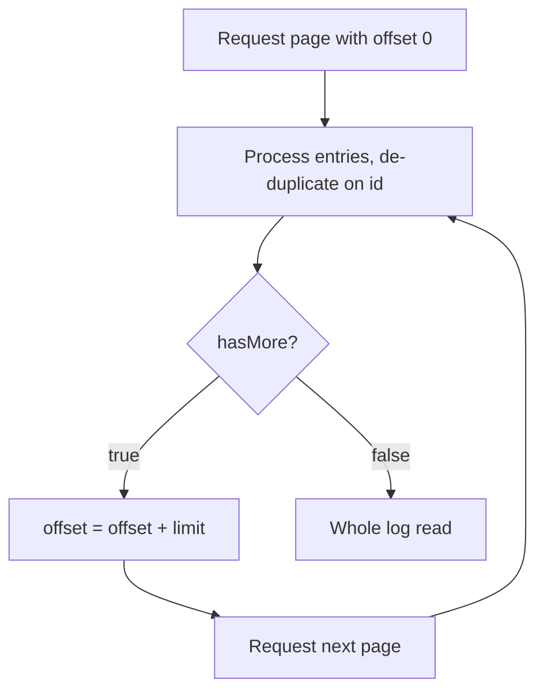

# Audit log

The audit log records changes to access in your organization: who did what, to whom, and when. Entries can't be changed or deleted through the API. You read the log with the `auditLogEntries` GraphQL query; the CLI has no command for it.

## What's recorded

The audit log records these twelve actions. Each one is recorded when the change succeeds.

| Action | Recorded when | Target |
|---|---|---|
| `iam.role.assign` | A role is assigned, including when an invite grants a role to an existing account | The principal |
| `iam.role.revoke` | A role is revoked, including when its organization is deleted | The principal |
| `iam.member.remove` | A member is removed, or a revoked service account's role assignments are removed (one entry in each organization it held roles in) | The principal |
| `iam.org_invite.create` | A pending invite is stored for an email address without an account | The email address |
| `iam.org_invite.revoke` | A pending invite is canceled, or deleted with its organization | The invite ID |
| `iam.service_account.create` | A service account is created | The service account's principal |
| `iam.service_account.revoke` | A service account is revoked | The service account's principal |
| `iam.federated_credential.create` | A federated credential is created on a service account | The federated credential's name; `details` holds its issuer, audience, conditions and service account |
| `iam.federated_credential.delete` | A federated credential is deleted | The federated credential's name; `details` names its service account |
| `iam.federated_credential.exchange` | A CI job's OIDC token is exchanged for the service account's access token through a federated credential; the actor is the service account | The federated credential's name; `details` holds the job token's issuer and subject, the run's claims (`run`), and the access token's id and expiry |
| `compute.instance.service_account.attach` | An instance is launched as a service account, or updated to run as one (replacing one records a detach, then an attach) | The instance's URN; `details` names the service account |
| `compute.instance.service_account.detach` | An instance's service account is removed or replaced | The instance's URN; `details` names the service account |

The audit log doesn't record organization or project lifecycle changes, other resource changes such as launching an instance without a service account, or refused requests. Writing an entry never blocks the change itself: if an entry can't be written, the change still takes effect, so in rare cases an action is missing from the log. The two `compute.instance.service_account` actions are recorded with the change itself and reach the log within seconds; a change that is refused records nothing. An exchange through a federated credential is the other way round: no access token is issued unless its entry is written, and it reaches the log within seconds.

## Entry fields

Each entry has these fields.

| Field | Description |
|---|---|
| `id` | Unique ID of the entry. |
| `orgId` | The organization the action happened in. |
| `projectId` | The project, for a project-scoped role assignment or revocation. Otherwise `null`. |
| `actor` | The principal that performed the action. |
| `action` | The action key from the table above. |
| `target` | What the action was applied to, as listed in the table above. |
| `outcome` | `SUCCESS` for every recorded action. |
| `occurredAt` | When the action happened, as an RFC 3339 timestamp. |
| `details` | Action-specific context as a JSON string, for example the role URN that was assigned. For a user actor or target, it also holds the verified email address the account had when the change was made, as `actor_verified_email` and `target_verified_email`, when one was verified. |

## Who can read it

Reading the audit log requires the `iam.audit_log.list` permission on the organization. Both `roles/owner` and `roles/viewer` include it, assigned org-wide. See [Built-in roles](roles.md).

## Paging through the log

`auditLogEntries` returns one page of entries, newest first, with a stable order for entries recorded at the same moment. You can read the whole organization's log, or narrow it to the entries of one project with `projectId`. Only project-scoped role assignments and revocations carry a project, so a narrowed query leaves out every other action.

The page tells you where you are:

- `entries` – the entries on this page.
- `total` – how many entries match your query across all pages.
- `offset` and `limit` – the window you were actually served.
- `hasMore` – `true` while entries remain beyond this page. When it's `false`, you've read to the end.

`limit` defaults to 100 and is capped at 500. If you ask for more than 500, you get 500, and the `limit` in the response says so. The cap applies to one page only; every entry is reachable by paging. To get the next page, add the served `limit` to `offset` and repeat while `hasMore` is `true`.

The following diagram shows the paging loop.



> **Note:** The log is written while you read it. If new entries are recorded while you page through, they're added at the front and shift older entries back, so an entry can appear on two consecutive pages. No entry is skipped. De-duplicate on `id` if you need each entry exactly once.

```graphql
query {
  iam {
    auditLogEntries(input: { orgId: "<org-id>", offset: 0, limit: 100 }) {
      entries {
        id
        actor
        action
        target
        outcome
        occurredAt
        details
      }
      total
      offset
      limit
      hasMore
    }
  }
}
```

## In the REST API

The IAM REST API serves the audit log too, as a preview (`v1beta1`) that may still change (see [IAM reference](reference/index.md#rest-api)). `GET /v1beta1/organizations/<org-id>/auditLogEntries` lists the entries newest first, a page at a time with `pageSize` and `pageToken`, and narrows them by `project`, `actor` or `action`.

It differs from the GraphQL query in three ways:

- It serves a recent window of the log: 90 days by default, which the platform can set longer. Each response says where the window starts in `windowStartTime`, and an older entry is answered with `NOT_FOUND`. The GraphQL query serves the whole log.
- The actor and the target are written as members, as they were when the change was made: `user:<email>` with the verified address the account had then, `userId:<user-id>` when none was recorded, `serviceAccount:<id>`, or `platform` for a change the platform made itself. A later change of address doesn't change an entry.
- A role in `details` has its role name, such as `roles/iam.editor`, not its URN.

## Related

- [Assign and revoke roles](assign-roles.md)
- [Manage organization members](manage-members.md)
- [Use service accounts](service-accounts.md)
- [API access](../platform/access/api.md)
