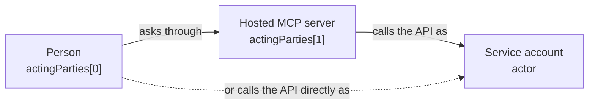
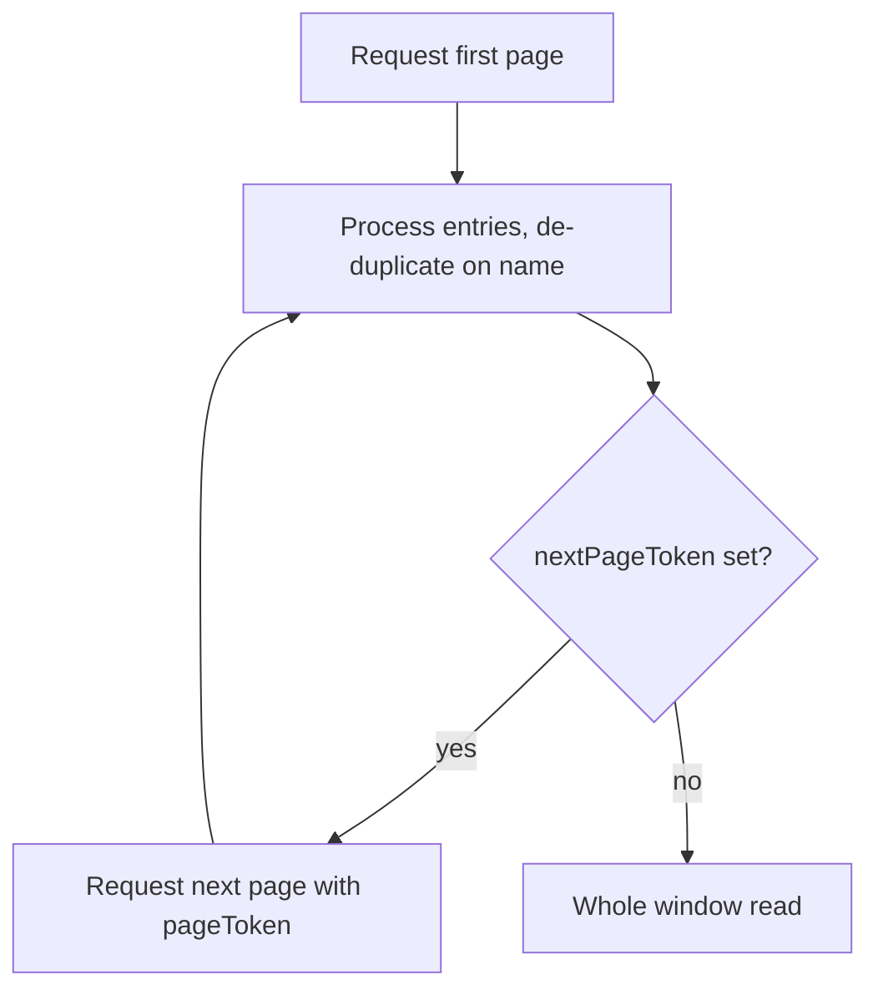

# Audit log

The audit log records changes to access in your organization, and the organization's and its projects' own lifecycle: who did what, to whom, and when. Entries can't be changed or deleted through the API. You read the log with the REST API's `ListAuditLogEntries` method; the CLI has no command for it.

## What's recorded

The audit log records these twenty-six actions. Each one is recorded when the change succeeds.

| Action | Recorded when | Target |
|---|---|---|
| `iam.role.assign` | A role is assigned, including when a role is granted to the email address of an existing account, and when a new organization binds a service agent (the platform is the actor) | The principal; for a binding limited to a list of resources, `details` holds its `resources` |
| `iam.role.revoke` | A role is revoked, including when its organization is deleted | The principal; for a binding limited to a list of resources, `details` holds its `resources` |
| `iam.member.remove` | A revoked service account's role assignments are removed (one entry in each organization it held roles in) | The principal |
| `iam.role_binding.create` | A pending role binding is created with `CreateRoleBinding` for an email address without an account | The email address; `details` holds the `role` and the `binding`'s full name |
| `iam.org_invite.create` | A pending role binding was created. Appears in older logs only; a pending binding is now recorded as `iam.role_binding.create` | The email address |
| `iam.org_invite.revoke` | A pending role binding is deleted with its organization; in older logs, also when one was withdrawn | Its internal ID, which is not the binding's ID |
| `iam.role_binding.activate` | A pending role binding becomes active when its address's verified account signs in with a client that activates pending bindings, such as the console, or calls `ActivatePendingRoleBindings`. The actor is whoever created the binding | The new user; `details` holds the `role` and the `binding`'s full name, `//iam.origincloudapis.eu/organizations/…/roleBindings/…`, which is the same as before it activated. An activation that grants nothing because the account already holds the role org-wide in a binding limited to a list of resources has outcome `FAILED`, and `details` names that binding as `held_in` |
| `iam.role_binding.update` | A role binding's list of resources is changed with `UpdateRoleBinding` in the REST API; not recorded when the new list is the old one | The binding's member; `details` holds the `role`, the `binding`'s full name, its new list as `resources` (empty for its whole scope), and the entries added and removed as `resources_added` and `resources_removed` |
| `iam.role_binding.withdraw` | A pending role binding is deleted with `DeleteRoleBinding` in the REST API | The email address; `details` holds the `role` and the `binding`'s full name |
| `iam.service_account.create` | A service account is created | The service account's principal |
| `iam.service_account.revoke` | A service account is revoked | The service account's principal |
| `iam.service_account_key.create` | A key is created for a service account | The key's full name, `//iam.origincloudapis.eu/organizations/…/serviceAccounts/…/keys/…`; `details` names its service account and algorithm |
| `iam.service_account_key.delete` | A key is deleted | The key's full name; `details` names its service account |
| `iam.service_account_key.exchange` | An assertion signed with a service account's key is exchanged at the security token service for the account's access token, or refused (outcome `FAILED`); the actor is the service account | The key's full name; `details` holds the assertion's `assertion_id` (its `jti`) and the access token's `token_id`, `audience` and `expires_at`, or for a refusal its `reason`: `key_not_found` (deleted, not the account's, or unknown a minute after it was first used), `signature`, `audience`, `expired`, `lifetime_too_long`, `lifetime`, `not_yet_valid`, `assertion_id`, `replayed` (its `jti` was used before), `account_not_found`, `account_revoked`, `not_external`, `subject_mismatch`, `algorithm` or `key_unreadable` |
| `iam.federated_credential.create` | A federated credential is created on a service account | The federated credential's name; `details` holds its issuer, audience, conditions and service account |
| `iam.federated_credential.delete` | A federated credential is deleted | The federated credential's name; `details` names its service account |
| `iam.federated_credential.exchange` | A CI job's OIDC token is exchanged for the service account's access token through a federated credential; the actor is the service account | The federated credential's name; `details` holds the job token's issuer and subject, the run's claims (`run`), and the access token's id, audience (`audience`) and expiry |
| `sts.token.exchange` | The hosted MCP server exchanges a service account's token for an API token that keeps the service account as the caller; the actor is the service account. A person's exchanges are recorded in the platform's own log, not in your organization's | The MCP server, by its workload's identity (`spiffe://…/workloads/mcp-server`); `details` holds the acting party (`acting_party`), the caller's full name (`subject`), the federated credential (`federated_credential`) or the service account key (`service_account_key`) the service account's token was issued for, and the API token's id, audience and expiry |
| `sts.token.impersonate` | A person impersonates a service account at the security token service, directly or through the hosted MCP server, and gets the account's access token, or is refused (outcome `FAILED`). The actor is the person, and the entry is in the service account's organization's log | The service account's full name, `//iam.origincloudapis.eu/organizations/…/serviceAccounts/…`; `actingParty` is the MCP server when the person asked through it. `details` holds the person (`impersonator`), their token's issuer, client and id (`subject_issuer`, `client`, `subject_token_id`), and the access token's `token_id`, `audience` and `expires_at`. For a refusal it holds the `reason`: `no_binding` (the person doesn't hold `iam.service_account.get_access_token` on the account, see [roles](roles.md)), `unknown_account` or `inactive_account` (the account is revoked) |
| `compute.instance.service_account.attach` | An instance is launched as a service account, or updated to run as one (replacing one records a detach, then an attach) | The instance's full name, `//compute.origincloudapis.eu/projects/…/zones/…/instances/…`; `details` names the service account |
| `compute.instance.service_account.detach` | An instance's service account is removed or replaced | The instance's full name; `details` names the service account |
| `resourcemanager.organization.create` | An organization is created | The organization's full name, `//resourcemanager.origincloudapis.eu/organizations/…`; `details` holds its `display_name` |
| `resourcemanager.organization.update` | An organization is renamed | The organization's full name; `details` holds the new `display_name` |
| `resourcemanager.organization.delete` | An organization is deleted, or a new one is removed again because its creator's roles couldn't be granted (`details` then holds the `reason`) | The organization's full name |
| `resourcemanager.project.create` | A project is created | The project's full name, `//resourcemanager.origincloudapis.eu/projects/…`; `details` holds its `display_name` |
| `resourcemanager.project.update` | A project is renamed | The project's full name; `details` holds the new `display_name` |
| `resourcemanager.project.delete` | A project is deleted, or a new one is removed again because its creator's role couldn't be granted (`details` then holds the `reason`) | The project's full name |

The KMS records every change to a key and every use of it but reading a public key, each answered only once its entry is written: `kms.keys.create`, `kms.keys.enable`, `kms.keys.disable`, `kms.keys.rotate`, `kms.keys.updateTags`, `kms.keys.scheduleDeletion`, `kms.keys.cancelDeletion`, `kms.keys.retireEncryptionContext` (the platform retiring an encryption context on a key it manages, named in `details.encryption_context`), `kms.keys.destroy` (the platform destroying a deleted key's material at its purge time, with the platform as the actor), `kms.keys.encrypt`, `kms.keys.decrypt`, `kms.keys.generateDataKey`, `kms.keys.sign`, and a key's grants: `kms.keys.createGrant`, `kms.keys.renewGrant` and `kms.keys.retireGrant`, whose `details.grant` names the grant, its host and when it expires. The target is the key's full name, `//kms.origincloudapis.eu/projects/…/keys/…`; `details` hold its `region`, the key `version` used or made, and the `encryption_context`, never a plaintext or a data key. An encrypt, decrypt, data key or sign the KMS refuses on one of your keys is recorded too, with outcome `FAILED` and the `reason` in `details`: `does_not_open` (the ciphertext doesn't decrypt under the key and that context), `key_not_enabled`, `version_unavailable` (the key version's material is destroyed), `context_retired` (the encryption context is retired on the key) or `invalid_request`. So is a grant the KMS refuses to make or renew, and a host's decryption under a grant it refuses: `no_live_grant`, `grantee_not_proven`, `grantee_not_enrolled` (the host the grant names isn't enrolled with the platform), `grant_expired`, `grant_limit_reached` (the key holds the most grants it may in the zone) or `grant_host_limit_reached` (the most it may for that host), besides the reasons above. A request naming a key that doesn't exist, or that isn't in the caller's project, is recorded against no key. See the [KMS guide](../kms/index.md).

The `resourcemanager.*` actions are recorded with the change itself and reach the log within seconds: a change that fails, or is refused for a reason other than a missing permission ([Denied attempts](#denied-attempts)), records nothing, and repeating a create with the same request ID records no second entry. An organization's log is kept after the organization is deleted, its `resourcemanager.organization.delete` entry included, but nobody holds a role in a deleted organization any more, so only the platform's operators can read it then.

The audit log doesn't record other resource changes such as launching an instance without a service account, or refused requests, except a change refused for lack of a permission ([Denied attempts](#denied-attempts)), a KMS key's refused uses, a service account key's refused exchanges and a refused impersonation of a service account. An assertion that names no key is recorded nowhere. Writing an entry never blocks the change itself: if an entry can't be written, the change still takes effect, so in rare cases an action is missing from the log. The two `compute.instance.service_account` actions are recorded with the change itself and reach the log within seconds; a change that is refused records nothing. An exchange through a federated credential or a service account key, and an impersonation, are the other way round: no access token is issued unless its entry is written, and it reaches the log within seconds. A refused key exchange or impersonation is answered whether or not its entry is written.

## Denied attempts

A request to change something that the caller holds no permission for is refused, and recorded with outcome `DENIED`, in any API: creating a VPC, assigning a role, deleting a volume. The entry is in the log of the organization the change was aimed at:

| Field | Value |
|---|---|
| `actor` | Who was refused. |
| `action` | The permission the change needed, such as `network.vpc.create` or `iam.role.assign`. See [Permissions](reference/index.md). |
| `target` | The resource the permission was checked on, by its full name: the project, such as `//resourcemanager.origincloudapis.eu/projects/<project-id>`, the organization, or the resource itself. |
| `project` | The project, when the target is in one. |
| `details` | `permission` and `target`, as above. |

Only changes are recorded. A refused read or listing isn't, nor is a question about permissions, such as `testIamPermissions`, whose answer is that a permission isn't held. A refusal aimed at no organization, such as a project that doesn't exist, has no log to be recorded in.

The same refusal again, by the same actor, of the same permission on the same target, within a minute of the one recorded is not recorded again, so a client retrying in a loop leaves one entry a minute. A denied attempt is recorded after the request is refused, within seconds, and in rare cases, such as a burst of refusals while the platform is under load, not at all. A denied entry has no `actingParty`.

## Entry fields

Each entry has these fields.

| Field | Description |
|---|---|
| `name` | The entry's name, `organizations/<org-id>/auditLogEntries/<entry-id>`. |
| `project` | The project's full name, for a project-scoped role assignment or revocation a `resourcemanager.project.*` action, or a denied attempt in a project. Otherwise `null`. The organization the action happened in is the one in `name`. |
| `actor` | Who performed the action, by full name: a principal such as `//iam.origincloudapis.eu/users/<user-id>`, or, for an action the platform took on its own account, the platform component that took it, such as `//iam.origincloudapis.eu/services/kms` for the KMS destroying a deleted key's material. |
| `action` | The action key from the table above, or for a denied attempt the permission it needed. |
| `target` | What the action was applied to, as listed in the table above. |
| `outcome` | `SUCCEEDED` for an action that was made; `DENIED` for a change refused because the actor lacks the permission ([Denied attempts](#denied-attempts)); `FAILED` for one that was attempted and refused for another reason, such as a KMS decrypt under the wrong encryption context, with the reason in `details`. |
| `occurTime` | When the action happened, as an RFC 3339 timestamp. |
| `actingParty` | Who acted for the actor: the first entry of `actingParties`. For a change the actor made through the [hosted MCP server](../platform/access/hosted-mcp.md), the MCP server, by its workload's identity (`spiffe://…/workloads/mcp-server`). For a change a person made as a service account by impersonating it, the person, by their full name (`//iam.origincloudapis.eu/users/…`), whether or not they asked through the MCP server. `null` for a change no one acted for. |
| `actingParties` | Everyone who acted for the actor, outermost first. For a change made through the MCP server, the MCP server alone. For a change a person made as a service account by impersonating it, the person, then the MCP server when they asked through it. Empty for a change no one acted for, and on an entry recorded before the audit log kept the whole list, which names `actingParty` alone. See [Changes made through the hosted MCP server](#changes-made-through-the-hosted-mcp-server) and [Changes made by impersonating a service account](#changes-made-by-impersonating-a-service-account). |
| `details` | Action-specific context, for example the role that was assigned, as `role`, by its public name such as `roles/viewer`. For a user actor or target, it also holds the verified email address the account had when the change was made, as `actor_verified_email` and `target_verified_email`, when one was verified. For a change made by a CI job, it also holds `federated` (see [Changes made by a CI job](#changes-made-by-a-ci-job)). |

## Changes made by a CI job

A CI job that signs in through a [federated credential](workload-identity-federation.md) acts as the credential's service account, so that service account is the `actor` of every change the job makes. To say which job made it, the entry of a change made with the access token the job exchanged its token for holds `federated` in `details`:

| Key | Description |
|---|---|
| `credential` | The federated credential's name. |
| `token_id` | The access token's ID. |

The `iam.federated_credential.exchange` entry with the same `token_id` holds the job token's subject and the run's claims, such as the repository, workflow and run ID, so together the two entries name the run that made the change. Entries that follow from a change rather than record it don't carry `federated`: a pending role binding's activation, and the revocations recorded when an organization is deleted. Neither does `iam.federated_credential.exchange` itself.

```json
{
  "role": "roles/viewer",
  "federated": {
    "credential": "organizations/<org-id>/serviceAccounts/<service-account-id>/federatedCredentials/<credential-id>",
    "token_id": "<token-id>"
  }
}
```

## Changes made through the hosted MCP server

When you, or a service account, make a change through the [hosted MCP server](../platform/access/hosted-mcp.md), the MCP server calls the API with a token that keeps you as the caller. The change is yours, so you are its `actor`. The entry also names the MCP server as `actingParty`, and as the only entry of `actingParties`, by its workload's identity (`spiffe://…/workloads/mcp-server`), so you can tell a change an AI assistant made for you from one you made yourself.

A change made without the MCP server, with the console, the CLI or the API directly, has no `actingParty` and an empty `actingParties`, and neither has an entry recorded before the audit log kept it. These entries name the acting party: the access changes recorded by IAM (the `iam.*` actions), an instance's service account attached or detached (`compute.instance.service_account.*`), an organization's or project's lifecycle (`resourcemanager.*`), and a KMS key's changes and uses (`kms.keys.*`), refused ones included. A command the platform refused because its sender may not send it names the acting party its caller asserted.

The MCP server's own exchange of a service account's token is recorded as `sts.token.exchange`, with the MCP server as its target.

## Changes made by impersonating a service account

A person who may impersonate a service account gets an access token from the security token service that acts as the account. That exchange is recorded as `sts.token.impersonate`, with the person as its actor. A change the person then makes with that token is the service account's: the account is its `actor`, and its roles decide what the change may do. The entry names who acted for the account in `actingParties`, outermost first:

- The person, by their full name (`//iam.origincloudapis.eu/users/<user-id>`).
- Then the hosted MCP server, by its workload's identity, when the person asked through it.

`actingParty` is the first of them, the person, so an entry of an impersonated change names the person in `actingParty` whether or not the MCP server was involved.



For example, a role a person assigns as a service account through the MCP server is recorded as:

```json
{
  "actor": "//iam.origincloudapis.eu/organizations/<org-id>/serviceAccounts/<service-account-id>",
  "action": "iam.role.assign",
  "actingParty": "//iam.origincloudapis.eu/users/<user-id>",
  "actingParties": [
    "//iam.origincloudapis.eu/users/<user-id>",
    "spiffe://…/workloads/mcp-server"
  ]
}
```

The entries that name the acting party name the whole list: the `iam.*` actions, `compute.instance.service_account.*`, `resourcemanager.*` and `kms.keys.*`.

## Who can read it

Reading the audit log requires the `iam.audit_log.list` permission on the organization. Both `roles/owner` and `roles/viewer` include it, assigned org-wide. See [Built-in roles](roles.md).

## Paging through the log

`ListAuditLogEntries`, `GET /v1beta1/organizations/<org-id>/auditLogEntries`, lists the entries newest first, a page at a time. You can narrow it with the `project` filter, the project's full name, `//resourcemanager.origincloudapis.eu/projects/<project-id>`, with `actor`, or with `action`. Only project-scoped role assignments and revocations, the `resourcemanager.project.*` actions and denied attempts in a project carry a project, so a query narrowed by project leaves out every other action. It's a preview (`v1beta1`) that may still change; see the [IAM reference](reference/index.md#rest-api).

```sh
curl -H "Authorization: Bearer $TOKEN" \
  "https://iam.origincloudapis.eu/v1beta1/organizations/<org-id>/auditLogEntries?pageSize=100"
```

The response holds:

- `auditLogEntries` – the entries on this page.
- `nextPageToken` – the token for the next page, empty on the last one. Send it back as `pageToken` to get the page after.
- `windowStartTime` – where the window the API serves starts.

`pageSize` is the most entries to return. The server limits it, so a larger request is served fewer, and 0 means its default. Repeat with `nextPageToken` until it's empty.



> **Note:** The log is written while you read it. A page can show an entry that an earlier page showed. De-duplicate on `name` if you need each entry exactly once.

- It serves a recent window of the log: 90 days by default, which the platform can set longer. An older entry is answered with `NOT_FOUND`.
- The actor and a target that is a principal are full names, as a role binding's `member` is: `//iam.origincloudapis.eu/users/<user-id>`, `//iam.origincloudapis.eu/organizations/<org-id>/serviceAccounts/<id>`, `//iam.origincloudapis.eu/serviceAgents/<name>` for a platform service agent acting in your organization ([Service agents](service-agents.md)), or `//iam.origincloudapis.eu/services/<service>` for a change the platform made itself, such as `//iam.origincloudapis.eu/services/kms` for the KMS destroying a deleted key's material. An entry names an account, never an address, so a later change of address doesn't change it.
- A role in `details` has its role name, such as `roles/iam.editor`.

`actingParty` and `actingParties` are left out of an entry no one acted for.

## Related

- [Assign and revoke roles](assign-roles.md)
- [Manage organization members](manage-members.md)
- [Use service accounts](service-accounts.md)
- [Use the REST APIs](../platform/access/api.md)
