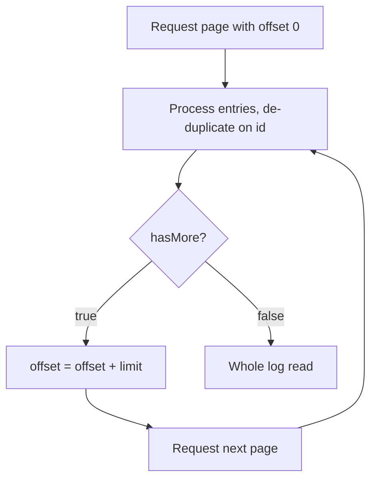

# Audit log

The audit log records changes to access in your organization: who did what, to whom, and when. Entries can't be changed or deleted through the API. You read the log with the `auditLogEntries` GraphQL query; the CLI has no command for it.

## What's recorded

The audit log records these seventeen actions. Each one is recorded when the change succeeds.

| Action | Recorded when | Target |
|---|---|---|
| `iam.role.assign` | A role is assigned, including when an invite grants a role to an existing account, and when a new organization binds a service agent (the platform is the actor) | The principal |
| `iam.role.revoke` | A role is revoked, including when its organization is deleted | The principal |
| `iam.member.remove` | A member is removed, or a revoked service account's role assignments are removed (one entry in each organization it held roles in) | The principal |
| `iam.org_invite.create` | A pending invite is stored for an email address without an account | The email address |
| `iam.org_invite.revoke` | A pending invite is canceled, or deleted with its organization | The invite ID |
| `iam.service_account.create` | A service account is created | The service account's principal |
| `iam.service_account.revoke` | A service account is revoked | The service account's principal |
| `iam.service_account_key.create` | A key is created for a service account | The key's full name, `//iam.origincloudapis.eu/organizations/…/serviceAccounts/…/keys/…`; `details` names its service account and algorithm |
| `iam.service_account_key.delete` | A key is deleted | The key's full name; `details` names its service account |
| `iam.service_account_key.exchange` | An assertion signed with a service account's key is exchanged at the security token service for the account's access token, or refused (outcome `FAILED`); the actor is the service account | The key's full name; `details` holds the assertion's `assertion_id` (its `jti`) and the access token's `token_id`, `audience` and `expires_at`, or for a refusal its `reason`: `key_not_found` (deleted, or not the account's), `signature`, `audience`, `expired`, `lifetime_too_long`, `lifetime`, `not_yet_valid`, `assertion_id`, `replayed` (its `jti` was used before), `account_not_found`, `account_revoked`, `not_external`, `subject_mismatch`, `algorithm` or `key_unreadable` |
| `iam.federated_credential.create` | A federated credential is created on a service account | The federated credential's name; `details` holds its issuer, audience, conditions and service account |
| `iam.federated_credential.delete` | A federated credential is deleted | The federated credential's name; `details` names its service account |
| `iam.federated_credential.exchange` | A CI job's OIDC token is exchanged for the service account's access token through a federated credential; the actor is the service account | The federated credential's name; `details` holds the job token's issuer and subject, the run's claims (`run`), and the access token's id, audience (`audience`) and expiry |
| `sts.token.exchange` | The hosted MCP server exchanges a service account's token for an API token that keeps the service account as the caller; the actor is the service account. A person's exchanges are recorded in the platform's own log, not in your organization's | The MCP server, by its workload's identity (`spiffe://…/workloads/mcp-server`); `details` holds the acting party (`acting_party`), the caller's full name (`subject`), the federated credential (`federated_credential`) or the service account key (`service_account_key`) the service account's token was issued for, and the API token's id, audience and expiry |
| `sts.token.impersonate` | A person impersonates a service account at the security token service, directly or through the hosted MCP server, and gets the account's access token, or is refused (outcome `FAILED`). The actor is the person, and the entry is in the service account's organization's log | The service account's full name, `//iam.origincloudapis.eu/organizations/…/serviceAccounts/…`; `actingParty` is the MCP server when the person asked through it. `details` holds the person (`impersonator`), their token's issuer, client and id (`subject_issuer`, `client`, `subject_token_id`), and the access token's `token_id`, `audience` and `expires_at`. For a refusal it holds the `reason`: `no_binding` (the person doesn't hold `iam.service_account.get_access_token` on the account, see [roles](roles.md)), `unknown_account` or `inactive_account` (the account is revoked) |
| `compute.instance.service_account.attach` | An instance is launched as a service account, or updated to run as one (replacing one records a detach, then an attach) | The instance's full name, `//compute.origincloudapis.eu/projects/…/zones/…/instances/…`; `details` names the service account |
| `compute.instance.service_account.detach` | An instance's service account is removed or replaced | The instance's full name; `details` names the service account |

The KMS records every change to a key and every use of it but reading a public key, each answered only once its entry is written: `kms.keys.create`, `kms.keys.enable`, `kms.keys.disable`, `kms.keys.rotate`, `kms.keys.updateTags`, `kms.keys.scheduleDeletion`, `kms.keys.cancelDeletion`, `kms.keys.destroy` (the platform destroying a deleted key's material at its purge time, with the platform as the actor), `kms.keys.encrypt`, `kms.keys.decrypt`, `kms.keys.generateDataKey`, `kms.keys.sign`, and a key's grants: `kms.keys.createGrant`, `kms.keys.renewGrant` and `kms.keys.retireGrant`, whose `details.grant` names the grant, its host and when it expires. The target is the key's full name, `//kms.origincloudapis.eu/projects/…/keys/…`; `details` hold its `region`, the key `version` used or made, and the `encryption_context`, never a plaintext or a data key. An encrypt, decrypt, data key or sign the KMS refuses on one of your keys is recorded too, with outcome `FAILED` and the `reason` in `details`: `does_not_open` (the ciphertext doesn't decrypt under the key and that context), `key_not_enabled`, `version_unavailable` (the key version's material is destroyed) or `invalid_request`. So is a grant the KMS refuses to make or renew, and a host's decryption under a grant it refuses: `no_live_grant`, `grantee_not_proven`, `grantee_not_enrolled` (the host the grant names isn't enrolled with the platform), `grant_expired`, `grant_limit_reached` (the key holds the most grants it may in the zone) or `grant_host_limit_reached` (the most it may for that host), besides the reasons above. A request naming a key that doesn't exist, or that isn't in the caller's project, is recorded against no key. See the [KMS guide](../kms/index.md).

The audit log doesn't record organization or project lifecycle changes, other resource changes such as launching an instance without a service account, or refused requests, except a KMS key's refused uses, a service account key's refused exchanges and a refused impersonation of a service account. An assertion that names no key is recorded nowhere. Writing an entry never blocks the change itself: if an entry can't be written, the change still takes effect, so in rare cases an action is missing from the log. The two `compute.instance.service_account` actions are recorded with the change itself and reach the log within seconds; a change that is refused records nothing. An exchange through a federated credential or a service account key, and an impersonation, are the other way round: no access token is issued unless its entry is written, and it reaches the log within seconds. A refused key exchange or impersonation is answered whether or not its entry is written.

## Entry fields

Each entry has these fields.

| Field | Description |
|---|---|
| `id` | The entry's full name, `//iam.origincloudapis.eu/organizations/<org-id>/auditLogEntries/<entry-id>`. |
| `project` | The project's full name, for a project-scoped role assignment or revocation. Otherwise `null`. The organization the action happened in is the one in `id`. |
| `actor` | Who performed the action, by full name: a principal such as `//iam.origincloudapis.eu/users/<user-id>`, or, for an action the platform took on its own account, the platform component that took it, such as `//iam.origincloudapis.eu/services/kms` for the KMS destroying a deleted key's material. |
| `action` | The action key from the table above. |
| `target` | What the action was applied to, as listed in the table above. |
| `outcome` | `SUCCESS` for an action that was made; `FAILED` for one that was attempted and refused, such as a KMS decrypt under the wrong encryption context, with the reason in `details`. |
| `occurredAt` | When the action happened, as an RFC 3339 timestamp. |
| `actingParty` | Who acted for the actor, when the actor made the change through the [hosted MCP server](../platform/access/hosted-mcp.md): the MCP server, by its workload's identity (`spiffe://…/workloads/mcp-server`). `null` for a change made without it. See [Changes made through the hosted MCP server](#changes-made-through-the-hosted-mcp-server). |
| `details` | Action-specific context as a JSON string, for example the role that was assigned, as `role`, by its public name such as `roles/viewer`. For a user actor or target, it also holds the verified email address the account had when the change was made, as `actor_verified_email` and `target_verified_email`, when one was verified. For a change made by a CI job, it also holds `federated` (see [Changes made by a CI job](#changes-made-by-a-ci-job)). |

## Changes made by a CI job

A CI job that signs in through a [federated credential](workload-identity-federation.md) acts as the credential's service account, so that service account is the `actor` of every change the job makes. To say which job made it, the entry of a change made with the access token the job exchanged its token for holds `federated` in `details`:

| Key | Description |
|---|---|
| `credential` | The federated credential's name. |
| `token_id` | The access token's ID. |

The `iam.federated_credential.exchange` entry with the same `token_id` holds the job token's subject and the run's claims, such as the repository, workflow and run ID, so together the two entries name the run that made the change. Entries that follow from a change rather than record it don't carry `federated`: a role assigned when a pending invite is applied, and the revocations recorded when an organization is deleted. Neither does `iam.federated_credential.exchange` itself.

```json
{
  "role": "roles/viewer",
  "federated": {
    "credential": "organizations/<org-id>/serviceAccounts/<service-account-id>/federatedCredentials/<credential-id>",
    "token_id": "<token-id>"
  }
}
```

## Changes made through the hosted MCP server

When you, or a service account, make a change through the [hosted MCP server](../platform/access/hosted-mcp.md), the MCP server calls the API with a token that keeps you as the caller. The change is yours, so you are its `actor`. The entry also names the MCP server as `actingParty`, by its workload's identity (`spiffe://…/workloads/mcp-server`), so you can tell a change an AI assistant made for you from one you made yourself.

A change made without the MCP server, with the console, the CLI or the API directly, has no `actingParty`, and neither has an entry recorded before the audit log kept it. These entries name the acting party: the access changes recorded by IAM (the `iam.*` actions), an instance's service account attached or detached (`compute.instance.service_account.*`), and a KMS key's changes and uses (`kms.keys.*`), refused ones included. A command the platform refused because its sender may not send it names the acting party its caller asserted.

The MCP server's own exchange of a service account's token is recorded as `sts.token.exchange`, with the MCP server as its target.

## Who can read it

Reading the audit log requires the `iam.audit_log.list` permission on the organization. Both `roles/owner` and `roles/viewer` include it, assigned org-wide. See [Built-in roles](roles.md).

## Paging through the log

`auditLogEntries` returns one page of entries, newest first, with a stable order for entries recorded at the same moment. You can read the whole organization's log, or narrow it to the entries of one project with `project`, its full name. Only project-scoped role assignments and revocations carry a project, so a narrowed query leaves out every other action.

The page tells you where you are:

- `entries` – the entries on this page.
- `total` – how many entries match your query across all pages.
- `offset` and `limit` – the window you were actually served.
- `hasMore` – `true` while entries remain beyond this page. When it's `false`, you've read to the end.

`limit` defaults to 100 and is capped at 500. If you ask for more than 500, you get 500, and the `limit` in the response says so. The cap applies to one page only; every entry is reachable by paging. To get the next page, add the served `limit` to `offset` and repeat while `hasMore` is `true`.

The following diagram shows the paging loop.



> **Note:** The log is written while you read it. If new entries are recorded while you page through, they're added at the front and shift older entries back, so an entry can appear on two consecutive pages. No entry is skipped. De-duplicate on `id` if you need each entry exactly once.

```graphql
query {
  iam {
    auditLogEntries(input: {
      organisation: "//resourcemanager.origincloudapis.eu/organizations/<org-id>"
      offset: 0
      limit: 100
    }) {
      entries {
        id
        actor
        action
        target
        outcome
        occurredAt
        actingParty
        details
      }
      total
      offset
      limit
      hasMore
    }
  }
}
```

## In the REST API

The IAM REST API serves the audit log too, as a preview (`v1beta1`) that may still change (see [IAM reference](reference/index.md#rest-api)). `GET /v1beta1/organizations/<org-id>/auditLogEntries` lists the entries newest first, a page at a time with `pageSize` and `pageToken`, and narrows them by `project`, `actor` or `action`.

It differs from the GraphQL query in three ways:

- It serves a recent window of the log: 90 days by default, which the platform can set longer. Each response says where the window starts in `windowStartTime`, and an older entry is answered with `NOT_FOUND`. The GraphQL query serves the whole log.
- The actor and a target that is a principal are full names, as a role binding's `member` is: `//iam.origincloudapis.eu/users/<user-id>`, `//iam.origincloudapis.eu/organizations/<org-id>/serviceAccounts/<id>`, `//iam.origincloudapis.eu/serviceAgents/<name>` for a platform service agent acting in your organization ([Service agents](service-agents.md)), or `//iam.origincloudapis.eu/services/<service>` for a change the platform made itself, such as `//iam.origincloudapis.eu/services/kms` for the KMS destroying a deleted key's material. An entry names an account, never an address, so a later change of address doesn't change it. The `project` is the project's full name, `//resourcemanager.origincloudapis.eu/projects/<project-id>`, and so is the `project` filter.
- A role in `details` has its role name, such as `roles/iam.editor`.

The acting party is `actingParty` there too. It is left out of an entry no one acted for.

## Related

- [Assign and revoke roles](assign-roles.md)
- [Manage organization members](manage-members.md)
- [Use service accounts](service-accounts.md)
- [API access](../platform/access/api.md)
