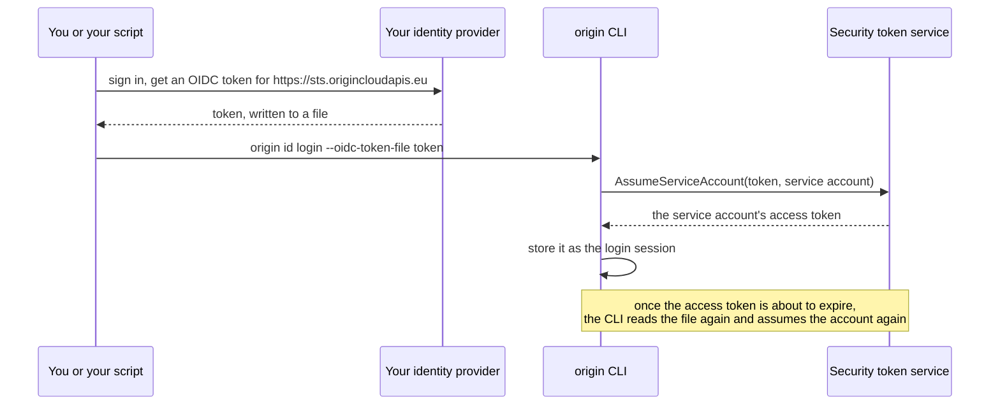

# Log in as a service account with your identity provider's token

A person or a script outside CI can act as a `WORKLOAD` service account with an OIDC token from an identity provider you run or use, such as your company's single sign-on. One of the account's federated credentials trusts that provider's tokens, and the security token service (STS) exchanges a token for the account's access token. No client secret is stored anywhere. [Workload identity federation](workload-identity-federation.md) explains what the exchange checks.



## Prerequisites

- The `origin` CLI, 1.18.0 or later.
- A `WORKLOAD` service account with the roles the work needs. See [Use service accounts](service-accounts.md) and [Assign and revoke roles](assign-roles.md).
- An identity provider that issues OIDC tokens and meets the [requirements](workload-identity-federation.md#the-exchange): OIDC discovery over HTTPS at a public address, and RS256 signatures.
- `iam.service_account.create` and `iam.service_account.act_as` on the organization, to create the federated credential. `roles/owner` holds both.

## Trust your identity provider's tokens

Create a federated credential that names your provider's issuer, exactly as its tokens carry it in `iss`, and a `sub` condition for the identity allowed to act as the service account:

```sh
origin iam create-federated-credential \
  --organization <org-id> \
  --service-account <service-account-id> \
  --display-name "ops automation" \
  --issuer https://idp.example.com \
  --condition sub=<subject>
```

The token must be issued for the audience `https://sts.origincloudapis.eu`, unless the credential names another with `--audience`. If your provider builds `sub` from a name that can be reassigned, such as an email address, add a condition on a claim that never changes, such as a numeric user ID.

## Log in

Get a token from your identity provider and write it to a file, then log in with it:

```sh
origin id login \
  --oidc-token-file token \
  --service-account organizations/<org-id>/serviceAccounts/<service-account-id>
```

```text
Logged in as organizations/<org-id>/serviceAccounts/<service-account-id>.
```

Every command after that runs as the service account, with nothing set in the environment, until you log in again. `--service-account` names the account to assume. Without it, the STS assumes the account whose federated credential trusts the token, and refuses a token that more than one credential trusts.

The service account's access token lasts 15 minutes. When it's about to expire, the next command reads the file again and assumes the account again. A file that your identity provider or a credential helper keeps current therefore keeps the login going. `--oidc-token-file -` reads the token from standard input instead. That token is read once, so log in again once its access token expires.

## Get an access token for another tool

`origin sts assume-service-account` exchanges a token once and prints the result, without logging in:

```sh
origin sts assume-service-account \
  --oidc-token-file token \
  --service-account organizations/<org-id>/serviceAccounts/<service-account-id> \
  --lifetime 10m
```

It prints the access token in `accessToken`, with `expireTime`, the `serviceAccount` and the `federatedCredential` it went through. `--lifetime` takes from `60s` to `1h`, and the default is 15 minutes. Neither command needs you to be logged in, because the STS authenticates no caller: the token is the proof.

## When the exchange is refused

A token that no federated credential trusts, or that more than one trusts, is refused with `PERMISSION_DENIED`, without saying which check failed. Compare the token's claims with the credential's issuer, audience and conditions. This prints the claims without the token itself:

```sh
python3 -c 'import sys, json, base64; p = open(sys.argv[1]).read().split(".")[1]; print(json.loads(base64.urlsafe_b64decode(p + "=" * (-len(p) % 4))))' token
```

## Related

- [Workload identity federation](workload-identity-federation.md)
- [Authenticate from GitLab CI and other CI providers](other-ci-providers.md)
- [Use service accounts](service-accounts.md)
- [IAM reference: security token service](reference/index.md#security-token-service)
