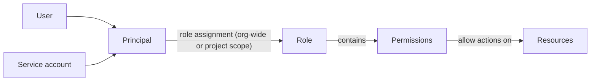

# What is Origin Cloud IAM?

IAM (Identity and Access Management) controls who can do what in your organization. You give people and automation access by assigning them built-in roles, either across the whole organization or for one project. Every API request is checked against those assignments, so you can also ask in advance whether a request will be allowed.

The following diagram shows how a principal gets access to a resource.

A principal is a user, a service account, or a service agent: the identity one of the platform's own services acts as in your organization. A role assignment gives a principal one role, either org-wide or for a single project. The role is a fixed set of permissions, and each permission allows one action, such as `compute.instance.launch`, on resources inside the assignment's scope. For the details, see [Access model](access-model.md).

## Features

**Built-in roles**  
Owner, Viewer, IAM Editor and three billing roles, each with a fixed set of permissions. See [Built-in roles](roles.md).

**Role assignments**  
Grant a role to a user or service account org-wide or for one project, and revoke it again. See [Assign and revoke roles](assign-roles.md).

**Organization members**  
Invite people by email in the console, list who has access, and remove a member's access in one step. See [Manage organization members](manage-members.md).

**Service agents**  
The platform's own services, such as compute, act in your organization as service agents. You see their role bindings and can remove them, but can't act as them. See [Service agents](service-agents.md).

**Service accounts**  
Non-interactive credentials for CI pipelines, scripts and infrastructure-as-code tools, with their own principal and roles. See [Service accounts](service-accounts.md).

**No secrets in CI**  
A GitHub Actions job exchanges its own OIDC token for a service account's access token, through a federated credential that trusts that repository's jobs. See [Workload identity federation](workload-identity-federation.md), [Authenticate from GitHub Actions](github-actions.md) and [GitLab CI and other CI providers](other-ci-providers.md). A person or script outside CI can do the same with a token from your own identity provider: see [Log in as a service account with your identity provider's token](identity-provider-login.md).

**Access checks**  
Look up your own grants, list available permissions, and check whether a principal holds a permission on a resource. See [Check access](check-access.md).

**Audit log**  
A record of who changed access in your organization and when. See [Audit log](audit-log.md).

## Ways to access IAM

**CLI**  
The `origin iam` command group. See [CLI access](../platform/access/cli.md) to install and sign in, and [`origin iam` commands](reference/cli.md) for every command.

**GraphQL API**  
IAM queries and mutations live under the `iam` namespace of the API. See [API access](../platform/access/api.md) and the [IAM reference](reference/index.md) for the list of operations.

## Limitations

- Custom roles aren't supported. You can assign and revoke the built-in roles only.
- Groups aren't supported. You assign a role to each user, service account or organization on its own.
- Role assignments are unconditional. You can't restrict a grant to a time window or an extra attribute check.
- A service account's access is the union of its roles. You can't narrow one credential to a subset of what its roles allow.
- Service accounts authenticate against the platform's own identity provider only. Federation with an external identity provider isn't supported.

For quotas, see [Limits](../platform/reference/limits.md#iam).

## Related

- [Organizations and projects](../platform/organizations/index.md) – the scopes that role assignments apply to
- [Billing access](../platform/billing/billing-access.md) – who can see and change billing accounts
- [CLI access](../platform/access/cli.md) – log in with `origin id login`

## On origincloud.eu

[Identity & Access Management](https://www.origincloud.eu/iam/) describes the service.

## Next steps

- Read the [Access model](access-model.md) to understand scopes and permissions.
- [Invite a member](manage-members.md) to your organization.
- [Create a service account](service-accounts.md) for automation.
