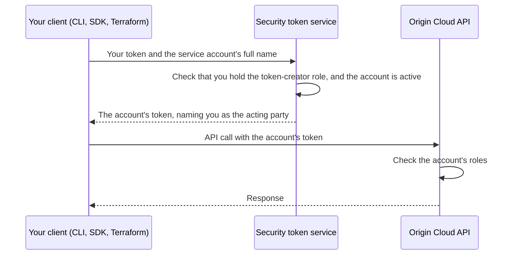

# Use service accounts

A service account is a non-interactive identity for automation such as CI pipelines, scripts and infrastructure-as-code tools. It belongs to one organization and acts as its own principal: the member `//iam.origincloudapis.eu/organizations/<org-id>/serviceAccounts/<service-account-id>` in the `origin iam` commands and the REST API, its `id` in the GraphQL API. Its access is checked exactly like a user's: it can do what its role bindings allow, and nothing else.

A service account never holds a password or a client secret. Software acts as it with an access token from the security token service, `https://sts.origincloudapis.eu`, which exchanges a proof for it: a CI job's own OIDC token, an instance's credential, or an assertion signed with one of the account's keys.

## Choose how the software authenticates

Pick the first of these that fits. Only the last stores a secret you have to keep.

1. **A CI job, or anything with an OIDC token of its own**, such as GitHub Actions, GitLab CI, HCP Terraform or a Kubernetes service account token: a `WORKLOAD` service account that [trusts the provider's tokens](#trust-a-ci-providers-tokens). See [Workload identity federation](workload-identity-federation.md).
2. **Software on an Origin Cloud instance**: launch the instance as a `WORKLOAD` service account. See [Run an instance as a service account](../compute/instances/service-account.md).
3. **You, running a tool on your own machine**, Terraform included: your own login, `origin id login`. See [Use the CLI](../platform/access/cli.md#log-in). To run it with a service account's narrower roles instead of yours, such as a deploy account's or an AI agent's, [impersonate the account](#impersonate-a-service-account) with that login: no key needed.
4. **Anything else**, such as a job on a server of your own with no identity provider: an `EXTERNAL` service account with a [key](#create-a-key). The key's private key is a long-lived secret: store it like one, and prefer any of the above.

Every service account has a type, set when it's created. It never changes.

| Type | Credential |
| --- | --- |
| `EXTERNAL` | A key, for software outside Origin Cloud that has no identity of its own to federate. The type a create uses when none is given. |
| `WORKLOAD` | No key, ever, so no copied credential authenticates as it. A CI job acts as it through a [federated credential](#trust-a-ci-providers-tokens), an instance through the instance's credential. Launching an instance as one needs `iam.service_account.act_as` on the organization, which [`roles/iam.service-account-user`](roles.md#rolesiamservice-account-user) grants. |

## Before you begin

- To create or delete a service account, its federated credentials or its keys: an org-wide `roles/owner` assignment.
- To list service accounts: an org-wide `roles/owner` or `roles/viewer` assignment.
- Your organization ID (`<org-id>`).

## Create a service account

1. Create the service account with a display name that tells you what uses it, and the type its credential needs.

   ```sh
   origin iam create-service-account --organization <org-id> --display-name ci-deploy --type WORKLOAD
   ```

   The output contains the service account's resource name, `organizations/<org-id>/serviceAccounts/<service-account-id>`, and its `member`. The account has no credential yet.

2. Grant the service account the roles it needs. A new service account holds no roles and can't do anything until you bind one. Use the `member` from the previous step.

   ```sh
   origin iam create-role-binding --organization <org-id> \
     --member //iam.origincloudapis.eu/organizations/<org-id>/serviceAccounts/<service-account-id> \
     --role //iam.origincloudapis.eu/roles/viewer \
     --project //resourcemanager.origincloudapis.eu/projects/<project-id>
   ```

   Grant the smallest role and scope that does the job. See [Assign and revoke roles](assign-roles.md).

3. Verify that the service account is listed with the state `ACTIVE`.

   ```sh
   origin iam list-service-accounts --organization <org-id>
   ```

4. Give it its credential: a [federated credential](#trust-a-ci-providers-tokens) for a `WORKLOAD` account, a [key](#create-a-key) for an `EXTERNAL` one. An instance needs neither.

## Create a key

A key is the credential of an `EXTERNAL` service account. The platform generates its key pair, an `ES256` (ECDSA P-256) key, returns the private key once, in a credentials file, and keeps only the public key. An account has at most 10 keys that aren't deleted. A `WORKLOAD` account never has one.

Whoever holds the credentials file acts as the service account. So creating a key needs `iam.service_account_key.create` and `iam.service_account.act_as` on the organization, which `roles/owner` holds.

1. Create the key, and name the file its credentials file is written to.

   ```sh
   origin iam create-service-account-key \
     --service-account //iam.origincloudapis.eu/organizations/<org-id>/serviceAccounts/<service-account-id> \
     --credentials-file deploy-key.json
   ```

   The CLI creates the file readable by you alone and never prints the private key: standard output shows the key without it, and standard error names the file and the key. An existing file is refused before the key is created; `--overwrite` replaces it once the key is in. If the request fails, nothing is written.

   The credentials file is a JSON document with these fields.

   | Field | Value |
   | --- | --- |
   | `type` | `service_account_key` |
   | `name` | The key's full name, `//iam.origincloudapis.eu/organizations/<org-id>/serviceAccounts/<service-account-id>/keys/<key-id>` |
   | `service_account` | The service account's full name |
   | `algorithm` | `ES256` |
   | `private_key` | The private key, a PKCS 8 private key in PEM |
   | `sts_endpoint` | `https://sts.origincloudapis.eu`, where its assertions are exchanged |

   > **Important:** The private key is shown only once. Keep the credentials file as it is, readable only by the software that uses it, or store it in your secret manager, and keep it out of version control. No API returns it again; if you lose it, delete the key and create a new one.

2. Verify that the key is listed with the state `ACTIVE`. A listed key shows its `lastUseTime`, never its private key.

   ```sh
   origin iam list-service-account-keys \
     --service-account //iam.origincloudapis.eu/organizations/<org-id>/serviceAccounts/<service-account-id>
   ```

3. Hand the file to the software that uses it, as [Use a credentials file](#use-a-credentials-file) shows.

In the REST API, `CreateServiceAccountKey` returns the credentials file once, as `credentialsFile`; see [Using the API](#using-the-api).

## Use a credentials file

The `origin` CLI, the Go, Rust and TypeScript SDKs and the Terraform provider all read a credentials file. Each signs an assertion with the key, exchanges it at the security token service for the service account's access token, and exchanges a new one about a minute before that token expires, so a long-running job or a long `terraform apply` isn't cut off. Every call is made as the service account, and the [audit log](audit-log.md) names it.

A file that is named but can't be read, or isn't a credentials file, is an error: the client doesn't fall back to another identity.

### The CLI

Point `ORIGINCLOUD_CREDENTIALS_FILE` at the file for one command or a whole script, or store it in the profile's `credentials-file` for every command. `origin config profile-set` checks the file first and stores its absolute path. Use the CLI from version 2.0.0.

```sh
ORIGINCLOUD_CREDENTIALS_FILE=deploy-key.json origin resourcemanager list-projects --organization //resourcemanager.origincloudapis.eu/organizations/<org-id>

origin config profile-set credentials-file deploy-key.json
```

The environment variable overrides the profile while a command runs. `origin id token` prints the service account's access token for a tool that isn't built on the CLI or an SDK. See [Run commands as a service account](../platform/access/cli.md#run-commands-as-a-service-account).

### The SDKs

Every SDK reads `ORIGINCLOUD_CREDENTIALS_FILE` without any code: set it where the program runs. To name the file in code, or to pass the file's content from a secret manager, give the client the credentials explicitly. Use sdk-go and sdk-typescript from version 0.49.0, sdk-rust from 0.48.0.

Go:

```go
credentials, err := core.CredentialsFromFile("/etc/myapp/origincloud-key.json") // or core.CredentialsFromJSON(secret)
if err != nil {
	log.Fatal(err)
}
client, err := core.NewClient(ctx, core.WithCredentials(credentials))
```

Rust:

```rust
use origincloud_core::{Client, ServiceAccount};

let client = Client::builder()
    .credentials(ServiceAccount::from_file("/etc/myapp/origincloud-key.json")?) // or ServiceAccount::from_json(..)
    .build()?;
```

TypeScript:

```ts
import { Client, credentialsFile } from "@origincloud/core";

const client = new Client({ credentials: credentialsFile("/etc/myapp/origincloud-key.json") });
// or ServiceAccountKeyCredentials.fromJSON(secret)
```

The credentials never print the private key, and their errors never quote the file.

### The Terraform provider

Give the provider the file's path in `credentials_file`, or set `ORIGINCLOUD_CREDENTIALS_FILE` where Terraform runs. Use the provider from version 0.22.0.

```hcl
provider "origincloud" {
  region           = "eu-central1"
  credentials_file = "/etc/origincloud/deployer.json"
}
```

Set, `credentials_file` comes before every credential of the environment. Keep the file readable only by the user that runs Terraform. In CI, use no key: the job's OIDC token is exchanged instead; see [Workload identity federation](workload-identity-federation.md).

#### Why the provider has no key resource

The API returns a key's private key once, in the answer to its creation. A Terraform resource that created a key would have to keep that private key in the state, where everyone who can read the state, and every backend that stores it, could act as the service account. So the provider has no resource that creates a key, and no data source returns one: `origincloud_iam_service_account_key` and `origincloud_iam_service_account_keys` read a key's metadata only. Create the key with the CLI or the console, and hand its file to the system that runs Terraform.

### Which credential a client uses

The CLI, the SDKs and the Terraform provider look for credentials in the same order, and use the first they find. Credentials given explicitly come before all of these: the Terraform provider's `credentials_file`, or the credentials an SDK client is built with.

1. `ORIGINCLOUD_ACCESS_TOKEN`, an access token, sent as it is.
2. `ORIGINCLOUD_CREDENTIALS_FILE`, then, in the CLI, the profile's `credentials-file`.
3. A CI job's OIDC token, exchanged for a `WORKLOAD` service account's access token: the file `ORIGINCLOUD_OIDC_TOKEN_FILE` names, `ORIGINCLOUD_OIDC_TOKEN`, an HCP Terraform run's token (the Go SDK and the Terraform provider only), then a GitHub Actions job's token. `ORIGINCLOUD_OIDC_DISABLED=true` leaves this step out. See [Workload identity federation](workload-identity-federation.md).
4. Your own login, the session `origin id login` stored.
5. On an instance that runs as a service account, that account's credential from the instance's metadata service. Off an instance this step gives up within about two seconds; `ORIGINCLOUD_METADATA_DISABLED=true` leaves it out.

A credentials file comes before a CI job's token, so leave it unset in a job that federates.

### Exchange the key yourself

A tool that isn't built on the CLI or an SDK signs a JWT assertion with the key's private key, naming the key and the service account, and exchanges it at the security token service for the account's access token, by default for 15 minutes. [Service account keys](reference/index.md#service-account-keys) lists the assertion's fields and shows the exchange:

```sh
curl -s https://sts.origincloudapis.eu/v1/token \
  -d grant_type=urn:ietf:params:oauth:grant-type:jwt-bearer \
  -d assertion=<assertion>
```

The response is JSON with an `access_token` and its lifetime in seconds, `expires_in`. Send the token as a bearer token with each API request, and make a new assertion before it expires. Each assertion needs its own `jti`.

## Impersonate a service account

A person can act as a service account with their own login, without a key: the client exchanges the person's token at the security token service for a short-lived token of the account, and calls the API with it. Every call then has the account's roles alone, not the person's. Use it to try what a deploy account may do, to run a local `terraform plan` with the pipeline's narrow rights, or to [restrict an AI agent](../platform/access/hosted-mcp.md#restrict-the-agent-to-a-service-accounts-roles) to a service account's roles.



### Who may impersonate

Impersonating needs `iam.service_account.get_access_token`, which [`roles/iam.service-account-token-creator`](roles.md#rolesiamservice-account-token-creator) grants, and `roles/owner` holds. Grant it org-wide, on the account's organization: a project-scoped grant lets its holder impersonate no account. An org-wide one lets its holder impersonate every active service account of the organization, `EXTERNAL` and `WORKLOAD` alike, so grant it only to people you would trust with each of them.

```sh
origin iam create-role-binding --organization <org-id> \
  --member //iam.origincloudapis.eu/users/<user-id> \
  --role //iam.origincloudapis.eu/roles/iam.service-account-token-creator
```

It is a different right from [`roles/iam.service-account-user`](roles.md#rolesiamservice-account-user):

| Role | Lets its holder | Doesn't let its holder |
| --- | --- | --- |
| `roles/iam.service-account-token-creator` | Get a service account's token and call the API as the account | Launch an instance that runs as the account |
| `roles/iam.service-account-user` | Launch an instance that runs as a `WORKLOAD` service account, with `compute.instance.launch` | Get the account's token |

Only a person can impersonate. A service account's credentials file, a CI job's token or an instance's credential can't: a CI job acts as its own service account through [federation](workload-identity-federation.md) instead.

### The token and its end

The account's token lives at most 5 minutes, and never past the person's own token; the CLI, the SDKs and the Terraform provider exchange a new one about a minute before it expires. Revoking the person's token-creator binding refuses the next exchange: a token already issued stays valid until it expires. Revoking the service account refuses its tokens at their next call.

A refused exchange, because the person lacks the role or the account doesn't exist or isn't active, is an error that names the account. No client falls back to calling the API as the person.

### With the CLI

From version 2.1.0, `--impersonate-service-account`, the variable `ORIGINCLOUD_IMPERSONATE_SERVICE_ACCOUNT` or the profile's `impersonate-service-account` name the account. Log in with `origin id login` first.

```sh
origin compute list-instances \
  --impersonate-service-account //iam.origincloudapis.eu/organizations/<org-id>/serviceAccounts/<service-account-id>
```

The flag overrides the variable, which overrides the profile; an empty flag impersonates no one. See [Act as a service account with your login](../platform/access/cli.md#act-as-a-service-account-with-your-login).

### With the SDKs

Every SDK reads `ORIGINCLOUD_IMPERSONATE_SERVICE_ACCOUNT` without any code, and wraps whichever credentials it finds, which must give a person's token, such as the `origin id login` session. To name the account in code, give the client the option, which overrides the variable; an empty name impersonates no one. Use sdk-go from version 0.52.0, sdk-rust from 0.51.0, sdk-typescript from 0.53.0.

Go:

```go
client, err := core.NewClient(ctx,
	core.WithImpersonateServiceAccount("//iam.origincloudapis.eu/organizations/<org-id>/serviceAccounts/<service-account-id>"))
```

Rust:

```rust
use origincloud_core::Client;

let client = Client::builder()
    .impersonate_service_account("//iam.origincloudapis.eu/organizations/<org-id>/serviceAccounts/<service-account-id>")
    .build()?;
```

TypeScript:

```ts
import { Client } from "@origincloud/core";

const client = new Client({
  impersonateServiceAccount: "//iam.origincloudapis.eu/organizations/<org-id>/serviceAccounts/<service-account-id>",
});
```

### With the Terraform provider

From version 0.26.0, `impersonate_service_account`, or `ORIGINCLOUD_IMPERSONATE_SERVICE_ACCOUNT` where Terraform runs, names the account. With only your `origin id login` session, `terraform plan` and `terraform apply` then run with the account's roles, so you see on your own machine what the pipeline's account may change.

```hcl
provider "origincloud" {
  region                      = "eu-central1"
  impersonate_service_account = "//iam.origincloudapis.eu/organizations/<org-id>/serviceAccounts/<service-account-id>"
}
```

The provider exchanges once as it is configured, so a refused impersonation fails the plan before any change, even one that would call no API. The argument overrides the variable; `""` runs with your own roles. The state holds the account's name, never a token.

### In the audit log

The exchange is recorded as `sts.token.impersonate` in the account's organization's log, with the person as its actor, whether it is issued or refused; a refusal carries its `reason`. A change made with the account's token names the account as its `actor` and the person in `actingParty`. See [Changes made by impersonating a service account](audit-log.md#changes-made-by-impersonating-a-service-account).

## Replace or delete a key

A key never expires and is never changed. To replace one, create the new key, move the software to its credentials file, check that the old key's `lastUseTime` stops moving, then delete the old key. An account's keys can overlap for as long as you need.

Deleting a key refuses its assertions from then on, and the access tokens already exchanged with it at their next API call. It stays readable, with the state `DELETED`. Deleting the service account deletes its keys. Deleting can't be undone, so the command needs `--yes`.

```sh
origin iam delete-service-account-key \
  --key //iam.origincloudapis.eu/organizations/<org-id>/serviceAccounts/<service-account-id>/keys/<key-id> --yes
```

## Revoke a service account

Deleting a service account revokes it: it deletes its federated credentials and keys and removes every role binding it holds, in every organization and at every scope. From that moment, every exchange for a new access token is refused, and an access token issued before is refused on its next request.

Deleting is permanent. A deleted service account can't be reactivated or bound to a role again; create a new service account instead. It stays readable, with the state `DELETED`.

An organization can't be deleted while it has a service account that isn't deleted; delete its service accounts first. See [Delete an organization](../platform/organizations/projects.md#delete-an-organization).

1. Find the service account's ID with `list-service-accounts`.

2. Delete it. Deleting can't be undone, so the command needs `--yes`.

   ```sh
   origin iam delete-service-account --organization <org-id> \
     --service-account <service-account-id> --yes
   ```

   This needs only `roles/owner`. The account's role bindings are removed even when they include a role you don't hold yourself, such as a billing role.

3. Check that the service account has the state `DELETED` and a `deleteTime`. Deleted service accounts are listed only with `--show-deleted true`.

   ```sh
   origin iam get-service-account --organization <org-id> --service-account <service-account-id>
   ```

4. Run `list-role-bindings --member //iam.origincloudapis.eu/organizations/<org-id>/serviceAccounts/<service-account-id>` and check that it lists no binding.

## Trust a CI provider's tokens

A `WORKLOAD` service account can trust the OIDC tokens of an identity provider outside Origin Cloud, such as the token GitHub Actions gives every job. That trust is a federated credential on the account. It names exactly:

- the token's issuer;
- the audience it must be issued for, `https://sts.origincloudapis.eu` unless you name another;
- the claims it must carry, each with exactly one value.

Software holding a matching token exchanges it for the service account's access token at the security token service, `https://sts.origincloudapis.eu`, so no secret is stored where it runs. [Workload identity federation](workload-identity-federation.md) explains how, and [Authenticate from GitHub Actions](github-actions.md) walks through it.

A federated credential is refused unless:

- **At least one condition names an identity that never changes.** For GitHub Actions' issuer, `https://token.actions.githubusercontent.com`, that is `repository_id` or `repository_owner_id`. For GitLab.com's, `https://gitlab.com`, it is `project_id` or `namespace_id`. For HCP Terraform's, `https://app.terraform.io`, it is `terraform_organization_id`. For any other issuer, it is `sub`. A repository's, project's or workspace's name alone isn't enough: a renamed one, or a new one created under an old name, would inherit the trust.
- **No value contains `*`.** Values are matched exactly, never as patterns.
- **The service account is an active `WORKLOAD` one.** An `EXTERNAL` account authenticates with a key.

Whoever matches a federated credential acts as the service account. So creating one needs `iam.service_account.create` and `iam.service_account.act_as` on the organization: the right to act as the account yourself. `roles/owner` holds both.

To change a federated credential, create the new one and delete the old; it is never updated. Deleting the service account deletes its federated credentials. Deleting a federated credential also stops the access tokens already exchanged through it, at their next API call.

```sh
origin iam create-federated-credential \
  --organization <org-id> \
  --service-account <service-account-id> \
  --display-name "deploy from main" \
  --issuer https://token.actions.githubusercontent.com \
  --condition repository_id=<repository-id> \
  --condition ref=refs/heads/main \
  --condition environment=production
```

`origin iam list-federated-credentials --organization <org-id> --service-account <service-account-id>` lists them; add `--show-deleted true` to include deleted ones. `origin iam delete-federated-credential --federated-credential <name>` deletes one.

## Using the API

In the REST API, these are `CreateServiceAccount`, `ListServiceAccounts`, `GetServiceAccount` and `DeleteServiceAccount`; for keys `CreateServiceAccountKey`, `ListServiceAccountKeys`, `GetServiceAccountKey` and `DeleteServiceAccountKey`; and for federated credentials `CreateFederatedCredential`, `ListFederatedCredentials`, `GetFederatedCredential` and `DeleteFederatedCredential`; see the [IAM reference](reference/index.md#rest-api). The GraphQL mutations are `createServiceAccount`, `revokeServiceAccount`, which takes the account's full name as `serviceAccount`, `createServiceAccountKey`, whose `credentialsFile` is the one-time credentials file, and `deleteServiceAccountKey`; an account's `id` is its member; the queries are `serviceAccounts` and `serviceAccountKeys`, all in the `iam` namespace. No response but a key's create carries its private key.

The type is the service account's `type` field in both APIs: set it in the create to make a `WORKLOAD` service account.

```graphql
mutation {
  iam {
    createServiceAccount(input: {
      organisation: "//resourcemanager.origincloudapis.eu/organizations/<org-id>"
      name: "nightly-backup"
      type: EXTERNAL
    }) {
      id
    }
  }
}
```

## Related

- [Access model](access-model.md)
- [Built-in roles](roles.md)
- [Restrict the hosted MCP server's agent to a service account](../platform/access/hosted-mcp.md#restrict-the-agent-to-a-service-accounts-roles)
- [Workload identity federation](workload-identity-federation.md)
- [Authenticate from GitHub Actions](github-actions.md)
- [API access](../platform/access/api.md)
- [`create-service-account`](reference/cli.md#create-service-account) and [`delete-service-account`](reference/cli.md#delete-service-account) commands
- [Audit log](audit-log.md) – creation and revocation are recorded, and so is the removal of a revoked account's role assignments; so are the creation and deletion of federated credentials and keys, and every exchange through either
