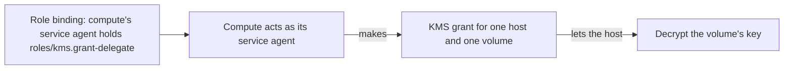

# Service agents

A service agent is the identity one of the platform's own services acts as in your organization, such as compute's, `//iam.origincloudapis.eu/serviceAgents/compute`. You see it in your role bindings like any other member, and it can do only what those bindings allow. It belongs to the platform, not to your organization: you can't create or delete one, get a key or a token for it, or act as it.

## The service agents

| Member | Service | Bound in every organization |
|---|---|---|
| `//iam.origincloudapis.eu/serviceAgents/compute` | Compute. It makes the KMS grants that let a host decrypt a volume's key while the volume is attached to an instance on that host. | [`roles/kms.grant-delegate`](roles.md#roleskmsgrant-delegate), org-wide |
| `//iam.origincloudapis.eu/serviceAgents/storage` | Storage, which manages the volumes key the platform keeps in each project. It makes and deletes the KMS grants that let the platform's workers decrypt a new volume's key while they prepare the volume, on the keys the platform manages only. | [`roles/kms.grant-issuer`](roles.md#roleskmsgrant-issuer), org-wide |

A service agent's full name is `//iam.origincloudapis.eu/serviceAgents/<name>`, such as `//iam.origincloudapis.eu/serviceAgents/compute`. The REST API and the `origin iam` commands and the GraphQL API take and show a service agent by its full name only. A name the platform has no service agent for is refused with `BAD_REQUEST`.

## What you can change

The following diagram shows how compute's binding lets it act in your organization.

Every organization holds compute's binding of `roles/kms.grant-delegate`, made by the platform once: a new organization holds it from its creation. You can [delete it](assign-roles.md) like any other binding, if you hold the role's permissions yourself. Compute then makes no new grants on your organization's keys, and the grants it already made run out within an hour. The platform doesn't make the binding again: to let compute grant again, create it yourself.

Storage's binding of `roles/kms.grant-issuer` works the same way: every organization holds it, made by the platform once, and you can delete it and create it again. Storage then makes no new grants in your organization. Whatever roles storage's service agent holds, the KMS lets it make, renew or delete grants only on the keys the platform manages for your projects. On a key of your own, its request is refused with `FORBIDDEN` and recorded in the audit log with reason `not_platform_managed`.

A service agent can hold only the roles its service needs: compute only `roles/kms.grant-delegate`, storage only `roles/kms.grant-issuer`. A binding of any other role to a service agent is refused with `BAD_REQUEST`, so a service agent never becomes a way to do what your own bindings don't allow.

## In the audit log

A binding the platform makes for a service agent is recorded as `iam.role.assign` with the platform as the actor, `//iam.origincloudapis.eu/services/<service>` in the REST API. A change you make to it is recorded under your name, as any other. Once compute makes KMS grants as its service agent, the entries of those grants will name the agent as the actor: `//iam.origincloudapis.eu/serviceAgents/compute`. See [Audit log](audit-log.md).

## Related

- [Access model](access-model.md) – principals, roles and scopes
- [Built-in roles](roles.md) – what `roles/kms.grant-delegate` and `roles/kms.grant-issuer` allow
