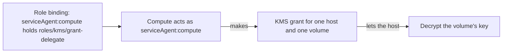

# Service agents

A service agent is the identity one of the platform's own services acts as in your organization, such as `serviceAgent:compute`. You see it in your role bindings like any other member, and it can do only what those bindings allow. It belongs to the platform, not to your organization: you can't create or delete one, get a key or a token for it, or act as it.

## The service agents

| Member | Service | Bound in a new organization |
|---|---|---|
| `serviceAgent:compute` | Compute. It makes the KMS grants that let a host decrypt a volume's key while the volume is attached to an instance on that host. | [`roles/kms/grant-delegate`](roles.md#roleskmsgrant-delegate), org-wide |
| `serviceAgent:storage` | Storage, for the volumes key the platform manages in each project. | Nothing |

The REST API, the `origin iam` commands and the GraphQL API all write a service agent as `serviceAgent:<name>`. A name the platform has no service agent for is refused with `BAD_REQUEST`.

## What you can change

The following diagram shows how compute's binding lets it act in your organization.

Every organization is created with compute's binding of `roles/kms/grant-delegate`. You can [delete it](assign-roles.md) like any other binding, if you hold the role's permissions yourself. Compute then makes no new grants on your organization's keys, and the grants it already made run out within an hour. To let compute grant again, create the binding again.

A service agent can hold only the roles its service needs: compute only `roles/kms/grant-delegate`, storage none. A binding of any other role to a service agent is refused with `BAD_REQUEST`, so a service agent never becomes a way to do what your own bindings don't allow.

## In the audit log

A binding the platform makes for a service agent is recorded as `iam.role.assign` with the actor `platform`. A change you make to it is recorded under your name, as any other. Once compute makes KMS grants as its service agent, the entries of those grants will name the agent as the actor: `serviceAgent:compute`. See [Audit log](audit-log.md).

## Related

- [Access model](access-model.md) – principals, roles and scopes
- [Built-in roles](roles.md) – what `roles/kms/grant-delegate` allows
