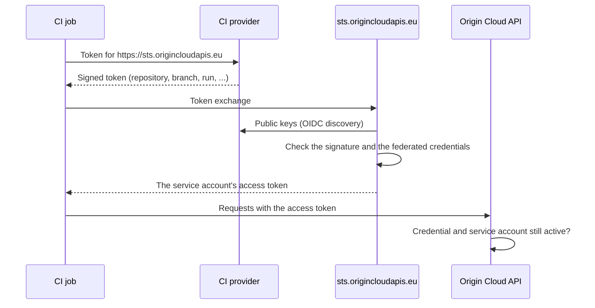

# Workload identity federation

Workload identity federation lets software outside Origin Cloud act as a `WORKLOAD` service account without holding a secret. The job's CI provider signs a short-lived OIDC token that says which job it is. A federated credential on the service account says which jobs to trust. The security token service (STS) at `https://sts.origincloudapis.eu` checks one against the other and exchanges the job's token for the service account's access token. The provider's signature is the proof, so nothing is stored that could leak or has to be rotated.

## Federated credentials

A federated credential belongs to one `WORKLOAD` service account and names exactly:

- **The issuer:** the CI provider's token issuer, such as `https://token.actions.githubusercontent.com` for GitHub Actions.
- **The audience:** the token must be issued for `https://sts.origincloudapis.eu`, unless the credential names another.
- **Conditions:** from 1 to 20 claims the token must carry, each with exactly that value. Values are compared exactly, never as patterns.

At least one condition must name an identity that never changes. For GitHub Actions, that's `repository_id` or `repository_owner_id`. For GitLab.com (`https://gitlab.com`), it's `project_id` or `namespace_id`. For any other issuer, it's `sub`. A name alone isn't enough: a renamed repository or project, or a new one created under an old name, would inherit the trust. GitLab builds `sub` from the project's path, which is why it doesn't count there. If another provider builds `sub` from names, add a condition on its numeric project or group id as well.

A credential is never changed: to change one, create the new one and delete the old. Deleting a service account deletes its federated credentials. Creating one needs `iam.service_account.create` and `iam.service_account.act_as`, because whoever matches it acts as the service account. See [Trust a CI provider's tokens](service-accounts.md#trust-a-ci-providers-tokens) for the request.

## The exchange

The STS accepts a job's token only if all of these hold:

- the issuer's public keys verify its signature, and it's signed with RS256;
- its issuer and audience are one federated credential's, and it hasn't expired;
- exactly one federated credential finds all its conditions in it. A token that two credentials match is refused as ambiguous;
- that credential's service account is an active `WORKLOAD` account.

The access token it issues lasts 15 minutes, or between one minute and one hour if the request asks. It names the federated credential it was exchanged through and the job's run. A refused exchange is answered `invalid_grant` without saying which check failed, so that it gives nothing away to someone guessing at a trust policy.

The STS finds an issuer's keys through OIDC discovery at `<issuer>/.well-known/openid-configuration`. So a CI provider qualifies if:

- its issuer serves that document over HTTPS, with a publicly trusted certificate, at a public address;
- the document names the issuer exactly as its tokens do;
- it signs tokens with RS256. A key in its key set that names no algorithm is taken as RS256.

GitHub Actions meets these. A self-hosted provider that can't be reached from the internet doesn't: the STS never fetches keys from a private address.

## Revocation and audit

Every API call made with an exchanged token checks again that its federated credential and its service account still exist. Deleting either stops the tokens already exchanged through it at their next call, not when they expire.

The [audit log](audit-log.md) records the creation and deletion of federated credentials, and every exchange, as `iam.federated_credential.exchange`. That entry has the service account as its actor and the credential as its target. It holds the job's repository, workflow, ref, commit and run, and the access token's id and expiry.

## Where the token comes from

In a GitHub Actions job granted `permissions: id-token: write`, the `origin` CLI and the Go, Rust and TypeScript SDKs find the job's token themselves, exchange it, and renew the access token before it expires. With another provider, such as GitLab CI, they exchange the token in the variable `ORIGINCLOUD_OIDC_TOKEN`, or in the file `ORIGINCLOUD_OIDC_TOKEN_FILE` names; see [Authenticate from GitLab CI and other CI providers](other-ci-providers.md). Any other tool can call the STS itself; [Authenticate from GitHub Actions](github-actions.md#exchange-the-token-yourself) shows the request.

## Related

- [Authenticate from GitHub Actions without a secret](github-actions.md)
- [Use service accounts](service-accounts.md)
- [Access model](access-model.md)
- [Audit log](audit-log.md)
