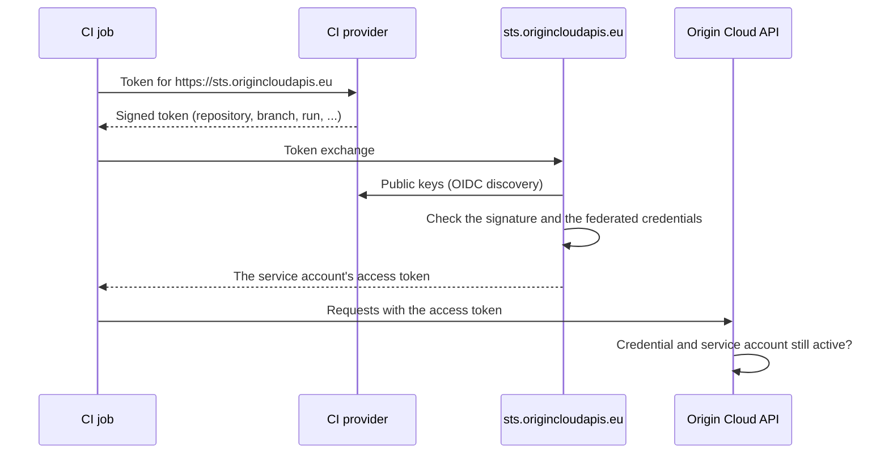

# Workload identity federation

Workload identity federation lets software outside Origin Cloud act as a `WORKLOAD` service account without holding a secret. The job's CI provider signs a short-lived OIDC token that says which job it is. A federated credential on the service account says which jobs to trust. The security token service (STS) at `https://sts.origincloudapis.eu` checks one against the other and exchanges the job's token for the service account's access token. The provider's signature is the proof, so nothing is stored that could leak or has to be rotated.



## Federated credentials

A federated credential belongs to one `WORKLOAD` service account and names exactly:

- **The issuer:** the CI provider's token issuer, such as `https://token.actions.githubusercontent.com` for GitHub Actions.
- **The audience:** the token must be issued for `https://sts.origincloudapis.eu`, unless the credential names another.
- **Conditions:** from 1 to 20 claims the token must carry, each with exactly that value. Values are compared exactly, never as patterns.

At least one condition must name an identity that never changes. For GitHub Actions, that's `repository_id` or `repository_owner_id`. For GitLab.com (`https://gitlab.com`), it's `project_id` or `namespace_id`. For HCP Terraform (`https://app.terraform.io`), it's `terraform_organization_id`. For any other issuer, it's `sub`. A name alone isn't enough: a renamed repository or project, or a new one created under an old name, would inherit the trust. GitLab builds `sub` from the project's path, which is why it doesn't count there. If another provider builds `sub` from names, add a condition on its numeric project or group id as well.

A credential is never changed: to change one, create the new one and delete the old. Deleting a service account deletes its federated credentials. Creating one needs `iam.service_account.create` and `iam.service_account.act_as`, because whoever matches it acts as the service account. See [Trust a CI provider's tokens](service-accounts.md#trust-a-ci-providers-tokens) for the request.

## The exchange

A job assumes the service account with the STS's `AssumeServiceAccount` method, or with the same exchange as an OAuth 2.0 token exchange request (RFC 8693) at `/v1/token`; see the [IAM reference](reference/index.md#security-token-service). The request may name the service account to assume; then only that account's federated credentials are considered, as an AWS role is named when it's assumed. The STS accepts a job's token only if all of these hold:

- the issuer's public keys verify its signature, and it's signed with RS256;
- its issuer and audience are one federated credential's, it hasn't expired, and its `nbf` (not before), if it has one, has passed;
- exactly one federated credential, of the named service account or of any, finds all its conditions in it. A token that two credentials match is refused as ambiguous, unless naming the service account leaves one;
- a pull request's job, a GitHub token whose `event_name` is `pull_request` or `pull_request_target`, matches only a credential that names that `event_name`. Trusting a repository never trusts its pull requests by itself;
- that credential's service account is an active `WORKLOAD` account.

The access token it issues lasts 15 minutes, or between one minute and one hour if the request asks. It names the federated credential it was exchanged through and the job's run.

The access token is for the platform's APIs (audience `origincloud:api`) unless the request names another `audience`. The only other one is the hosted MCP server's, `https://mcp.origincloudapis.eu`: a token for it is otherwise the same token, and is presented to the hosted MCP server, never to the API, which refuses it. A request naming any other audience is refused with `INVALID_ARGUMENT` (`invalid_target` at `/v1/token`) before the job's token is checked, and nothing is issued or recorded.

A refused exchange is answered `PERMISSION_DENIED` (`invalid_grant` at `/v1/token`) without saying which check failed, so that it gives nothing away to someone guessing at a trust policy.

The STS finds an issuer's keys through OIDC discovery at `<issuer>/.well-known/openid-configuration`. So a CI provider qualifies if:

- its issuer serves that document over HTTPS, with a publicly trusted certificate, at a public address;
- the document names the issuer exactly as its tokens do;
- it signs tokens with RS256. A key in its key set that names no algorithm is taken as RS256.

GitHub Actions, GitLab.com and HCP Terraform meet these. A self-hosted provider that can't be reached from the internet doesn't: the STS never fetches keys from a private address.

Every availability zone of the region answers at `sts.origincloudapis.eu`, and the name gives out only the zones whose STS is healthy. If a zone goes down, the jobs' exchanges are answered by the others, and tokens a job already holds keep working. Each zone signs with its own key and names itself in the token's `iss` claim (for example `origincloud:sts:eu-central1-az2`). The API accepts a token from any of them, so a job doesn't need to know which zone answered.

## Revocation and audit

Every API call made with an exchanged token checks again that its federated credential and its service account still exist. Deleting either stops the tokens already exchanged through it at their next call, not when they expire.

The [audit log](audit-log.md) records the creation and deletion of federated credentials, and every exchange, as `iam.federated_credential.exchange`. That entry has the service account as its actor and the credential as its target. It holds the job's repository, workflow, ref, commit and run, or an HCP Terraform run's organization, project, workspace, run ID and phase, and the access token's id, audience and expiry. Each change the job then makes with that access token is recorded with the federated credential and the access token's id in its `details`, so it can be traced back to the run (see [Changes made by a CI job](audit-log.md#changes-made-by-a-ci-job)).

## Where the token comes from

In a GitHub Actions job granted `permissions: id-token: write`, the `origin` CLI and the Go, Rust and TypeScript SDKs find the job's token themselves, exchange it, and renew the access token before it expires. With another provider, such as GitLab CI, they exchange the token in the variable `ORIGINCLOUD_OIDC_TOKEN`, or in the file `ORIGINCLOUD_OIDC_TOKEN_FILE` names; see [Authenticate from GitLab CI and other CI providers](other-ci-providers.md). Outside CI, `origin id login --oidc-token-file` logs the CLI in as a service account with a token from your own identity provider, and `origin sts assume-service-account` exchanges a token once; see [Log in as a service account with your identity provider's token](identity-provider-login.md). Any other tool can call the STS itself; [Authenticate from GitHub Actions](github-actions.md#exchange-the-token-yourself) shows the request.

## HCP Terraform

HCP Terraform gives a workspace's runs workload identity tokens, which it calls dynamic credentials: one for the plan and one for the apply, issued by `https://app.terraform.io`. A federated credential trusts them through the IDs HCP Terraform puts in its tokens, never its names: a renamed workspace, or a new one created under an old name, doesn't inherit the trust.

### Trust a workspace's runs

You need the organization's ID, shown under **Organization settings → General** as `org-…`, and the workspace's ID, shown under the workspace's **Settings → General** as `ws-…`. Create a federated credential on the `WORKLOAD` service account the runs act as:

```sh
origin iam create-federated-credential \
  --organization <org-id> \
  --service-account <service-account-id> \
  --display-name "HCP Terraform: deploy" \
  --issuer https://app.terraform.io \
  --condition terraform_organization_id=<hcp-organization-id> \
  --condition terraform_workspace_id=<hcp-workspace-id>
```

The credential is refused without `terraform_organization_id`. A workspace ID, an organization's or workspace's name, or the `sub` HCP Terraform builds from those names isn't enough without it. These are the conditions an HCP Terraform credential commonly names:

| Claim | Value | Trusts |
|---|---|---|
| `terraform_organization_id` | `org-…` | Every run in the organization. Required. |
| `terraform_workspace_id` | `ws-…` | Only that workspace's runs. |
| `terraform_project_id` | `prj-…` | Only runs of the project's workspaces. |
| `terraform_run_phase` | `plan` or `apply` | Only that phase of a run. Any other value is refused, as it would match no run. |

HCP Terraform lists every claim of its tokens in [Workload identity tokens](https://developer.hashicorp.com/terraform/cloud-docs/workspaces/dynamic-provider-credentials/workload-identity-tokens).

### Separate the plan from the apply

A plan reads, so it can act as a service account that only reads, while the apply acts as one that changes resources. Create a credential with `--condition terraform_run_phase=plan` on the reading account, and one with `--condition terraform_run_phase=apply` on the other. A credential that names `plan` refuses the apply's token, and the other way round.

Give every credential of one workspace a phase once one of them has it. A plan's token that matches both a phase-less credential and a `plan` one is refused as ambiguous.

### Have the workspace issue its tokens

In the workspace's **Variables**, add the environment variable `TFC_WORKLOAD_IDENTITY_AUDIENCE` with the value `https://sts.origincloudapis.eu`. HCP Terraform then gives the plan and the apply a token for that audience in `TFC_WORKLOAD_IDENTITY_TOKEN`. No secret is stored in the workspace.

The Origin Cloud Terraform provider reads that token from v0.21.0 on, exchanges it at the STS for the service account's access tokens, and needs no other configuration. Leave the provider's `credentials_file`, `ORIGINCLOUD_ACCESS_TOKEN` and `ORIGINCLOUD_CREDENTIALS_FILE` unset in the workspace: they come before any CI token.

A workspace that also asks for tokens for other audiences tags this one. Add `TFC_WORKLOAD_IDENTITY_AUDIENCE_<TAG>` instead, such as `TFC_WORKLOAD_IDENTITY_AUDIENCE_ORIGINCLOUD`, and HCP Terraform puts the token in `TFC_WORKLOAD_IDENTITY_TOKEN_ORIGINCLOUD`. Then add the environment variable `ORIGINCLOUD_TFC_WORKLOAD_IDENTITY_TAG` with the tag, `ORIGINCLOUD` here, so the provider reads that token. With a tag set, the provider reads only the tagged token, and fails naming the variable if the run doesn't have it.

If several CI tokens are present, the provider takes the first of: the file `ORIGINCLOUD_OIDC_TOKEN_FILE` names, `ORIGINCLOUD_OIDC_TOKEN`, HCP Terraform's token, then a GitHub Actions job's token. `ORIGINCLOUD_OIDC_DISABLED=true` makes it ignore all of them.

The provider reads the token through the Go SDK, which does so from v0.48.0 on. The `origin` CLI and the Rust and TypeScript SDKs don't read `TFC_WORKLOAD_IDENTITY_TOKEN`. In a run that uses one of those, pass the token in `ORIGINCLOUD_OIDC_TOKEN`, or call the STS yourself, as [Exchange the token yourself](github-actions.md#exchange-the-token-yourself) shows.

Each exchange is recorded in the [audit log](audit-log.md) with the run's organization, workspace, run ID and phase under `run`, so every change the run makes can be traced back to it.

## Related

- [Authenticate from GitHub Actions without a secret](github-actions.md)
- [Authenticate from GitLab CI and other CI providers without a secret](other-ci-providers.md)
- [Log in as a service account with your identity provider's token](identity-provider-login.md)
- [Use service accounts](service-accounts.md)
- [Access model](access-model.md)
- [Audit log](audit-log.md)
