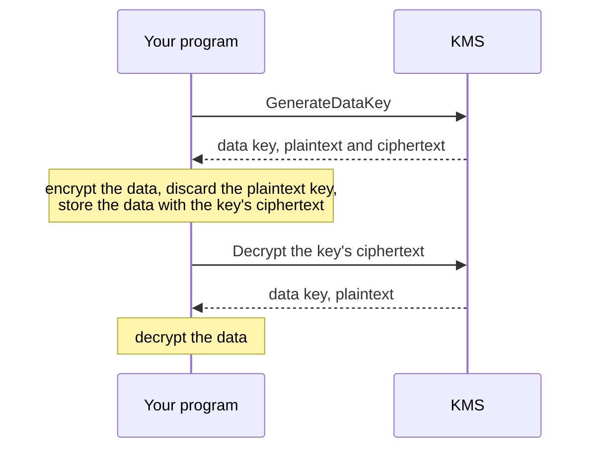

# Encrypt large data with a data key

Encrypt is limited to 64 KiB, and sends your data to the KMS. To encrypt a file, a backup or a database column of any size, encrypt it yourself with a data key, and let the KMS keep only the data key safe. This is envelope encryption.



## Before you begin

- An `ENCRYPT_DECRYPT` key; see [Create a key](create-key.md).
- `kms.key.generate_data_key` and `kms.key.decrypt` on its project, which `roles/kms.encrypter-decrypter` holds.

## Encrypt

1. Generate a data key, with an encryption context that names what it will encrypt:

   ```sh
   curl -sS -X POST \
     https://kms.origincloudapis.eu/v1beta1/projects/<project-id>/regions/eu-central1/keys/<key-id>:generateDataKey \
     -H "$(origin id token --as-header --raw)" \
     -H 'Content-Type: application/json' \
     -d '{"encryptionContext": {"backup": "2026-11-13"}}'
   ```

   The response holds the 32-byte data key twice, both base64: `plaintext`, and `ciphertext`, encrypted under your key.

2. Encrypt your data with the plaintext data key, as an AES-256 key, with an authenticated mode such as AES-256-GCM. This illustrative Python uses the `cryptography` package:

   ```python
   import base64, os
   from cryptography.hazmat.primitives.ciphers.aead import AESGCM

   data_key = base64.b64decode(response["plaintext"])
   nonce = os.urandom(12)
   encrypted = nonce + AESGCM(data_key).encrypt(nonce, data, None)
   del data_key
   ```

3. Store the encrypted data together with the data key's `ciphertext`. Never store the plaintext data key.

## Decrypt

1. Decrypt the data key's ciphertext with the same key and encryption context, as in [Decrypt](encrypt-decrypt.md#decrypt). The response's `plaintext` is the data key.
2. Decrypt your data with it, and discard it again.

A data key encrypts as much data as you like. Generate a new one for each object you encrypt, so that one data key exposed exposes one object.

## Related

- [Encrypt and decrypt data](encrypt-decrypt.md)
- [Encryption context](keys.md#encryption-context)
