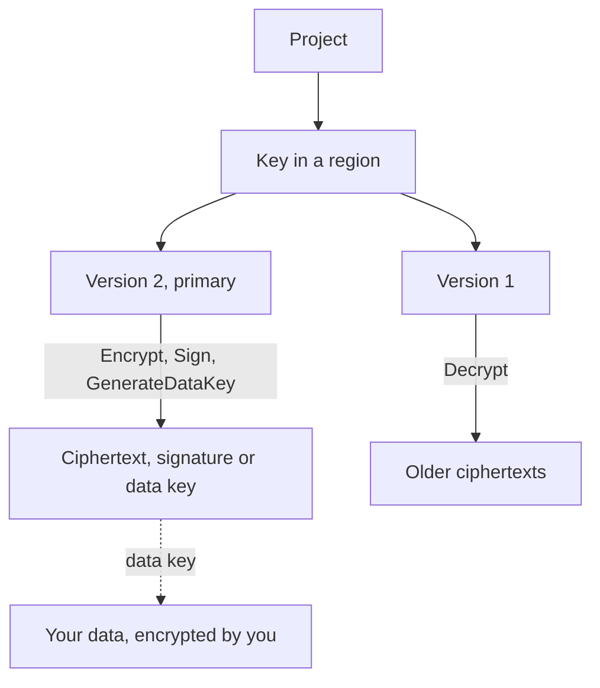

# What is Origin Cloud KMS?

The Key Management Service (KMS) keeps keys for you and uses them on your behalf. You create a key, then ask the KMS to encrypt, decrypt or sign with it. The key's material never leaves the platform: you never see it, store it or rotate it by hand, and every use of it is recorded in your organization's audit log.

> **Note:** The KMS is a preview (`v1beta1`): names and fields may still change.

The following diagram shows how the parts relate.

A key belongs to a project and a region, such as `eu-central1`. Every availability zone of the region serves it, so encrypting, decrypting and signing keep working while any one zone of the region is down.

## Key concepts

**Key**  
An encryption or signing key, named `projects/<project-id>/regions/<region>/keys/<key-id>`. Its purpose, fixed at creation, says what it does. See [Keys and versions](keys.md).

**Key version**  
One generation of a key's material. Rotating a key adds a version and makes it the primary; older versions still decrypt. See [Key versions](keys.md#key-versions).

**Encryption context**  
Pairs of your own, such as `order=o-1001`, bound into a ciphertext. Decrypting needs the same pairs, and the audit log records them. See [Encryption context](keys.md#encryption-context).

**Data key**  
A key the KMS generates for you to encrypt large data yourself, returned in plaintext and encrypted under your key. See [Encrypt large data with a data key](envelope-encryption.md).

**Grant**  
Permission for one platform host to decrypt with your key, for one encryption context, for at most an hour. See [Grants](grants.md).

## Features

**Encryption**  
Encrypt and decrypt up to 64 KiB with AES-256-GCM-SIV. See [Encrypt and decrypt data](encrypt-decrypt.md).

**Envelope encryption**  
Encrypt data of any size with a data key, and keep only the data key's ciphertext. See [Encrypt large data with a data key](envelope-encryption.md).

**Signing**  
Sign with ECDSA over P-256 and SHA-256, or with Ed25519, and verify with the public key anywhere. See [Sign data and verify signatures](sign-verify.md).

**Rotation, disabling and deletion**  
Rotate a key, disable it, and delete it with a waiting period during which you can undo the deletion. See [Rotate a key](rotate-key.md) and [Disable, delete and restore a key](disable-delete.md).

## Ways to access the KMS

**REST API**  
The KMS API answers at `https://kms.origincloudapis.eu`, at the regional name `https://kms.eu-central1.origincloudapis.eu`, and through the SDKs generated from it. See [Call the KMS API](reference/index.md#call-the-kms-api) and [KMS API methods](reference/index.md#api-methods).

## Access

Each method needs a `kms.key.*` or `kms.grant.*` permission on the key's project. Owner holds them all, and Viewer can read keys. To give a program only what it uses, assign one of the KMS roles to its service account:

- `roles/kms.encrypter-decrypter`: encrypt, decrypt and generate data keys.
- `roles/kms.signer`: sign, and read public keys.
- `roles/kms.admin`: manage keys, but never use them on data.
- `roles/kms.viewer`: read keys, public keys and grants.
- `roles/kms.grant-delegate`: make grants that let the platform's hosts decrypt with your keys, never use them. Every organization holds its org-wide binding to compute's [service agent](../iam/service-agents.md), `//iam.origincloudapis.eu/serviceAgents/compute`, which attaches your volumes; only a service agent's binding of it does anything. See [Grants](grants.md).

See [Permissions and roles](reference/index.md#permissions-and-roles).

## Related services

- [IAM](../iam/index.md) – roles, service accounts and the audit log that records every use of a key
- [Platform](../platform/index.md) – organizations, projects and access

## Next steps

- [Create a key](create-key.md)
- [Encrypt and decrypt data](encrypt-decrypt.md)
- [Encrypt large data with a data key](envelope-encryption.md)
- [Sign data and verify signatures](sign-verify.md)
- [Troubleshoot the KMS](troubleshooting/index.md)
