# Keys and versions

A key belongs to a project and a region. Its name is `projects/<project-id>/regions/<region>/keys/<key-id>`. Origin Cloud assigns the key id when it creates the key, such as `key-RAiXDqjUHLh`, and never uses it again, not even after the key is deleted. Keep the name CreateKey returns: it's what your programs use the key by.

## Purposes

A key's purpose is fixed when it's created and says what the key does.

| Purpose | Operations | Algorithm |
|---|---|---|
| `ENCRYPT_DECRYPT` | Encrypt, Decrypt, GenerateDataKey | AES-256-GCM-SIV |
| `SIGN_ECDSA_P256_SHA256` | Sign, GetPublicKey | ECDSA over P-256 with SHA-256; signatures are ASN.1 DER |
| `SIGN_ED25519` | Sign, GetPublicKey | Ed25519; signatures are 64 bytes |

## Key versions

A key has one or more versions, numbered from 1, each its own material. One of them is the primary: Encrypt, GenerateDataKey and Sign use it. A ciphertext records the version that made it, so Decrypt uses that version, and a signature's response names its version, whose public key verifies it. Rotating a key adds a version and makes it the primary; the older versions keep decrypting and their public keys stay readable. See [Rotate a key](rotate-key.md).

A version is named `projects/<project-id>/regions/<region>/keys/<key-id>/versions/<version>`, and its full name is `//kms.origincloudapis.eu/` followed by that name. Responses name the version they used in `keyVersion`, by its full name, and Sign takes one in `keyVersion` the same way.

## States

```mermaid
stateDiagram-v2
  accTitle: Key states
  accDescr: A key is created enabled. UpdateKey disables and enables it. DeleteKey makes an enabled or disabled key deleted. UndeleteKey restores a deleted key as disabled until its purge time; at the purge time its material is destroyed for good.
  [*] --> ENABLED: CreateKey
  ENABLED --> DISABLED: UpdateKey
  DISABLED --> ENABLED: UpdateKey
  ENABLED --> DELETED: DeleteKey
  DISABLED --> DELETED: DeleteKey
  DELETED --> DISABLED: UndeleteKey, before purgeTime
  DELETED --> [*]: purgeTime, material destroyed
```

| State | Means |
|---|---|
| `ENABLED` | Serves every operation of its purpose. |
| `DISABLED` | Refuses every operation but GetPublicKey with `CONFLICT` until it's enabled again. |
| `DELETED` | Refuses every operation but GetPublicKey. Until `purgeTime`, UndeleteKey restores it, disabled. At `purgeTime` its material is destroyed: nothing it encrypted can be decrypted again, and its public keys are gone. |

A deleted key stays readable with GetKey, and is listed only when you ask for deleted keys. See [Disable, delete and restore a key](disable-delete.md).

## Keys the platform manages

Origin Cloud can create keys in your project for its own use of the project's data, such as a key tagged `origin:name=volumes` for your volumes' data keys. Such a key has `platformManaged` set. Ids of these keys are assigned like any other.

- You see it like any key of yours: with GetKey and ListKeys, with its grants, and with its entries in the audit log.
- Only the platform makes, renews and deletes its grants: CreateGrant, RenewGrant and DeleteGrant on it answer `FORBIDDEN`, recorded with reason `platform_managed`. See [Grants](grants.md).
- You can't change it: UpdateKey, DeleteKey, UndeleteKey and RotateKey answer `FORBIDDEN`, whatever roles you hold. Each refusal is recorded in the audit log, with reason `platform_managed`. Disabling, rotating or deleting it would break, or destroy for good, every volume it protects.
- Using it on data follows your roles, as for any key.
- It's deleted with its project. Deleting the project makes the key `DELETED`, with a `purgeTime` 30 days later, when its material is destroyed. The audit log records the deletion as `kms.keys.scheduleDeletion`, with the actor `platform`. A key of your own isn't deleted on your behalf: [delete it](disable-delete.md#delete-a-key) before you delete the project, or the project's deletion is refused with `CONFLICT`. See [Delete a project](../platform/organizations/projects.md#delete-a-project).

## Encryption context

The encryption context is a set of pairs of your own, such as `{"order": "o-1001"}`, given to Encrypt or GenerateDataKey and bound into the ciphertext. Decrypt needs exactly the same pairs; with any other pairs, or none, the ciphertext doesn't decrypt. Use it to tie a ciphertext to what it belongs to, so that a ciphertext copied to another record doesn't decrypt there.

The context isn't secret: the audit log records it with every use of the key. It holds at most 16 pairs, each key and value 1 to 256 bytes.

## Where a request is answered

Every availability zone of a key's region keeps a copy of the key and answers Encrypt, Decrypt, GenerateDataKey, Sign and GetPublicKey from it, without asking another zone. So these keep working while any one zone of the region is down.

Creating, reading, listing, rotating, enabling, disabling, deleting and undeleting a key are answered by one zone of the region. While it's unreachable, they're refused with `SERVICE_UNAVAILABLE` and can be retried; the operations on data carry on. A change reaches the region's other zones within seconds. Until it has, an operation that needs it, such as encrypting with a key you've just created, is refused with `SERVICE_UNAVAILABLE`, never `NOT_FOUND`: retry it.

A request's secrets travel between the API and the zone that answers encrypted for that one request.

## Audit

Every change to a key and every use of it but GetPublicKey is recorded in the organization's [audit log](../iam/audit-log.md), with the caller, the key's full name as the target, the key version, and the encryption context. Plaintexts, data keys and the data you sign are never recorded.

A use the KMS refuses is recorded too, with outcome `FAILED` and a `reason` in `details`, so a decrypt under the wrong context shows up whether it came from a misconfigured caller or from someone holding a copied ciphertext:

| `reason` | The KMS refused because |
|---|---|
| `does_not_open` | the ciphertext doesn't decrypt under the key and the encryption context given, or isn't a ciphertext of this KMS |
| `key_not_enabled` | the key is disabled or deleted |
| `version_unavailable` | the key version the ciphertext names has had its material destroyed |
| `invalid_request` | the request doesn't fit the key, such as signing with an encryption key or encrypting more than 64 KiB |
| `platform_managed` | the request changes a key the platform manages, or makes, renews or deletes one of its grants; see [Keys the platform manages](#keys-the-platform-manages) |

A request that only failed for a moment, such as one sent while a zone was starting, isn't recorded: retried, it is answered and recorded then.

## Related

- [Create a key](create-key.md)
- [KMS reference](reference/index.md)
