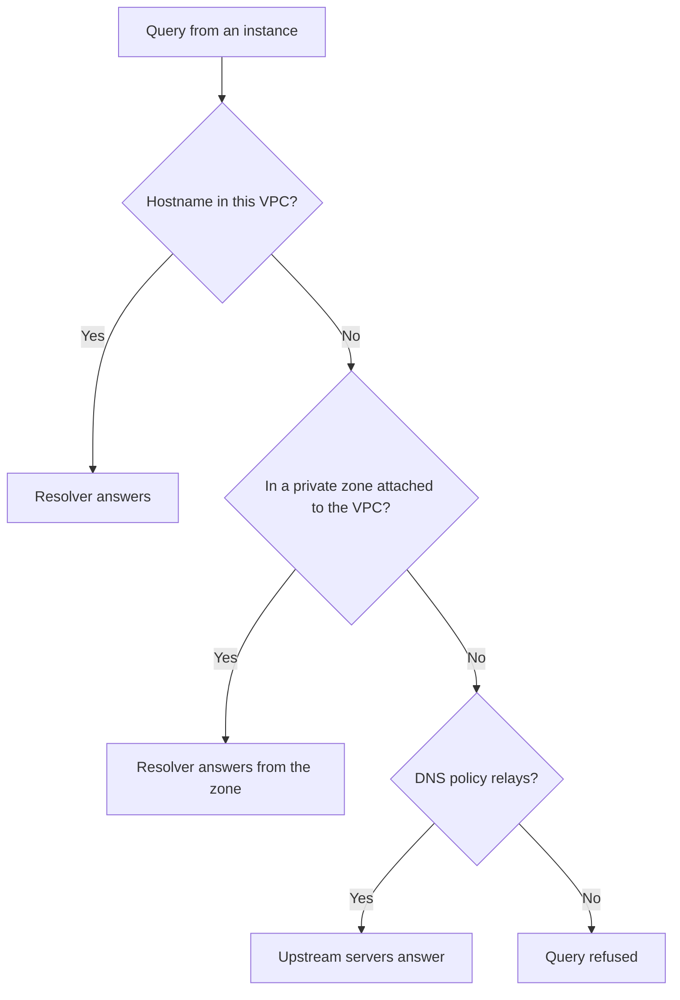

# DNS

Instances in the same VPC can resolve each other by hostname without any setup. Every subnet has a DNS resolver on its second address after the network address, and every instance uses it. The resolver answers names in its own VPC and in the private zones attached to it itself, and relays every other query according to the VPC's DNS policy.

The following diagram shows how the resolver handles a query.

## Key concepts

**Internal hostname**  
Every instance has a hostname derived from its primary private IPv4 address in the `internal` domain. An instance at `10.0.1.20` answers to `ip-10-0-1-20.internal`. Because `internal` is on every instance's DNS search list, the short name `ip-10-0-1-20` works too.

**Per-VPC resolution**  
Each VPC resolves only its own instances' hostnames. Two instances in different VPCs can have the same hostname without conflict, and neither VPC can resolve the other's.

**DNS policy**  
Decides what happens to queries the resolver can't answer itself: whether they're relayed at all, and to which upstream servers. A DNS policy belongs to a project and a region, not to one VPC. A project can have several, and one policy can serve several VPCs of its region, each through a DNS policy association. If a policy has relaying turned off, every query outside the VPC is refused.

**Private zones**  
A private hosted zone attached to the VPC is answered by the resolver too, so instances resolve its names, such as `db.corp.example`, without relaying. The zone answers for every name below it, so inside the VPC it hides the public zone of the same domain. See [Private zones and VPC attachments](../../dns/private-zones/index.md#how-a-vpc-answers).

**Default policy**  
Each project has exactly one default policy in a region, its `projectDefault` field `true`. The platform creates it with your first VPC in the project, pointing at a public resolver with relaying on. A VPC with no DNS policy association relays through the project's default policy in its region, and follows it when you change the default. A VPC you create starts with no association, so its `dnsPolicy` is empty. Your default VPC is associated with the policy that was the default when it was created.

## What you can do

- [Manage DNS policies](manage-policies.md): create policies, change their servers, associate one with a VPC, change the project default, delete one.

## Related

- [VPC and subnet addressing](../vpcs/addressing.md#reserved-addresses)
- [How rules, routes and lists change](../traffic-control/replace-rule-sets.md)
- [`origin network` commands](../reference/cli.md)
