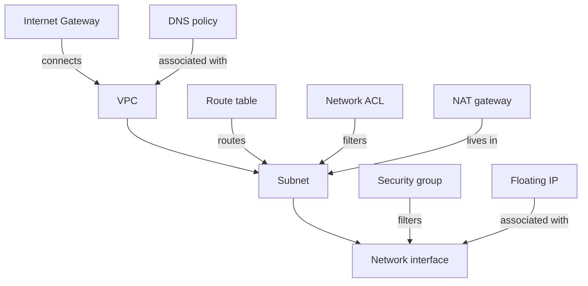

# What is Origin Cloud Network?

Network is where your instances live. A VPC is an isolated network with its own private address space, subnets divide that space, and every instance connects to a subnet through a network interface. A new VPC is private: nothing in it is reachable from the internet until you create an Internet Gateway for it and give instances a way out. Security groups and network ACLs decide which traffic is allowed, and a DNS policy decides how the VPC resolves names it doesn't know.

The following diagram shows how the parts contain and connect to each other.

An instance's network interface holds its private IPv4 and IPv6 addresses in one subnet. A Floating IP gives one interface a public IPv4 address. A NAT gateway gives a whole subnet outbound-only internet access through one shared address.

## Features

**VPCs and subnets**  
Isolated networks with a private IPv4 range you choose or the platform picks, an IPv6 range assigned for you, and subnets carved from both. A project also gets a default VPC the first time an instance is launched without a subnet. See [VPCs and subnets](vpcs/index.md).

**Internet access**  
Internet Gateways, route tables, NAT gateways and Floating IPs decide whether and how traffic reaches the internet. See [Internet access](internet-access/index.md).

**Traffic control**  
Stateful security groups on each network interface and stateless network ACLs on each subnet. See [Traffic control](traffic-control/index.md).

**DNS**  
Every instance gets an internal hostname that other instances in its VPC can resolve. DNS policies decide where other queries are relayed. See [DNS](dns/index.md). For zones and records of your own domains, public or private, see the [DNS guide](../dns/index.md).

## Ways to access Network

**CLI**  
The `origin network` command group, with a command for each resource and for the associations between them. VPCs, route tables, network ACLs, security groups, Internet Gateways and DNS policies are regional; subnets, network interfaces, Floating IPs and NAT gateways are zonal. See [Use the CLI](../platform/access/cli.md) to install it and log in, and [`origin network` commands](reference/cli.md) for every command.

**GraphQL API**  
VPCs, subnets, network interfaces, gateways, route tables, Floating IPs, ACLs, security groups and DNS policies live under the `network` namespace of the API, for both queries and mutations. See [API access](../platform/access/api.md) and the [Network reference](reference/index.md).

## When to use Network

Every instance needs a network interface in a subnet, so you use Network whenever you run Compute. Create your own VPCs when you want to choose the address range, keep workloads apart, or decide yourself which subnets reach the internet, or use your project's [default VPC](vpcs/default-vpc.md).

Network doesn't connect two VPCs to each other, and it doesn't give instances IPv6 internet access. Traffic between the internet and your instances is IPv4 only, through a Floating IP or a NAT gateway.

## Related services

- [Compute](../compute/index.md) – instances that connect to subnets through network interfaces
- [DNS](../dns/index.md) – public and private hosted zones, and private zones attached to VPCs
- [Platform](../platform/index.md) – organizations, projects, billing and access

## Pricing

VPCs, subnets, route tables, ACLs, security groups and DNS policies cost nothing by themselves. Floating IPs and NAT gateways are billed while you hold them, and traffic from your VPC to the internet is billed. Allocating a Floating IP and creating a NAT gateway require a payment method; see [Add a payment method](../platform/billing/payment-method.md). For prices, see [Pricing](../pricing/index.md).

## On origincloud.eu

[VPC networking](https://www.origincloud.eu/vpc/) describes the service.

## Next steps

- [Get started with Origin Cloud](../platform/getting-started/index.md)
- [Create a VPC and subnets](vpcs/create.md)
- [Give a private subnet internet access with a NAT gateway](internet-access/nat-gateways.md)
- [Troubleshoot Network](troubleshooting/index.md)
