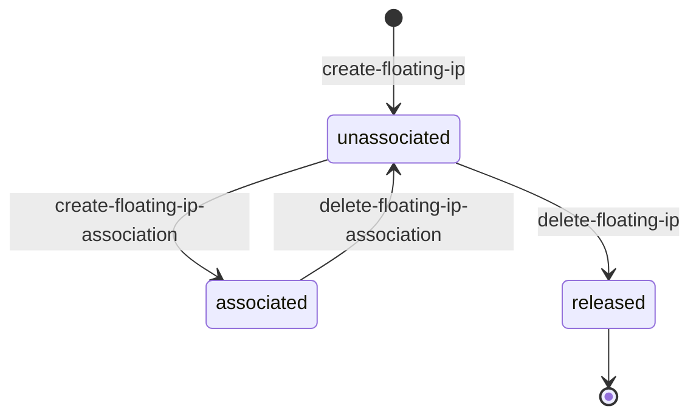

# Floating IPs

A Floating IP is a public IPv4 address that you allocate to a project and associate with a network interface. The platform translates it 1:1 to the interface's private IPv4 address, in both directions: the instance reaches the internet as that address, and the internet reaches the instance through it. The address stays yours, unassociated if need be, until you release it.

A Floating IP lives in one zone, and associates with a network interface in the same zone.

The following diagram shows the states of a Floating IP you allocate.



## Use a Floating IP

You work with a Floating IP through these commands:

- `create-floating-ip` allocates an address from the zone's public addresses for your project. It requires a payment method; without one, it's refused with [`PAYMENT_METHOD_REQUIRED`](../../platform/reference/errors.md#payment_method_required).
- `create-floating-ip-association` points it at a network interface. A Floating IP serves one interface at a time; associating one that's already associated, or that backs a NAT gateway, is refused with `FAILED_PRECONDITION`.
- `delete-floating-ip-association` removes the association. The address stays allocated.
- `delete-floating-ip` releases the address. It's refused while the address is associated or a NAT gateway uses it.

For example, to give an instance a public address, allocate one, find the instance's network interface with `origin compute get-instance` or `list-network-interfaces`, and associate the address with it:

```sh
origin network create-floating-ip
origin network create-floating-ip-association --floating-ip <floating-ip-id> \
  --network-interface <network-interface-id>
```

The Floating IP's `address` is the public address, and `networkInterface` and `privateAddress` show where it points. You can associate the address before you launch the instance, as soon as the interface exists. The instance's subnet must be in a VPC with an Internet Gateway, and its security groups and network ACL must allow the traffic. See [Internet access](index.md).

To move the address, remove its association and create a new one. The association's id is the network interface's id:

```sh
origin network delete-floating-ip-association --floating-ip <floating-ip-id> \
  --association <network-interface-id> --yes
```

## When an address is released

An address you allocated is never released for you. Terminating an instance releases the network interface you launched it with, which keeps its Floating IP association, so the address reaches the next instance you launch with that interface. An interface that a launch created for the instance is deleted with it, and an address you allocated and associated with it stays allocated, unassociated.

An address the platform assigned at launch, because the subnet has auto-assign public IP turned on, is different: its `autoAssigned` is `true`, and it's part of the network interface the launch created. Disassociating or releasing it is refused with [`CONFLICT`](../../platform/reference/errors.md#conflict), naming the interface; the platform releases it with the interface when you terminate the instance. To keep an address across instances, allocate one yourself. See [Default VPC](../vpcs/default-vpc.md#auto-assigned-public-ips).

A released Floating IP no longer exists in your project. `get-floating-ip` on it fails with [`NOT_FOUND`](../../platform/reference/errors.md#not_found) and exits with `1`.

A released address isn't allocated again for one hour, whether you released it or the platform did. DNS records, allow-lists and integrations that still name the address have that hour to expire or be updated before the address can belong to someone else. For the same reason, an address you're allocated wasn't someone else's a moment ago.

## Reaching a Floating IP from inside its VPC

An instance can connect to the Floating IP of another instance in the same VPC, or to its own, and gets the reply from that Floating IP. This happens when services in one VPC address each other by public DNS name, or when an instance checks itself through its public address. Two things differ from private-address traffic:

- **The server sees a public source address.** A caller with its own Floating IP appears as that address. A caller without one appears as the Floating IP it called. Security group rules that name a group, including the default group's rule, match private addresses only, so they don't admit this traffic and the connection hangs. Allow the port from the public addresses you expect, as you would for an external client.
- **It works only from the Floating IP's own VPC.** From an instance in a different VPC, even one of yours, connecting to a Floating IP hangs. Reach that instance from outside the platform instead.

## When no address is available

The public IPv4 pool is shared by the whole platform, so `create-floating-ip` can be refused because no address is left. That's separate from your organization's and project's public IP quota, which is refused with the limit you reached. Both messages say which one applies. Releasing Floating IPs you don't need frees quota and pool space.

## Billing

A Floating IP is billed for as long as it's allocated to you, whether or not it's associated. For prices, see [Pricing](../../pricing/index.md).

## Related

- [Give a private subnet internet access with a NAT gateway](nat-gateways.md)
- [Network interfaces](../vpcs/network-interfaces.md)
- [`create-floating-ip` reference](../reference/cli.md#create-floating-ip)
- [`create-floating-ip-association` reference](../reference/cli.md#create-floating-ip-association)
- [Limits](../../platform/reference/limits.md#network)
