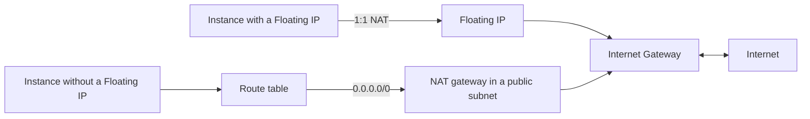

# Internet access

A VPC you create is private: nothing in it reaches the internet or can be reached from it. Internet access takes an Internet Gateway on the VPC, plus one of two ways out for each instance. A Floating IP gives one instance a public IPv4 address in both directions. A NAT gateway gives a whole subnet outbound-only access through one shared address.

The following diagram shows the two paths from an instance to the internet.

Internet traffic is IPv4 only. Instances can't use IPv6 to or from the internet; see [VPC and subnet addressing](../vpcs/addressing.md#ipv6-addresses).

An instance with a Floating IP always uses it, even in a subnet routed through a NAT gateway. An instance with neither has no internet access. In a VPC you create, you add the default route to the Internet Gateway yourself; see [Create a VPC and subnets](../vpcs/create.md#build-a-network-that-reaches-the-internet). On both paths, the subnet's network ACL and the instance's security groups must also allow the traffic; see [Traffic control](../traffic-control/index.md).

## Key concepts

**Internet Gateway**  
Connects a whole VPC to the internet. A VPC has at most one. Creating it adds no route, except in your default VPC, where it adds default routes to the VPC's main route table. See [Create and delete an Internet Gateway](internet-gateways.md).

**Route table**  
Decides where a subnet's internet-bound traffic goes: out through the Internet Gateway, through a NAT gateway, or nowhere. A subnet with no route table association has no route out of the VPC and isn't reachable from the internet. Internet access is decided per subnet and address family by the subnet's own table. See [Route tables](route-tables.md).

**Floating IP**  
A public IPv4 address you hold in your project and associate with a network interface. The platform translates it 1:1 to the interface's private address. See [Floating IPs](floating-ips.md).

**NAT gateway**  
Shared outbound IPv4 access for instances without a Floating IP. Instances behind it aren't reachable from the internet. See [Give a private subnet internet access with a NAT gateway](nat-gateways.md).

## What you can do

- [Create and delete an Internet Gateway](internet-gateways.md)
- [Give a private subnet internet access with a NAT gateway](nat-gateways.md)
- [Allocate, associate and release Floating IPs](floating-ips.md#use-a-floating-ip)

## Limits and quotas

Internet Gateways, NAT gateways and public IPv4 addresses are limited per organization and project. See [Limits](../../platform/reference/limits.md#network).

## Related

- [VPCs and subnets](../vpcs/index.md)
- [Traffic control](../traffic-control/index.md)
- [Troubleshoot Network](../troubleshooting/index.md#an-instance-cant-reach-the-internet)
