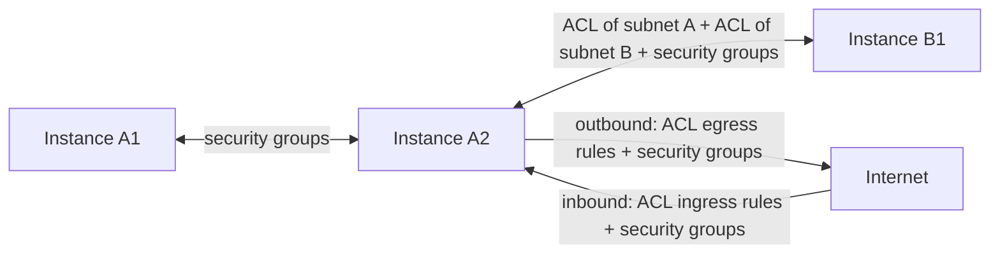

# Traffic control

Two kinds of rules decide which traffic reaches your instances. Security groups are stateful firewalls on each network interface and apply to every packet the instance sends or receives. Network ACLs are stateless rule lists on each subnet, and apply to every packet that crosses the subnet's boundary. Use security groups as your main control, and network ACLs as an extra layer between subnets and toward the internet.

The following diagram shows which rules apply on each path.

Instances A1 and A2 are in subnet A, instance B1 is in subnet B. The table summarizes the same paths.

| Traffic | Security groups | Network ACL |
|---|---|---|
| Between instances in the same subnet | Yes | No, never |
| Between subnets of a VPC | Yes | Egress rules of the source subnet and ingress rules of the destination subnet |
| From a subnet to the internet | Yes | Egress rules of the subnet |
| From the internet to a subnet | Yes | Ingress rules of the subnet |

Whether two instances run on the same machine makes no difference, and the rules are the same in a VPC with or without an Internet Gateway. In a VPC without an Internet Gateway, instances in different subnets can't reach each other at all; see [VPCs and subnets](../vpcs/index.md).

## Key concepts

**Security group**  
A stateful set of ingress and egress rules on a network interface. Anything not allowed is denied, and replies to allowed connections pass automatically. See [Security groups](security-groups.md).

**Network ACL**  
A stateless, ordered list of allow and deny rules for a subnet. See [Network ACLs](network-acls.md), including exactly where they're enforced.

**Source-address check**  
Before either kind of rule applies, every packet an instance sends must come from its own network interface's addresses, unless the interface's source-address check is turned off. See [Source-address check](../vpcs/network-interfaces.md#source-address-check).

**Rules and associations**  
Each rule is a resource you add or remove on its own, and a security group or network ACL applies to an interface or subnet through an association. See [How rules, routes and lists change](replace-rule-sets.md).

## What you can do

- [Change a security group's rules](security-groups.md#change-a-security-groups-rules)
- [Change an interface's security groups](security-groups.md#change-an-interfaces-security-groups)
- [Create and assign a network ACL](network-acls.md#create-and-assign-a-network-acl)

## Limits and quotas

See [Limits](../../platform/reference/limits.md#network).

## Related

- [Internet access](../internet-access/index.md)
- [Network interfaces](../vpcs/network-interfaces.md)
- [`origin network` commands](../reference/cli.md)
