# Create a VPC and subnets

Create your own VPC when you want to choose its address range or control which subnets reach the internet. A new VPC is empty: you add its subnets, Internet Gateway, route tables, network ACLs and security groups yourself, and the network interfaces your instances launch with.

## Before you begin

- The `origin` CLI, logged in, with a default project, zone and region. See [Use the CLI](../../platform/access/cli.md#set-a-default-project-zone-and-region). A VPC lives in a region, and its subnets in a zone of that region.
- If you want your own IPv4 range, a private range between `/16` and `/28`. See [VPC and subnet addressing](addressing.md) for how the range sets the subnet size.

Creating VPCs and subnets doesn't require a payment method.

## Create the VPC

1. Create the VPC. Pass `--ipv4-cidr-block` to choose the IPv4 range, or leave it out to get a free `/16` from `172.16.0.0/12`.

   ```sh
   origin network create-vpc --ipv4-cidr-block 10.0.0.0/16 \
     --tag origin:name=frontend
   ```

   `--tag origin:name=frontend` names the VPC; leave it out for an unnamed VPC. See [Name and tag network resources](name-and-tag.md).

2. Note the VPC's id, the last segment of its `name` in the output. The commands below take it as `--vpc <vpc-id>`; see [Name resources](../../platform/access/cli.md#name-resources). Its `ipv4CidrBlock` shows the range, and `subnetIpv4PrefixLength` the size every subnet gets. To read it again:

   ```sh
   origin network get-vpc --vpc <vpc-id>
   ```

The VPC has no subnet, route table, network ACL, security group or Internet Gateway, and its `dnsPolicy` is empty: it relays DNS through the project's default policy in its region. See [DNS](../dns/index.md).

## Add a subnet

1. Create the subnet in your default zone:

   ```sh
   origin network create-subnet --vpc <vpc-id>
   ```

   The platform picks the subnet's ranges from the VPC. If the VPC has no room left, the command is refused; see [When address space runs out](addressing.md#when-address-space-runs-out).

2. Note the subnet's id from its `name`. Its `ipv4CidrBlock`, `ipv4Gateway` and `ipv4DnsServers` show its range, gateway and resolver:

   ```sh
   origin network get-subnet --subnet <subnet-id>
   ```

   In a VPC you created, the subnet's `routeTable` and `acl` are empty: it has no route out of the VPC, isn't reachable from the internet, and isn't filtered at its edge. Internet access is decided per subnet by its own route table; see [How internet access is decided](../internet-access/route-tables.md#how-internet-access-is-decided). In your default VPC, a new subnet is associated with the VPC's main route table and default ACL.

`--auto-assign-public-ip true` on `create-subnet` gives a Floating IP to each instance whose launch creates its network interface in the subnet, as the GraphQL API's `launchInstance` does. An instance you launch with `origin compute create-instance` uses a network interface you created, which gets no address this way: associate a Floating IP with the interface, as in the next section. For how auto-assigned addresses behave, see [Default VPC](default-vpc.md#auto-assigned-public-ips).

## Build a network that reaches the internet

A subnet reaches the internet once the VPC has an Internet Gateway and the subnet's route table has a default route to it. Its instances also need a public address and a security group that admits their traffic. A network ACL is optional.

```mermaid
flowchart LR
  accTitle: Building a VPC that reaches the internet
  accDescr: Create the subnet and the VPC's Internet Gateway, create a route table with a default route to the gateway and associate it with the subnet, optionally associate a network ACL, create a security group with rules, create a network interface with that group and a Floating IP, then launch an instance with the interface.
  subnet[Create a subnet] --> igw[Create an Internet Gateway]
  igw --> rt[Create a route table and a default route]
  rt --> assoc[Associate the table with the subnet]
  assoc --> acl["Associate a network ACL (optional)"]
  acl --> sg[Create a security group and its rules]
  sg --> nic[Create a network interface with the group]
  nic --> fip[Associate a Floating IP with the interface]
  fip --> launch[Launch with the interface]
```



1. Create a subnet, as in [Add a subnet](#add-a-subnet).

2. Create the VPC's Internet Gateway, and note its id:

   ```sh
   origin network create-internet-gateway --vpc <vpc-id>
   ```

   Creating it adds no route to a VPC you created. See [Create and delete an Internet Gateway](../internet-access/internet-gateways.md).

3. Create a route table, and note its id. Its `localRoutes` are the VPC's own ranges, which every table reaches directly.

   ```sh
   origin network create-route-table --vpc <vpc-id>
   ```

4. Add a default route to the gateway:

   ```sh
   origin network create-route --route-table <route-table-id> \
     --destination 0.0.0.0/0 --internet-gateway <internet-gateway-id>
   ```

5. Associate the subnet with the table:

   ```sh
   origin network create-route-table-association --subnet <subnet-id> \
     --route-table <route-table-id>
   ```

   For more on routes, see [Route tables](../internet-access/route-tables.md).

6. Optional: filter the subnet's edge with a network ACL. Create one, add rules, and associate it with the subnet. An ACL with no rules drops everything, and ACLs are stateless, so allow the replies too. For example, to allow all traffic in both directions and both address families:

   ```sh
   origin network create-acl --vpc <vpc-id>
   origin network create-acl-rule --acl <acl-id> --direction INGRESS \
     --priority 100 --protocol ALL --cidr-block 0.0.0.0/0 --action ACCEPT
   origin network create-acl-rule --acl <acl-id> --direction INGRESS \
     --priority 110 --protocol ALL --cidr-block ::/0 --action ACCEPT
   origin network create-acl-rule --acl <acl-id> --direction EGRESS \
     --priority 100 --protocol ALL --cidr-block 0.0.0.0/0 --action ACCEPT
   origin network create-acl-rule --acl <acl-id> --direction EGRESS \
     --priority 110 --protocol ALL --cidr-block ::/0 --action ACCEPT
   origin network create-acl-association --subnet <subnet-id> --acl <acl-id>
   ```

   See [Network ACLs](../traffic-control/network-acls.md).

7. Create a security group and add its rules. A network interface in no security group passes no traffic. For example, to allow SSH and ping in, traffic between the group's members, and everything out:

   ```sh
   origin network create-security-group --vpc <vpc-id> --tag origin:name=web
   origin network create-security-group-rule --security-group <security-group-id> \
     --direction INGRESS --protocol TCP --first-port 22 --cidr-block 0.0.0.0/0
   origin network create-security-group-rule --security-group <security-group-id> \
     --direction INGRESS --protocol ICMP --cidr-block 0.0.0.0/0
   origin network create-security-group-rule --security-group <security-group-id> \
     --direction INGRESS --protocol ALL --same-group true
   origin network create-security-group-rule --security-group <security-group-id> \
     --direction EGRESS --protocol ALL --cidr-block 0.0.0.0/0
   origin network create-security-group-rule --security-group <security-group-id> \
     --direction EGRESS --protocol ALL --cidr-block ::/0
   ```

   See [Security groups](../traffic-control/security-groups.md).

8. Create a network interface in the subnet, note its id, and associate the security group with it:

   ```sh
   origin network create-network-interface --subnet <subnet-id>
   origin network create-security-group-association \
     --network-interface <network-interface-id> \
     --security-group <security-group-id>
   ```

   See [Network interfaces](network-interfaces.md).

9. Give the interface a public address. Allocate a Floating IP, note its id, and associate it with the interface. Allocating a Floating IP requires a payment method.

   ```sh
   origin network create-floating-ip
   origin network create-floating-ip-association --floating-ip <floating-ip-id> \
     --network-interface <network-interface-id>
   ```

   See [Floating IPs](../internet-access/floating-ips.md).

10. Launch an instance with `--network-interface <network-interface-id>`. See [Launch an instance](../../compute/instances/launch.md).

## Change a subnet's auto-assign setting

1. Set the new value with `true` or `false`:

   ```sh
   origin network update-subnet --subnet <subnet-id> \
     --auto-assign-public-ip true
   ```

2. Verify that the output's `autoAssignPublicIp` field shows the new value.

The change applies only to instances launched afterwards, and only to launches that create their own network interface. To give a running instance a public address, associate a Floating IP with its interface; see [Floating IPs](../internet-access/floating-ips.md).

## Next steps

- [Launch an instance](../../compute/instances/launch.md) with a network interface in the subnet
- [Give a private subnet internet access with a NAT gateway](../internet-access/nat-gateways.md)

## Related

- [`create-vpc` reference](../reference/cli.md#create-vpc)
- [`create-subnet` reference](../reference/cli.md#create-subnet)
- [`create-route` reference](../reference/cli.md#create-route)
- [`create-route-table-association` reference](../reference/cli.md#create-route-table-association)
- [`update-subnet` reference](../reference/cli.md#update-subnet)
