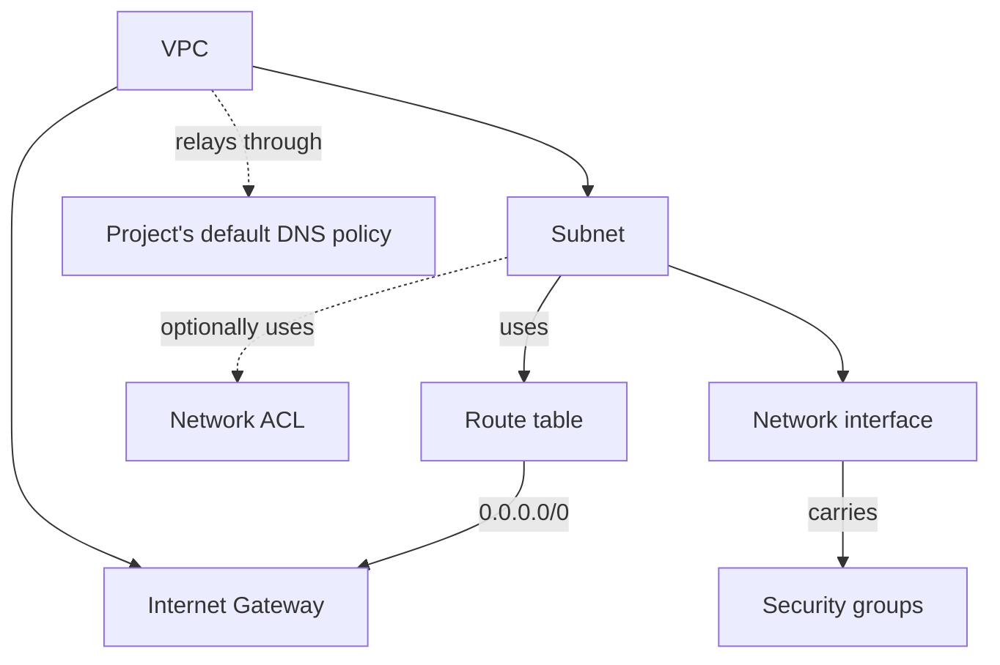

# VPCs and subnets

A VPC (virtual private cloud) is an isolated network for your resources. It has one private IPv4 range and one IPv6 range, and you divide them into subnets. Every instance connects to a subnet through its network interface. Instances in different VPCs can't reach each other over their private addresses.

A VPC lives in one region of a project, and each of its subnets in one zone. A VPC you create is empty: it has no subnet, route table, network ACL, security group or Internet Gateway. You add what your workload needs. The following diagram shows the pieces of a VPC that reaches the internet.

Until it has an Internet Gateway and a subnet's route table has a default route to it, nothing in the VPC can reach the internet or be reached from it. A missing piece has a defined meaning:

- A subnet with no route table has no route out of the VPC and isn't reachable from the internet. Internet access is decided per subnet and address family by the subnet's own route table; see [Route tables](../internet-access/route-tables.md#how-internet-access-is-decided).
- A subnet with no network ACL isn't filtered at its edge; its instances' security groups still apply.
- A network interface in no security group passes no traffic except address resolution.
- A VPC with no DNS policy association relays through the project's default policy in its region.

Your project's [default VPC](default-vpc.md) is the exception: the platform creates it with all of these in place.

## Key concepts

**VPC**  
An isolated network in one region of a project. Creating one gives you an empty VPC with its address ranges; you add subnets, route tables, network ACLs and security groups. See [Create a VPC and subnets](create.md).

**Subnet**  
A slice of the VPC's IPv4 and IPv6 ranges, in one zone. A VPC can have many subnets. Each subnet uses at most one route table and at most one network ACL, and has a setting that decides whether instances launched into it get a public IPv4 address automatically.

**Addressing**  
The rules for VPC ranges, subnet sizes and reserved addresses, and what happens when address space runs out. See [VPC and subnet addressing](addressing.md).

**Default VPC**  
The VPC the platform creates for a project the first time an instance is launched without naming a subnet. See [Default VPC](default-vpc.md).

**Tags**  
Key-value labels on a VPC and the other network resources. The `origin:name` tag names one. See [Tags](../../platform/tags.md).

**Network interface**  
What holds an instance's private addresses in a subnet and carries its security groups. See [Network interfaces](network-interfaces.md).

> **Note:** Instances in different subnets of one VPC reach each other through the VPC's router, which serves a VPC only while it has an Internet Gateway. In a VPC without an Internet Gateway, only instances in the same subnet can reach each other. To connect instances across subnets, create an Internet Gateway for the VPC; see [Create and delete an Internet Gateway](../internet-access/internet-gateways.md).

## What you can do

- [Create a VPC and subnets](create.md)
- [Name and tag network resources](name-and-tag.md)
- [Delete a subnet or VPC](delete.md)

## Limits and quotas

The number of VPCs per organization and project is limited. See [Limits](../../platform/reference/limits.md#network).

## Related

- [Internet access](../internet-access/index.md)
- [Traffic control](../traffic-control/index.md)
- [DNS](../dns/index.md)
- [`origin network` commands](../reference/cli.md)
