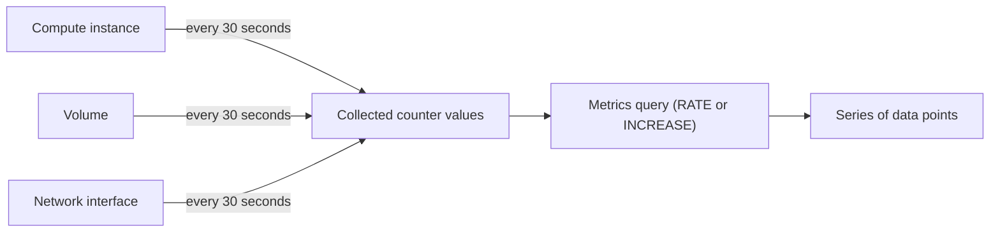

# What is Origin Cloud Observability?

Origin Cloud Observability gives you usage metrics for your own resources: how much CPU time an instance consumes, how many bytes a network interface sends and receives, and how many bytes an instance reads from and writes to a volume. The platform collects these metrics for you. You query them through the REST API or the GraphQL API to graph activity, size instances, or find a busy disk.

## How metrics flow

The following diagram shows how the platform turns activity on your resources into the series of data points a metrics query returns.

Every metric is a counter: a running total, such as total CPU seconds or total bytes received, that grows while the instance runs. A raw total is rarely useful, so a query never returns it. Instead, you pick a statistic, and the platform computes it for each period of your time window:

- `RATE` returns the average per-second increase over the period, for example bytes per second.
- `INCREASE` returns the total increase over the period, for example bytes transferred in the last five minutes.

The platform collects a value for each counter every 30 seconds, but only while the instance runs. Volumes and network interfaces are measured through the instance they're attached to, so a volume or interface that isn't attached to a running instance has no data points.

## Features

**Built-in metrics**  
Seven metrics cover CPU time, network traffic, and volume reads and writes, in bytes and in operations. See [Metrics reference](reference/metrics.md).

**Metric queries**  
One query returns a series of data points per metric for one resource over a time window you choose. See [Query metrics](query-metrics.md).

## Ways to access Observability

**REST API**  
The Observability API answers at `https://observability.origincloudapis.eu`, with one method, `QueryTimeSeries`. It's a preview (`v1beta1`): names and fields may still change. See [Query metrics](query-metrics.md#query-metrics-with-the-rest-api).

**GraphQL API**  
Metrics are available through the `observability` namespace of the API, with the `metrics` query. See [Query metrics](query-metrics.md#query-metrics-with-the-graphql-api). For authenticating against the API, see [Use the API](../platform/access/api.md).

The `origin` CLI has no command for metrics.

## What Observability doesn't do

- Metrics are collected by the platform only. You can't submit your own metrics.
- There's no query that lists metric names. The complete list is in the [Metrics reference](reference/metrics.md).
- Metrics measure your resources from the outside. They don't show memory use, processes, or file systems inside an instance.
- There are no alarms or notifications on metric values.

## Pricing

Each metrics query you run and each value the platform collects for your resources are billed. For the rates, see [Observability prices](../pricing/reference/price-list-api.md#observability_api_request) in the price list reference.

## Related services

- [Instances](../compute/instances/index.md) – the compute instances whose CPU time is measured.
- [Volumes](../storage/volumes/index.md) – the volumes whose reads and writes are measured.
- [Network interfaces](../network/vpcs/network-interfaces.md) – the interfaces whose traffic is measured.

## On origincloud.eu

[Observability](https://www.origincloud.eu/observability/) describes the service.

## Next steps

- [Query metrics](query-metrics.md)
- [Observability reference](reference/index.md)
