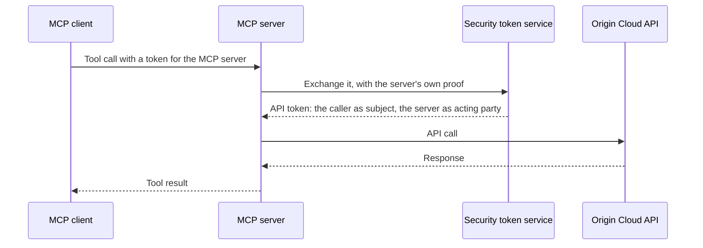

# Connect an MCP client to Origin Cloud

Origin Cloud's hosted MCP server at `https://mcp.origincloudapis.eu` gives an MCP client the same tools as the `origin` CLI's local server, without installing anything. The client connects by URL and presents a token issued for the server: a person signs in in the browser, and an agent that runs unattended presents its service account's token. For what the tools do, how destructive tools are confirmed and how operations are waited on, see [Use Origin Cloud from an AI agent](mcp.md#how-the-agent-works-with-origin-cloud).

## Before you begin

- An MCP client that connects to remote servers over HTTP.
- To sign in as yourself: a client that signs in with OAuth, such as Claude Code, and an Origin Cloud user account. The agent can do only what your roles allow.
- For an agent that runs unattended: a [service account](../../iam/service-accounts.md) that signs in through [workload identity federation](../../iam/workload-identity-federation.md) or with a [key](../../iam/reference/index.md#service-account-keys). The agent can do only what the service account's roles allow.

## Connect the client

The server serves a token of any client, as long as Origin Cloud's login issued it for the server's audience, `https://mcp.origincloudapis.eu`. Origin Cloud's login doesn't register clients on the fly yet, so a client that has no client of its own there signs in as the pre-registered client `origincloud-mcp`, which accepts the redirect `http://localhost:33418/callback`.

1. Add the server to your client by its URL. In Claude Code:

   ```sh
   claude mcp add --transport http --client-id origincloud-mcp --callback-port 33418 \
     origincloud https://mcp.origincloudapis.eu
   ```

   For another client, give it the URL, the client ID `origincloud-mcp` without a secret, and the callback port 33418. The client asks for the scope `mcp`, which puts the server's audience in the token, and may ask for `openid` and `offline_access`, the last for renewing its token; any other scope is refused.

2. Sign in. In Claude Code, run `/mcp` and choose `origincloud`. Your browser opens Origin Cloud's login page; after you sign in, the client holds a token for the MCP server and renews it as it expires.

3. Verify the connection: ask the agent which zones Origin Cloud has. It answers by calling the `location_list_zones` tool.

Your account must have a given name and a family name. A token without either, as an account signed in through an identity provider that sends no names may have, is refused as not a person's token: add the names to your account and sign in again.

## Restrict the agent to a service account's roles

Signed in as yourself, the agent can do everything you can. To give it less, connect it as a service account that holds only the roles the agent needs, such as `roles/viewer` on one project. You still sign in as yourself; the server then impersonates the service account for you, and every tool call reaches the API as the account, with the account's roles alone. The API enforces them: a call the account may not make is refused by the API, whatever tools the client sees.

1. Create a service account for the agent and grant it the narrow roles, as [Use service accounts](../../iam/service-accounts.md#create-a-service-account) shows. Its type doesn't matter: an `EXTERNAL` or a `WORKLOAD` account both work, and it needs no key or federated credential for this.

2. Grant yourself [`roles/iam.service-account-token-creator`](../../iam/roles.md#rolesiamservice-account-token-creator) on the account's organization, org-wide. A project-scoped grant lets you impersonate no account. `roles/owner` already includes it.

   ```sh
   origin iam create-role-binding --organization <org-id> \
     --member //iam.origincloudapis.eu/users/<user-id> \
     --role //iam.origincloudapis.eu/roles/iam.service-account-token-creator
   ```

3. Add the server with the account's full name in `service_account`. In Claude Code:

   ```sh
   claude mcp add --transport http --client-id origincloud-mcp --callback-port 33418 \
     origincloud-agent \
     "https://mcp.origincloudapis.eu/?service_account=//iam.origincloudapis.eu/organizations/<org-id>/serviceAccounts/<service-account-id>"
   ```

   The value may be URL-encoded or not. Anything but a service account's full name, an empty value or the parameter given twice is refused with `400`.

4. Sign in as yourself, as in [Connect the client](#connect-the-client), and verify: a read, such as listing the project's volumes, works; a change the account's roles don't allow, such as creating a volume, fails with the API's `403`.

What the agent can then do is exactly what the service account's roles allow, in the projects they're granted on. `toolsets` and `read_only` still [choose the tools](#choose-the-tools) the client sees, but they restrict nothing; the account's roles do.

**When the server refuses the connection**  
If you don't hold the token-creator role on the account, or the account doesn't exist or is revoked, the connection's first request is answered `403` with `WWW-Authenticate: Bearer error="insufficient_scope"`, naming the account and the role. The server never falls back to your own access. It can't tell you which of these causes it was, as the security token service doesn't say. The refusal is recorded in the audit log, and the server remembers it for 30 seconds, so a binding you add takes up to that long to be seen. Only a person can impersonate: a service account's own token on such a connection is refused the same way.

**Taking the access back**  
Revoke your token-creator binding, or the service account's roles. Without the binding, the next exchange for the account's token is refused. The server keeps a token it already holds until shortly before it expires, at most 5 minutes after it was issued and never past your own token, so an agent already connected may go on for up to that long. A role revoked from the account itself applies at the agent's next call.

**Audit**  
Each exchange for the account's token, issued or refused, is recorded as `sts.token.impersonate` in the account's organization's log, with you as its actor, the MCP server as its acting party and a refusal's `reason`, such as `no_binding`. A change the agent makes is recorded with the service account as its `actor`, and you, then the MCP server, in `actingParties`. See [Changes made by impersonating a service account](../../iam/audit-log.md#changes-made-by-impersonating-a-service-account).

## Connect an agent that runs as a service account

An agent that runs unattended, such as one in a CI job, connects with its service account's access token instead of signing in. The token must be issued for the MCP server's audience, `https://mcp.origincloudapis.eu`, not the APIs': the server refuses a token for any other audience, and the APIs refuse one for the server's.

1. Get the token from the security token service with `audience` set to `https://mcp.origincloudapis.eu`:

   - A `WORKLOAD` service account exchanges its CI job's OIDC token, as in [Authenticate from GitHub Actions](../../iam/github-actions.md#exchange-the-token-yourself), with the form field `audience` added, or calls `AssumeServiceAccount` with `audience` (see the [security token service's reference](../../iam/reference/index.md#security-token-service)):

     ```sh
     mcp_token=$(curl -sSf https://sts.origincloudapis.eu/v1/token \
       -d grant_type=urn:ietf:params:oauth:grant-type:token-exchange \
       -d subject_token_type=urn:ietf:params:oauth:token-type:jwt \
       --data-urlencode "subject_token=$id_token" \
       --data-urlencode "audience=https://mcp.origincloudapis.eu" | jq -r .access_token)
     ```

   - An `EXTERNAL` service account exchanges an assertion signed with one of its [keys](../../iam/reference/index.md#service-account-keys), with the same `audience`:

     ```sh
     mcp_token=$(curl -sSf https://sts.origincloudapis.eu/v1/token \
       -d grant_type=urn:ietf:params:oauth:grant-type:jwt-bearer \
       -d assertion="$ASSERTION" \
       --data-urlencode "audience=https://mcp.origincloudapis.eu" | jq -r .access_token)
     ```

   A service account's client-secret token, from Origin Cloud's login, isn't served.

2. Give the client the server's URL and the token as a bearer token. In Claude Code:

   ```sh
   claude mcp add --transport http origincloud https://mcp.origincloudapis.eu \
     --header "Authorization: Bearer $mcp_token"
   ```

   Another client takes the same `Authorization` header in its configuration of the server.

The token lives 15 minutes by default and at most an hour (`requested_token_lifetime`), and isn't renewed: when it expires, the server answers `401`, and the agent gets a new token the same way. The server accepts the service account's token while the security token service would: deleting the federated credential or the key, or revoking the account, stops it at its next call.

## Choose the tools

Options are query parameters of the URL, since many clients take nothing but a URL:

| Parameter | Effect | Default |
|---|---|---|
| `toolsets=pvs,compute` | Serves only the named services' tools, comma-separated. The toolsets are those of [`origin mcp serve`](mcp.md#connect-the-agent). | Every toolset |
| `read_only=true` | Serves only the tools that change nothing: reads, and waiting for operations. | `false` |

For example, an agent that only looks at volumes and instances:

```sh
claude mcp add --transport http --client-id origincloud-mcp --callback-port 33418 \
  origincloud-readonly "https://mcp.origincloudapis.eu/?toolsets=pvs,compute&read_only=true"
```

A misspelt parameter or toolset is refused with HTTP status `400`, which names the valid ones.

**These parameters restrict nothing.** They choose which tools the server offers the client, to keep the agent's tool list short and its changes out of reach by mistake. They aren't permissions: the token behind them is the same, and whoever holds it can call the same API with every right its principal has, through another URL or directly. To limit what an agent may do, give the account it runs as only the [roles](../../iam/roles.md) it needs: for an agent you sign in for, [connect it as a service account](#restrict-the-agent-to-a-service-accounts-roles) with narrow roles; for an agent that runs unattended, give it a service account of its own.

## How the server calls the API

The MCP server accepts only tokens issued for it. It never passes a token on: for each caller, it exchanges the caller's token at Origin Cloud's security token service for an API token, proving its own identity as it does, and calls the API with that. The API token keeps the caller, you or the service account, as its subject and names the MCP server as the party acting for it. On a connection with `service_account`, the server asks for that account's token instead: its subject is the account, and you, then the MCP server, are the parties acting for it.



**Audit**  
A change made through the server is recorded in the [audit log](../../iam/audit-log.md) as one made by the caller, you or the service account, as its `actor`, with the MCP server as its `actingParty`. Not every service records the acting party yet: see [which entries name it](../../iam/audit-log.md#changes-made-through-the-hosted-mcp-server). For a service account, the exchange itself is recorded as `sts.token.exchange` in its organization's log; for a connection that impersonates one, as `sts.token.impersonate`, as [above](#restrict-the-agent-to-a-service-accounts-roles).

**Your context**  
The hosted server knows no CLI profile, so `current_context` names no default project or zone. Tell the agent which project and zone to work in, or let it find your projects with the `resourcemanager` tools.

**Expired sign-in**  
When a person's token can't be renewed any more, the server answers `401` again and the client asks you to sign in.

## Related

- [Use Origin Cloud from an AI agent](mcp.md)
- [Use Origin Cloud with coding agents](coding-agents.md)
- [Use service accounts](../../iam/service-accounts.md)
- [Workload identity federation](../../iam/workload-identity-federation.md)
- [Audit log](../../iam/audit-log.md)
