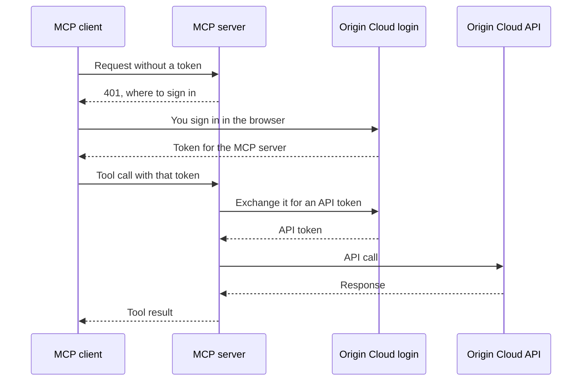

# Connect an MCP client to Origin Cloud

Origin Cloud's hosted MCP server at `https://mcp.origincloudapis.eu` gives an MCP client the same tools as the `origin` CLI's local server, without installing anything. The client connects by URL, and you sign in in your browser. For what the tools do, how destructive tools are confirmed and how operations are waited on, see [Use Origin Cloud from an AI agent](mcp.md#how-the-agent-works-with-origin-cloud).

## Before you begin

- An MCP client that connects to remote servers over HTTP and signs in with OAuth, such as Claude Code.
- An Origin Cloud user account to sign in with. The agent can do only what your roles allow.

## Connect the client

1. Add the server to your client by its URL. Origin Cloud's login doesn't register clients on the fly, so the client signs in as the pre-registered client `origincloud-mcp`, which accepts the redirect `http://localhost:33418/callback`. In Claude Code:

   ```sh
   claude mcp add --transport http --client-id origincloud-mcp --callback-port 33418 \
     origincloud https://mcp.origincloudapis.eu
   ```

   For another client, give it the URL, the client ID `origincloud-mcp` without a secret, and the callback port 33418. The client may ask for the scopes `openid`, `mcp` and `offline_access`, the last for renewing its token; any other scope is refused.

2. Sign in. In Claude Code, run `/mcp` and choose `origincloud`. Your browser opens Origin Cloud's login page; after you sign in, the client holds a token for the MCP server and renews it as it expires.

3. Verify the connection: ask the agent which zones Origin Cloud has. It answers by calling the `location_list_zones` tool.

## Choose the tools

Options are query parameters of the URL, since many clients take nothing but a URL:

| Parameter | Effect | Default |
|---|---|---|
| `toolsets=pvs,compute` | Serves only the named services' tools, comma-separated. The toolsets are those of [`origin mcp serve`](mcp.md#connect-the-agent). | Every toolset |
| `read_only=true` | Serves only the tools that change nothing: reads, and waiting for operations. | `false` |

For example, an agent that may only look at volumes and instances:

```sh
claude mcp add --transport http --client-id origincloud-mcp --callback-port 33418 \
  origincloud-readonly "https://mcp.origincloudapis.eu/?toolsets=pvs,compute&read_only=true"
```

A misspelt parameter or toolset is refused with HTTP status `400`, which names the valid ones.

## How sign-in works

The MCP server accepts only tokens issued for it. It never passes your token on: for each call, it exchanges your token at Origin Cloud's login for one the API accepts, and calls the API with that.



**Your context**  
The hosted server knows no CLI profile, so `current_context` names no default project or zone. Tell the agent which project and zone to work in, or let it find your projects with the `resourcemanager` tools.

**Expired sign-in**  
When the client's token can't be renewed any more, the server answers `401` again and the client asks you to sign in.

## Agents that run as a service account

The hosted server accepts only people who sign in through their MCP client in a browser. It refuses the token of a [service account](../../iam/service-accounts.md) with HTTP status `403` and a message saying so. An agent that runs unattended as a service account uses the `origin` CLI's local server instead: it runs [`origin mcp serve`](mcp.md#connect-the-agent) with the service account's own credentials, which serves the same tools. See [Use Origin Cloud from an AI agent](mcp.md#how-the-agent-works-with-origin-cloud) for the credentials it reads, and [Use Origin Cloud with coding agents](coding-agents.md) to add it to an agent.

## Related

- [Use Origin Cloud from an AI agent](mcp.md)
- [Use Origin Cloud with coding agents](coding-agents.md)
- [Use service accounts](../../iam/service-accounts.md)
