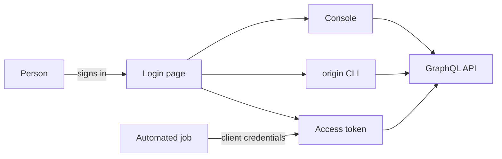

# Ways to access Origin Cloud

You work with Origin Cloud through the console, the `origin` CLI or the GraphQL API. All three talk to the same API and act as you, so they see the same organizations and are bound by the same roles. A change you make in one shows up in the others.

The following diagram shows how a person and an automated job reach the GraphQL API, and with which credential.

## Key concepts

**Login page**  
Where people authenticate, with whatever sign-in methods your account has, including a second factor. Neither the console nor the CLI sees your password. See [Use the CLI](cli.md#log-in).

**Access token**  
A short-lived bearer token that every API request carries in its `Authorization` header. The CLI gets and renews one for you. See [Use the GraphQL API](api.md#authenticate).

**Service account**  
A credential for automation, such as CI jobs and scripts, that authenticates as itself rather than as a person. See [Service accounts](../../iam/service-accounts.md).

**Resource URN**  
The identifier the API and the CLI use for every resource. See [Use the GraphQL API](api.md#resource-urns).

## Compare the access methods

| Method | Best for | Authenticates as |
|---|---|---|
| Console | Working in a browser | A person |
| `origin` CLI | Interactive work in a terminal, scripts and CI jobs | A person or a service account |
| GraphQL API | Automation, integrations, and anything the CLI doesn't cover | A person or a service account |
| AI agent, through `origin mcp serve` | Letting an AI assistant work with your resources | Whoever the CLI is logged in as, or a service account |

The CLI covers organizations and projects with their quotas, billing, compute, storage, network, IAM with the audit log, metrics and support cases. An AI agent gets a tool for nearly every one of its commands.

## What you can do

- [Install and use the CLI](cli.md)
- [Call the GraphQL API](api.md)
- [Connect an AI agent](mcp.md)
- [Create a service account for automation](../../iam/service-accounts.md)

## Related

- [Platform CLI commands](../reference/cli.md)
- [Error codes](../reference/errors.md)
