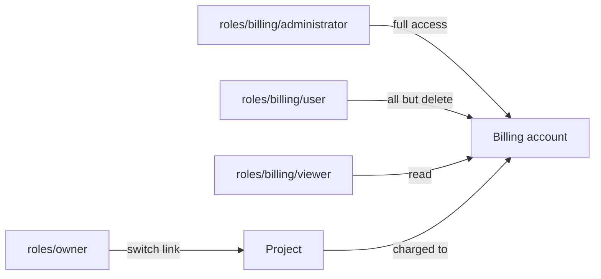

# Billing access

Billing is deliberately separate from `roles/owner`. An Owner runs the organization's infrastructure, but can't view, create or change a billing account. That takes one of three billing roles, which keeps the people who spend money and the people who manage payment apart.

The following diagram shows which roles reach a billing account, and what an Owner can do without one.



## Billing roles

| Role | Allows |
|---|---|
| `roles/billing/administrator` | View, list, create, update and delete billing accounts. This includes billing details and payment methods. |
| `roles/billing/user` | Everything the administrator can do, except delete a billing account. |
| `roles/billing/viewer` | View and list billing accounts. |

Assign billing roles organization-wide, with no project: they govern billing accounts, which belong to the organization rather than to a project. A billing role assigned to a single project isn't refused, but it isn't supported and doesn't give the access you'd expect.

To assign a role, see [Assign and revoke roles](../../iam/assign-roles.md). For example, to make someone a billing user:

```sh
origin iam create-role-binding --organization <org-id> \
  --member user:jane@example.com \
  --role roles/billing.user
```

## Who holds a billing role from the start

Whoever creates an organization gets `roles/billing/administrator` on it, together with `roles/owner`. So the person who signs up can add a payment method right away.

Nobody else gets a billing role implicitly. A member you invite holds only the roles you assign, so an Owner you add has no billing access until you grant a billing role as well.

Only someone who holds the billing permissions can hand them out: you can assign or revoke a billing role only if you hold every permission it grants, so in practice `roles/billing/administrator`. An Owner without a billing role can't give one to anyone, including itself. See [Who can assign a role](../../iam/access-model.md#who-can-assign-a-role).

## What the Owner role covers

Without a billing role, an Owner can still:

- Switch which billing account a project is charged to. See [Manage projects](../organizations/projects.md#change-a-projects-billing-account).
- Set, clear and read the organization's spend limit.
- Read usage and cost reports.
- Read and set quota budgets on projects.

An Owner can't read a billing account's details or payment method, and can't add a payment method.

## Related

- [Add a payment method](payment-method.md)
- [Built-in roles](../../iam/roles.md)
- [Assign and revoke roles](../../iam/assign-roles.md)
