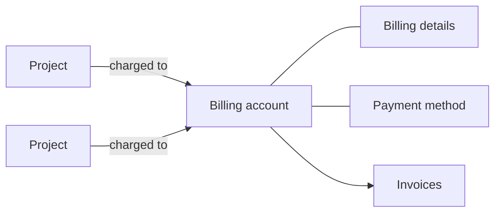

# Billing

Your organization pays for what its projects use through billing accounts. A billing account holds the details invoices are issued to and, for card payment, a verified payment method. Every project is charged to exactly one billing account, and one billing account can pay for many projects.

The following diagram shows how projects, billing accounts and invoices relate.

## Key concepts

**Billing account**  
What projects are charged to. Every organization starts with one, named `default`, and every new project is linked to it. You can create more and switch a project to another one. See [Manage projects](../organizations/projects.md#change-a-projects-billing-account).

**Billing details**  
The postal address, invoice email, contact person and VAT identification number that invoices are issued to. See [Billing details](#billing-details).

**Payment method**  
A card on file with the payment provider. Creating billable resources needs a verified payment method on the project's billing account, unless billing is arranged with Origin Cloud directly. See [Add a payment method](payment-method.md).

**Billing roles**  
Access to billing accounts comes from dedicated roles, not from the Owner role. See [Billing access](billing-access.md).

**Invoices**  
Issued per billing account and calendar month, and emailed to the invoice email address with a usage statement attached. The usage statement lists the month's usage by project and product.

**Spend limit**  
An amount per calendar month that triggers email alerts when the month's spend crosses the thresholds you set, such as 80 % and 100 %. A spend limit only alerts; it doesn't stop or refuse anything. Manage it with `setSpendLimit`, `clearSpendLimit` and `spendLimitStatus`, or in the [REST API](rest-api.md) with `UpdateSpendLimit` and `GetSpendLimit`.

**Usage and cost**  
What a project or the whole organization has used and what it costs, by hour or by day. Read it with the `usageCost` and `orgUsageCost` queries, or in the [REST API](rest-api.md) with `QueryProjectCost` and `QueryOrganizationCost`. Prices come from the [price list](../../pricing/index.md).

## Billing details

Billing details are stored on the billing account. `register-organisation` sets them on the default billing account when you create the organization. To set or change them, call the `updateBillingAccountProfile` mutation in the `admin` namespace. It replaces every field at once: a field you leave out is cleared, not kept.

The same rules apply as at registration: the invoice email must be a valid email address, the country must be an EU member state given as its ISO code, and every country except `DE` needs a VAT identification number. The `billingCountries` query lists the accepted countries and which need a VAT identification number.

To rename a billing account, call `updateBillingAccountDisplayName`. The name appears in spend limit alert emails and can't be empty.

## What you can do

- [Add a payment method](payment-method.md)
- [Give someone access to billing](billing-access.md)
- [Charge a project to another billing account](../organizations/projects.md#change-a-projects-billing-account)

Billing accounts, payment methods, spend limits and cost reports are available through the [GraphQL API](../access/api.md) in the `admin` namespace. They are also in the [billing REST API](rest-api.md). The CLI doesn't cover them.

## Related

- [Pricing](../../pricing/index.md)
- [Organizations and projects](../organizations/index.md)
- [`PAYMENT_METHOD_REQUIRED`](../reference/errors.md#payment_method_required)
