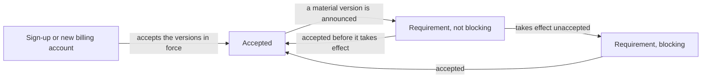

# Legal documents and acceptance

> **Preview.** The documents are still being published. Until the first version of a document is published, nothing needs accepting and sign-up asks for no acceptance. Field and method names may change while the billing API is `v1beta1`.

Origin Cloud's contract with your organization is made of four documents your billing account accepts: the **Terms of Service** (`terms`), the **Data Processing Agreement** (`dpa`), the **Service Level Agreement** (`sla`) and the **Acceptable Use Policy** (`aup`). Five more are published beside them and are never accepted: the sub-processor list (`subprocessors`), the technical and organisational measures (`toms`), the privacy policy (`privacy`), the switching and export information (`switching`) and the shared responsibility model (`shared-responsibility`).

The billing account is the legal entity that accepts. Each billing account accepts for itself, so an organization with several billing accounts accepts once per account.

## Versions

Every published version of a document keeps a fixed name, such as `legalDocuments/terms/versions/2026-12` (its full name `//billing.origincloudapis.eu/legalDocuments/terms/versions/2026-12`, which `AcceptLegalDocuments` takes), and a fixed web address. A published version never changes: a correction is a new version. Each version has:

- **`effectiveDate`**, the day it takes effect. It applies from that day until the next version of the document takes effect.
- **`sha256`**, which identifies its text. An acceptance records it, so it names exactly the text accepted.
- **`changeClass`**, what the change asks of you:
  - `MATERIAL` changes rights or obligations. A material version of a document you accept needs your acceptance. It is announced at least six weeks before it takes effect.
  - `NOTICE` is announced and never accepted, such as a new sub-processor, at least 30 days ahead.
  - `EDITORIAL` corrects wording and asks nothing of you.

Read the documents without an access token with `ListLegalDocuments` and `GetLegalDocumentVersion`, and download a version as a PDF with `DownloadLegalDocumentVersion`. See the [billing REST API](rest-api.md).

## When you accept

**At sign-up.** Once a version is in force, creating a billing account must accept every version in force of the four documents, and confirm that you act as a business. `CreateBillingAccount` takes this as `acceptedLegalDocuments`, the versions with their `sha256`, plus `actsAsBusiness: true`. A request that leaves out a version in force, or names one with the wrong `sha256`, fails naming the field and creates nothing. An organization created with the resource manager's `CreateOrganization` accepts nothing; its billing account then has the versions in force as requirements.

**When a document changes.** `QueryLegalRequirements` lists the versions a billing account has yet to accept: the version in force, if it isn't accepted, and every material version announced after it. Accept them with `AcceptLegalDocuments`, naming each version with the `sha256` of the text you showed. Accepting a newer version also covers the ones before it. An editorial version is never required.

A requirement is `blocking` once its version is in force. Until then, the version you accepted earlier keeps applying. Accepting a version again changes nothing, so you can retry safely.

## Notices of changes

When a version is published that changes what you agreed to, Origin Cloud emails each billing account within minutes. That is a material version of a document you accept, and a new sub-processor list. An editorial version, or a new version of the other published documents, sends no email.

One email lists every such version published since the last one. For each, it gives the summary of changes, the day it takes effect, and links to the new version and to the version it replaces. For a document you accept, it asks you to accept the new version before that day. For the sub-processor list, it says how to object: write to privacy@origincloud.eu before the new list takes effect.

The email goes to the billing account's invoice address and to the verified email address of each Owner of the organization, once per version.

## While a requirement blocks

While a billing account has a blocking requirement, its projects can't create or grow anything billable: launching an instance, creating, importing or growing a volume, creating a snapshot, allocating a Floating IP, creating a NAT gateway or a hosted zone. Each is refused with [`LEGAL_ACCEPTANCE_REQUIRED`](../reference/errors.md#legal_acceptance_required) and creates nothing. Resources that already run keep running, and you can still change, stop and delete them.

The refusal starts within minutes of midnight at the start of the day the version takes effect, in Germany's time zone. It ends as soon as `AcceptLegalDocuments` records the acceptance.

## Who can accept

Reading a billing account's requirements and acceptances needs `admin.billing_account.get`. Accepting needs `admin.billing_account.update`. Both are in the billing roles, not in the Owner role; see [Billing access](billing-access.md).

## Acceptance history

`ListLegalAcceptances` lists a billing account's acceptances, the latest first. Each acceptance records:

- the version and its `sha256`;
- who accepted, and when;
- how the acceptance came about: `SIGNUP`, `CHANGE`, or `MIGRATION` for an account that existed before the document was published;
- the legal entity as it was then: the organization's name, the billing address and the VAT identification number.

An acceptance never changes. It is kept after the billing account and the organization are deleted.

## Related

- [Billing REST API](rest-api.md)
- [Billing access](billing-access.md)
- [`LEGAL_ACCEPTANCE_REQUIRED`](../reference/errors.md#legal_acceptance_required)
- [Billing](index.md)
