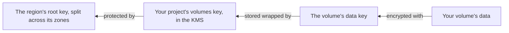

# Encryption at rest

Origin Cloud encrypts your volumes, local disks, snapshots and the images you create, each with a data key of its own. Origin Cloud holds every key: the key that protects your volumes' data keys lives in your project in the [KMS](../kms/index.md), where you can see it, its grants and every use of it, but you can't change it. This page lists what is encrypted, with which key, and who holds it.

## What is encrypted

| Data | Encrypted at rest | Key | Who holds the key |
| --- | --- | --- | --- |
| Volumes, including every instance's root disk | Yes, LUKS2 | A data key of the volume's own | Origin Cloud, wrapped by your project's volumes key |
| Local disks | Yes, LUKS in qcow2 | A data key of the disk's own | Origin Cloud, wrapped by your project's volumes key |
| Snapshots | Yes | The data key of the snapshot's volume | Origin Cloud, as for the volume |
| Images you create | Yes | The data keys of the volume and snapshot the image is made from | Origin Cloud, as for the volume |
| Public images | No | None | They hold no data of yours |
| KMS keys, yours and the platform's | Yes | The region's root key | Origin Cloud: split across the region's zones, with offline recovery shares |
| The disks of the storage cluster | Yes | A key per disk | Origin Cloud's storage cluster |
| Backups of the platform's databases | Yes | An offline key | Origin Cloud |
| The platform's databases, logs and metrics: your resources' names, tags and settings, and the audit log | No | None | |

Every volume and local disk created now is encrypted, with no setting to turn it off, and a snapshot is encrypted when its volume is. A volume created before encryption was turned on isn't encrypted: its `encryption` field is absent. See [Check whether a volume is encrypted](#check-whether-a-volume-is-encrypted).

## The keys

Each encrypted volume has its own random data key. The data key is stored with the volume, wrapped (encrypted) by your project's volumes key, and the volumes key is protected by the region's root key. Neither the volumes key nor the root key ever leaves the KMS.



**Your project's volumes key**  
A KMS key in your project, tagged `origin:name=volumes`, that Origin Cloud creates with the project's first volume. It has `platformManaged` set: you see it, its grants and its audit log entries, but you can't disable, rotate or delete it, because that would make every volume it protects unreadable. It's deleted with its project. See [Keys the platform manages](../kms/keys.md#keys-the-platform-manages).

**A clone's keys**  
A volume created from a snapshot or an image has a data key of its own for what it writes, and reads what it shares with its source through the source's data key.

**The region's root key**  
Each zone of the region holds one share of the root key, and a zone's KMS starts only with the share of a second zone. No single zone, host or disk holds the whole root key. Offline recovery shares let Origin Cloud restore the root key if the zones' shares are lost.

## Who can open a volume's key

Once a volume is ready, only the machine your instance runs on can open its key, and only while the volume is attached to the instance there.

1. Before an instance starts or a volume is attached, Origin Cloud's compute service creates a [grant](../kms/grants.md) on your volumes key. The grant lets that one machine decrypt that one volume's data key, for at most an hour.
2. The machine decrypts the data key under the grant and hands it to the instance's virtual machine process, in memory only. The data key is never written to the machine's disk or to a log.
3. The compute service renews the grant every 15 minutes while the volume stays attached, and deletes it when you detach the volume, or stop, move or terminate the instance.

The compute service makes grants, but can't decrypt with your key. The storage cluster, and whoever administers it, sees only ciphertext. Another machine, or a grant that has expired or names another volume, decrypts nothing: the KMS refuses the request. Each grant, each decryption under a grant, and each refusal is recorded in your organization's [audit log](../iam/audit-log.md). To see the grants on your volumes key now, list them with `origin kms list-grants`. See [See the grants on a key](../kms/grants.md#see-the-grants-on-a-key).

A new volume is prepared by Origin Cloud's storage service the same way, under a grant of its own for that one volume, which ends when the volume is ready.

## What you control

- **The service agents' bindings.** Compute's service agent holds `roles/kms.grant-delegate` in your organization, and storage's holds `roles/kms.grant-issuer` and `roles/kms.volume-keys-agent`. If you delete compute's binding, no encrypted volume opens on a start or an attach. If you delete storage's, no new volume can be created. See [Service agents](../iam/service-agents.md).
- **Your own keys.** You can't bring your own key for volumes. To encrypt data under a key you control, use a [key of your own](../kms/create-key.md) with [envelope encryption](../kms/envelope-encryption.md), or encrypt inside the guest.

## When you delete a volume

Origin Cloud destroys a volume's data key once nothing needs it any more: the volume, its snapshots, the images made from them, and the volumes cloned from them. A local disk's data key is destroyed when its instance is terminated. The volume's record of its data key is then cleared. What the volume stored, including any of its data left on the storage cluster's disks, opens only with that key.

Older copies of the wrapped data key remain in the platform's internal message streams, and in its encrypted database backups until they expire, after at most 90 days. None of them opens: once the data key is destroyed, Origin Cloud retires the volume's encryption context on your project's volumes key, usually within a minute, and from then on the key management service refuses to decrypt anything under that context, whoever asks. Your project's audit log records the retirement, made by the storage service agent as `kms.keys.retireEncryptionContext`, and a refused attempt with the reason `context_retired`.

> **Note:** Until the retirement is recorded, a copy of the wrapped data key could still be decrypted by someone who holds both the copy and `kms.key.decrypt` on your project's volumes key. When you delete the project, its volumes key is deleted and its material is destroyed 30 days later, after which no copy of a data key it wrapped can be opened at all.

The volume itself stays readable with its `encryption` field, so you can still see how it was encrypted.

## What encryption at rest doesn't protect against

Encryption at rest protects data on a disk. It doesn't hide data from your running instance, which reads it in plaintext, or from someone who controls the machine your instance runs on while the volume is attached there. Protect access to your instances with [security groups](../network/traffic-control/index.md) and [IAM](../iam/index.md).

## Check whether a volume is encrypted

Read the volume's `encryption` field with the REST API:

```sh
curl -s -H "Authorization: Bearer $(origin id token --raw)" \
  "https://pvs.origincloudapis.eu/v1beta1/projects/<project-id>/zones/eu-central1-az1/volumes/<volume-id>" \
  | jq .encryption
```

An encrypted volume returns its format and the key that wraps its data key (illustrative output):

```json
{
  "format": "LUKS2",
  "kmsKey": "//kms.origincloudapis.eu/projects/my-project-123/regions/eu-central1/keys/<key-id>"
}
```

A volume that isn't encrypted returns `null`. For the field's values, see [Encryption field](../storage/reference/index.md#encryption-field).

## Related

- [KMS](../kms/index.md): keys, grants and envelope encryption.
- [Volumes](../storage/volumes/index.md) and [Local disks](../compute/instance-storage/local-disks.md).
- [Audit log](../iam/audit-log.md): every grant and decryption on your keys.
